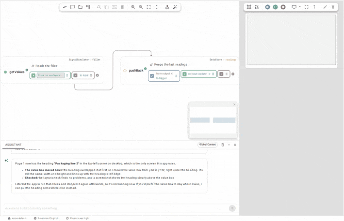
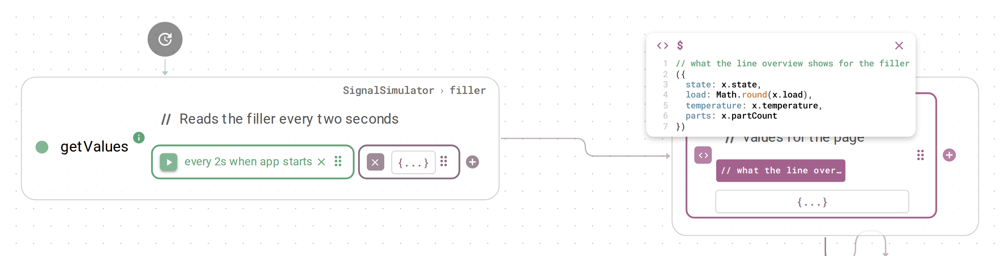
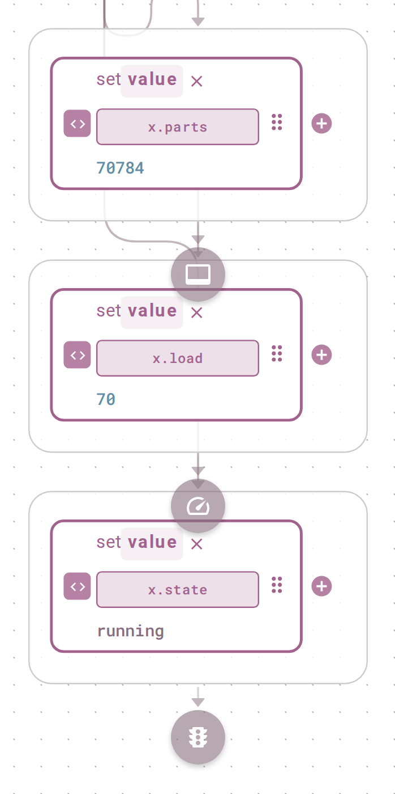
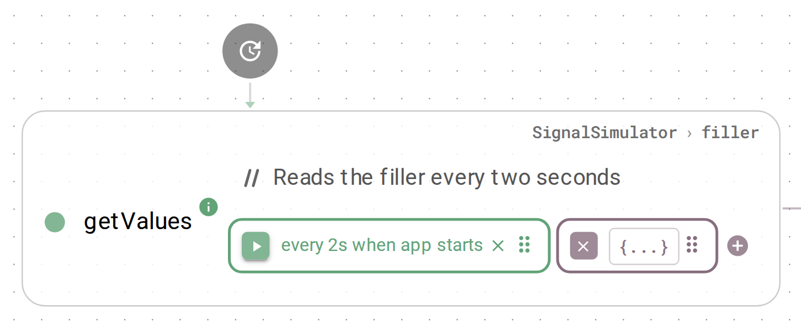
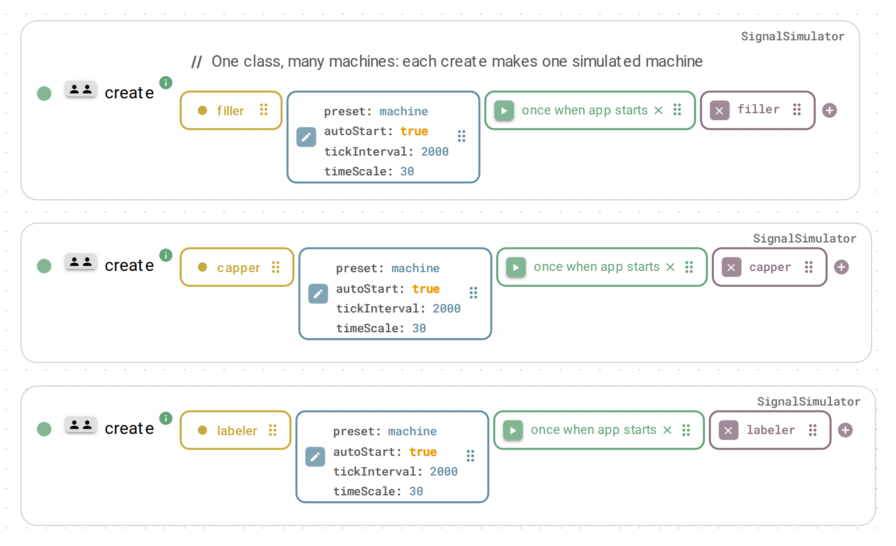
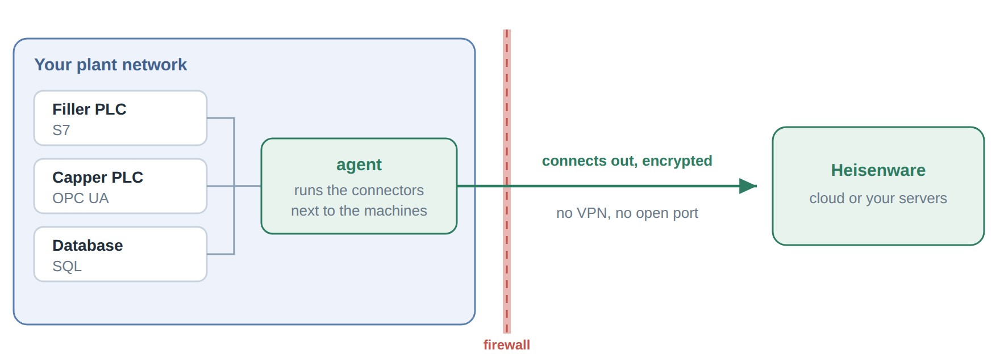

# Welcome

**Heisenware is an industrial application platform where AI builds the software with you.** You describe what your shop floor needs. The assistant plans the App with you, builds its logic and its pages, and shows every step as it goes. You check, change or undo anything, by asking or by hand. Underneath runs a distributed platform, so an App grows from one machine to a whole plant.

## The platform at a glance

Heisenware has three parts:

<table data-view="cards"><thead><tr><th></th><th></th><th data-hidden data-card-target data-type="content-ref"></th><th data-hidden data-card-cover data-type="image">Cover image</th></tr></thead><tbody><tr><td><strong>App Manager</strong></td><td>Plan Apps with the assistant, run them, and manage members, agents and integrations.</td><td><a href="app-manager/README.md">overview.md</a></td><td><a href=".gitbook/assets/manager-dashboard.png">manager-dashboard.png</a></td></tr><tr><td><strong>App Builder</strong></td><td>Build and test an App: its logic on the Flowboard, its pages in the Page editor, with the assistant at your side.</td><td><a href="app-builder/README.md">overview.md</a></td><td><a href=".gitbook/assets/builder-tour.png">builder-tour.png</a></td></tr><tr><td><strong>App Player</strong></td><td>Runs your Apps for their users, in the browser or installed on a device.</td><td><a href="app-player/README.md">overview.md</a></td><td><a href=".gitbook/assets/welcome-app-player.png">welcome-app-player.png</a></td></tr></tbody></table>

## Where to start

* **New here**: [sign up and sign in](getting-started/sign-up-and-sign-in.md), then build [your first App with the assistant](getting-started/first-app-with-the-assistant.md).
* **Build it yourself**: the same App [step by step by hand](getting-started/first-app-by-hand.md), to see what the pieces are.
* **How it works**: the concepts explain one idea per page, starting with [executors and instances](concepts/executors-and-instances.md).
* **Look something up**: every [function](reference/functions/README.md) and [widget](reference/widgets/README.md) in the reference, and the words in the [glossary](reference/glossary.md).
* **Use your own AI**: [the assistant](assistant/README.md) is built in; your own client connects through the [MCP server](assistant/mcp-server.md).

## How Heisenware thinks

The pictures below come from one small App that watches a packaging line: three machines, a handful of values, one page.

### AI builds with you

The assistant knows the rules of the platform, the platform law, and builds by them: logic on the Flowboard, pages, links, variables. It works in the open. You see every step, its checkpoints let you go back at any time, and before the few things a checkpoint cannot undo — deploying, or deleting a whole App — it asks. Prefer your own AI client? The [MCP server](assistant/mcp-server.md) gives it the same tools.

<figure><figcaption>
One sentence, and the App changes while you watch. The clip is sped up: the assistant went on to test what it built, look at it and correct the spacing.
</figcaption></figure>

### See and change everything

Nothing is hidden behind the pictures. Every executor shows its inputs, its trigger and its outputs. Where clicking is not enough, you write an [expression](app-builder/flowboard/modifier.md) in JavaScript or JSONata, and your own code joins as an [add-on](reference/functions/add-ons/README.md).

<figure><figcaption>
The executor reads the machine; the modifier beside it picks out the four values the page needs. Both are open to you.
</figcaption></figure>

### Widgets linked straight to your logic

Drop an executor's output onto a widget, and the widget shows its value, live. A button runs an executor, a form fills its inputs. There is no code in between. See the [widgets](reference/widgets/README.md).

<figure><figcaption>
One reading, three widgets: a number, a gauge and a lamp, each wired to the value it shows.
</figcaption></figure>

### Reacts when something happens

Nothing runs in an endless loop. An executor runs when one of its triggers fires: the App starts, a value arrives, a user clicks, a timer ticks. Until then it waits, and the rest of the App keeps running. See the [Flowboard](app-builder/flowboard/README.md).

<figure><figcaption>
This one has a clock. Take the trigger away and the executor still exists — it simply waits.
</figcaption></figure>

### Build once, use for every machine

A class is a blueprint: the OPC UA client, the signal simulator. An instance is one living copy of it, with its own name and settings. You build the logic once and point it at the next machine by its instance name. See [executors and instances](concepts/executors-and-instances.md).

<figure><figcaption>
One class, three machines. The second and the third cost a name each.
</figcaption></figure>

### Reaches machines behind the firewall

Your machines sit in a protected network, while the platform may run in the cloud. An [agent](concepts/agents-and-where-code-runs.md) inside that network connects out to the platform, with no VPN and no open port, and runs the connectors right next to the machines.

<figure><figcaption>
The connection is made from the inside out. Nothing is opened towards your plant.
</figcaption></figure>

## Where Heisenware runs

In the Heisenware cloud, hosted in Germany, or on your own servers — the same platform either way. [Cloud or on-prem](self-hosting/README.md) compares the two.
