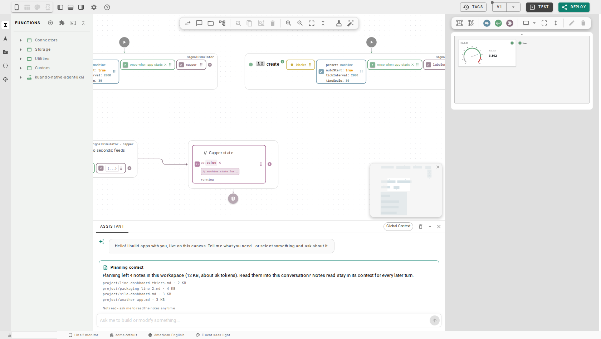
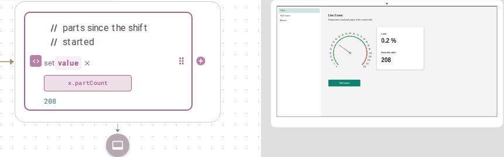
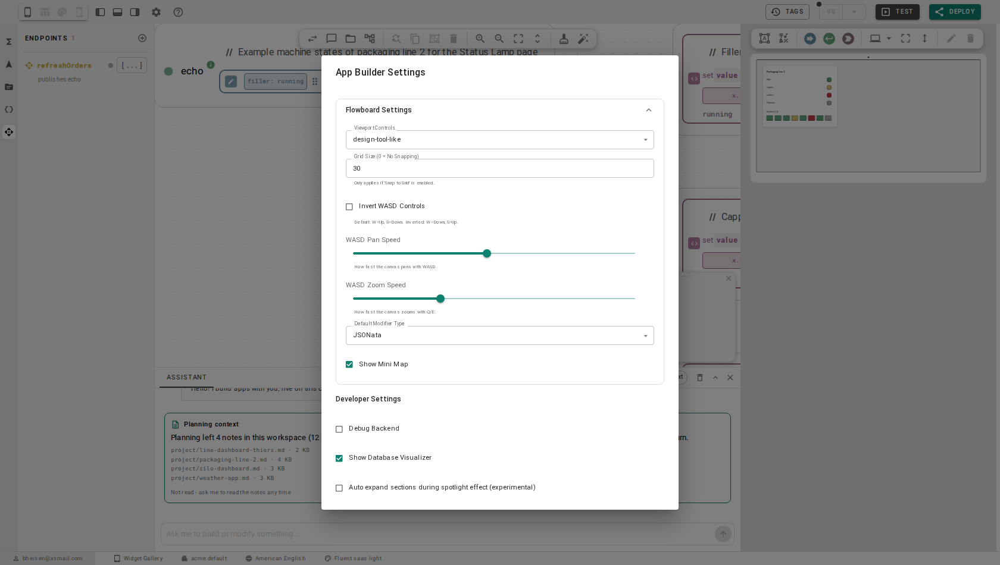

# App Builder tour

The App Builder is where you build one App: its logic, its pages, its look and its data. You open it from the App Manager, and it works on that App until you leave.

<figure><figcaption></figcaption></figure>

## The areas

The Builder is one workbench, and the App editor is its main view: the [Flowboard](flowboard/README.md) in the middle, the [Page editor](page-editor.md) on the right, the Explorer on the left and the Console at the bottom.

* **The top bar** holds four editors: the **App editor**, the [Database editor](database-editor.md), the [Theme editor](theme-editor.md) and the [Template editor](template-editor.md). Next to them, three toggles show and hide the Explorer, the Console and the Page editor. Then the settings and the help menu. On the right: the deployed version, **Test** and **Deploy**, see [Test and deploy](test-and-deploy.md).
* **The Explorer** is the panel on the left, with five tabs on its icon rail: [Functions](explorers/functions.md), [Pages and actions](explorers/pages.md), [Files](explorers/files.md), [Variables](explorers/variables.md) and [Endpoints](explorers/endpoints.md). A click on the active icon closes the panel, a click on another opens that tab.
* **The Flowboard** carries the logic of the whole App. You drag functions onto it, where each becomes an executor, and wire the executors together.
* **The Page editor** is where you design each page, for every screen the App serves.
* **The Console** at the bottom holds the [assistant](assistant.md), which builds with you. An installation without an assistant has no Console and no toggle for it.

The footer along the bottom edge names who is signed in, the App, the workspace, the App's language, which is set in the [App Manager](../app-manager/README.md), and the base theme its look is compiled from.

While a test run is on, the four editors are locked. Stop the test to go on building.

## How the pieces fit

Logic and pages are built separately and joined by **links**. A button's click fires an executor's trigger, an input field writes an executor's input, an executor's output feeds a gauge, a chart or a widget's color. There is no glue code: a value that arrives moves on by itself.

* [Executors and instances](../concepts/executors-and-instances.md): what a node on the Flowboard is made of.
* [Triggers and wires](../concepts/triggers-and-wires.md): what makes an executor run.
* [Widgets and links](../concepts/widgets-and-links.md): the three kinds of link and where each one leads.
* [Scopes](../concepts/scopes.md): which users see which value.

<figure><figcaption>
A link: the modifier's item on the left, the widget it feeds on the right
</figcaption></figure>

## Settings

The gear in the top bar opens **App Builder Settings**. They belong to you and to this browser, not to the App.

<figure><figcaption></figcaption></figure>

Under **Flowboard Settings**:

* **Viewport Controls**: how the board pans and zooms. `design-tool-like` behaves like Figma or Miro, `google-maps-like` like a map.
* **Grid Size**: the grid nodes snap to. `0` switches snapping off.
* **Invert WASD Controls**: by default W is up and S is down. Inverted, they swap.
* **WASD Pan Speed** and **WASD Zoom Speed**: how far the WASD keys move the board, and the Q and E keys zoom it.
* **Default Modifier Type**: which language a new [modifier](flowboard/modifier.md) starts in, JSONata or JavaScript.
* **Show Mini Map**: the overview in the bottom right corner of the board.

Under **Developer Settings**:

* **Debug Backend**: shows the platform's own agents and control classes in the Functions explorer. They run the platform, they are not building blocks.
* **Show Database Visualizer**: whether the Database editor's icon sits in the top bar.
* **Auto expand sections during spotlight effect**: experimental.


Leave **Debug Backend** off unless Heisenware support asks you to switch it on.


## Where to go next

* [Flowboard](flowboard/README.md), and the extensions on an output: [modifier](flowboard/modifier.md), [filter](flowboard/filter.md), [recorder](flowboard/recorder.md), [error handler](flowboard/error-handler.md).
* The Explorer: [Functions](explorers/functions.md), [Pages and actions](explorers/pages.md), [Files](explorers/files.md), [Variables](explorers/variables.md), [Endpoints](explorers/endpoints.md).
* [Page editor](page-editor.md), [Theme editor](theme-editor.md), [Template editor](template-editor.md), [Database editor](database-editor.md).
* [The assistant in the Builder](assistant.md).
* [Test and deploy](test-and-deploy.md).
