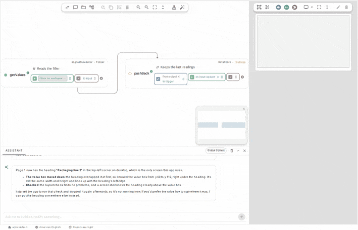

# The assistant in the Builder

The assistant builds the App with you, on the Flowboard and the pages you are looking at. It lives in the Console, the panel at the bottom of the Builder.

What the assistant is, what it may do and what it never does is in [The assistant](../assistant/README.md). Planning a set of Apps happens before this, in the Manager: see [Planning with the assistant](../app-manager/planning.md).

## Where it is

**Toggle Console**, the middle of the three layout toggles in the top bar, opens and closes the panel. Inside it the **Assistant** tab holds the conversation. The panel's own buttons maximize it over the Flowboard and close it again.

Type what you need and press Enter. Shift and Enter make a new line.


The conversation belongs to you and to this App. Another member of the workspace has their own. The bin icon in the Console header, **Start a fresh conversation**, deletes it: a reload does not bring it back, and your other open tabs of this App start anew too. What you have built stays, and so do the project notes. The bin is grey while a run is on.


## What it sees

The chips in the Console header say what the assistant takes as context besides the App itself:

* **Executor Selected** or **Extension Selected**: the node you clicked on the Flowboard.
* **Widget**: the widget you selected in the Page editor, with its type.
* **File**: the file you selected in the [Files explorer](explorers/files.md). That is how a document reaches the assistant: select it, then ask. There is no attachment button here. A file that is not in the workspace yet goes up with **Upload** in the Files explorer first.
* **Global Context**: nothing selected, the whole App.

It also knows the page and the screen you are on. "Make this red" works because the selection travels with your message.

## It works in the open

<figure><figcaption>
One sentence, and the App changes while you watch. The clip is sped up: the assistant went on to test what it built, look at it and correct the spacing.
</figcaption></figure>

Every step is in the feed. The tool calls between two messages fold into one line, closed, that counts them: *7 steps*. Open it, and each call is a line with a short summary of what it did. The icon separates building your App from reading the platform, and a click on a line shows the arguments. The assistant's words and every card end a fold, so nothing that needs you is folded away. The steps stay after a reload, with their summaries; their arguments do not. Nothing happens behind your back.

A call that failed is a muted line under it, cut to one line; a click shows the whole message, a second folds it again. Most such failures are working steps the assistant reads and handles itself: a render that came too early, a lookup that found nothing, an argument it corrects on the next call. Red is kept for what stops the conversation and needs you: a run that failed, or an assistant that cannot start or take your message, says why in a red message, in a sentence.

The Builder follows along. When the assistant writes to a page, it moves the canvas to that page and screen, pulses what it just made, and after a build tidies the executors it touched. If you move to another page or screen during a run, it leaves you where you are until your next message.

While a run is on, the line under the feed says what happens now: the kind of step in words, then its summary, for example *Checking the layout · page Start*, with a running clock. **Working** means it is thinking. The send button turns into a stop button while a run is on: press it and the run ends. A run outlives the tab it started in, so you can close the Builder and find it still going when you come back.

## Checkpoints and rollback

Before a build of several steps the assistant saves a checkpoint, a version of the App to come back to. If the result is not what you wanted, ask it to roll back: executors, widgets, pages, extensions, variables, endpoints and the theme return to that state. Rollback is the undo of the App Builder. See [Versions](test-and-deploy.md#versions).

What a rollback cannot undo, the assistant does not do on its own.

## What it asks you first

Four things need your explicit go, and they arrive as a card in the feed with **Approve** and **Reject**:

* deleting a whole App, which takes its versions with it;
* deploying, because that is what users then run;
* ending a registration on an agent, which stops the listeners of everyone who shares it;
* reshaping the data model or running SQL that loses data, because there is no bin.

The card names the step and shows what it would do. Nothing runs until you approve, and a rejection means the assistant leaves that step undone and goes on.

## Project notes

The first time you open an App that planning prepared, a card offers the workspace's [project notes](../app-manager/planning.md): how many there are, how large, and the choice **Read them** or **Not now**. The assistant reads nothing until you say so, because a note read stays in the conversation's context for every later turn. You can ask for them at any time afterwards, and a fresh conversation offers the card again.

## Reporting a platform defect

When the assistant runs into something the platform itself gets wrong, it writes a report card instead of quietly working around it: **Platform issue**, with the report it would send. You decide:

* **Inform Heisenware** sends it and shows the link it was filed under. **Include this conversation (credentials redacted)** adds the conversation, and it is ticked by default.
* **Dismiss** folds the card away. The finding stays on record, nothing leaves.

Nothing is sent unless you click. On an installation that talks to nobody, the button copies the report to your clipboard instead, to mail to [support](mailto:support@heisenware.com) if you like.

## Where it is not available

The assistant needs an AI key, which the installation provides. Where none is set, there is no Console in the Builder and no Assistant tab, and nothing in the Builder refers to it. The platform is fully usable by hand: that is what the rest of these pages describe.
