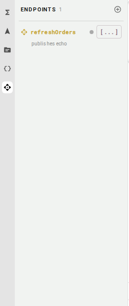

# Endpoints explorer

An endpoint publishes one executor under a stable public name, so that another App, an external system or [Ask](../../app-manager/ask.md) can run it. The Endpoints explorer lists the names this App offers.

Open it with the **Endpoints** icon in the Explorer's icon rail. What endpoints are for is in [Variables and endpoints](../../concepts/variables-and-endpoints.md): endpoints are the actions, variables are the values.

<figure><figcaption></figcaption></figure>

## Publishing one

Right-click the executor on the Flowboard and choose **Publish as Endpoint…**. The dialog asks for:

* **Name**: camelCase, unique in the App, such as `startOrder`. This is the public name, and it is a promise: you can rebuild the logic behind it and callers notice nothing.
* **Description**: what the endpoint does and what it changes. People and AI decide by it whether to call.
* **Ask the user first**: when the AI of [Ask](../../app-manager/ask.md) runs this endpoint for an invited user of the App, the user agrees to that one call first. It stays ticked for everything that changes something. Untick it only for an endpoint that merely reads or opens a page.

Click **Publish**. A chip with the name appears above the executor on the Flowboard. Click the chip to jump to the explorer row; click the x on it to unpublish.

**+** at the top of the explorer does the same from the other side: it asks for the name and then for the executor to publish.

## The list

Each row shows the endpoint's name, its live output on the right, and below it the function it publishes. Hover a row and the published executor pulses on the Flowboard; click it and the Flowboard flies there.

A row that says *executor missing* publishes an executor that no longer exists. Unpublish it, or publish the name anew on the executor that replaced it.

## What a caller gets

A caller fills the executor's inputs by position, runs it, and gets what the function returned. It can also subscribe to the output. Nothing but the name is needed: internal ids never leave the App.

* **Another App of the workspace** calls the endpoint instead of reaching into this App's logic. The address while you build is the agent `builder-backend`, the class `Endpoints` and the instance `endpoints-<appId>`; in the deployed App the platform routes the same name to its release. See [Suites of Apps](../../concepts/suites-of-apps.md).
* **An external system** reaches it through an [integration](../../app-manager/integrations.md), with that integration's credentials.
* **Ask** runs the App's endpoints as the user who asked, under the **Ask the user first** rule above.


Publishing gives a stable name, not a permission boundary. Who may reach the App decides who may call its endpoints. A value no user should read belongs in a secret [variable](variables.md).


## Trying it out

The explorer has no call button. Try the endpoint the way its caller will use it: start the App with **Test**, then run the published executor from the Flowboard, or ask the assistant to call the endpoint by its name. Do that before you hand the name out, because from then on it is a contract.

## Changing and removing

* **Edit** on the row changes the name and the description, and the **Ask the user first** tick. A rename moves the public channels in one go, so external subscribers follow, but whoever calls the old name by hand has to be told.
* The executor an endpoint publishes cannot be swapped in the dialog. Pointing a public name at another executor is unpublish and publish again, on purpose.
* **Unpublish** removes the name. The executor keeps running and keeps its wires; only the callers outside lose it.
