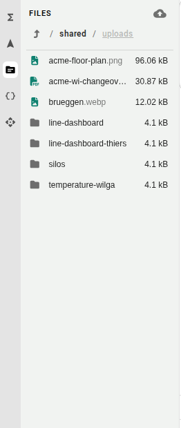
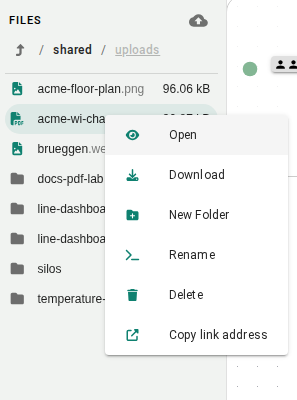

# Files explorer

The Files explorer is the workspace's shared storage: the files your logic reads and writes, the images and logos your pages show, the PDF masters your templates print on, and what the platform itself keeps. Every App of the workspace sees the same files.

It opens in `uploads`, where what you upload lands. The breadcrumb above the list takes you to the other areas.

<figure><figcaption></figcaption></figure>

## The areas

| Folder | What it holds | What you may do |
| --- | --- | --- |
| `uploads` | your own files: data, images, PDF masters | upload, rename, move, delete |
| `project` | the workspace's [project notes](../../app-manager/planning.md), written by you and the assistant | read, write |
| `runtime-files` | what a running App writes by name: exports, dumps, reports | read, download, upload |
| `files` | the file store: the files your table rows point to. One folder with a count; a file in it is reached through the row that points to it, see [Files in a table](../../reference/functions/storage/relational-database.md#files-in-a-table) | read through the row |
| `native-agents` | the [agents](../../app-manager/agents/README.md) you built, ready to download again | read, download, delete |
| `themes`, `data-backups`, `reports` | what the platform produces: compiled looks, database backups, the documents [Ask](../../app-manager/ask.md) made | read, download |
| `builder-backend`, `apps`, `connectors`, `templates` | the platform's own records | read only |


Outside `uploads` and `project`, leave things as they are unless you know what you are doing. An App's records and a running App's files are not yours to rename.


Nobody deletes in `files`: the platform's clean-up removes a file thirty days after the last row let go of it.

## Uploading

1. Go to `uploads` and click the upload icon (<i class="fa-cloud-arrow-up">:cloud-arrow-up:</i>) at the top of the panel.
2. Drag files in, or click to pick them from your computer.
3. Click **Upload**.

Outside `uploads` the icon turns into **Refresh**, which fetches the list again.

## Working with files

Right-click a file or a folder:

* **Open**: shows it in a tab, what a double-click does.
* **Download**: saves it to your computer.
* **New Folder**, **Rename**, **Delete**.
* **Copy link address**: copies a download link for the file.

<figure><figcaption></figcaption></figure>

Drag a file onto a folder to move it there.


A copied link carries an access ticket and works for anyone who has it, for twelve hours. Treat it as what it is: a key to that file.



Renaming or deleting is for good. An executor, a PDF template or a widget that names the old path stops working, and nothing warns you.


## Looking at a file

Double-click a file to open it in a tab next to the Flowboard. Text and code files (CSV, JSON, YAML, scripts), Markdown (rendered, with a toggle to its source), images and PDFs show right there; any other type offers a download instead. The view is read-only and follows the file: when an executor or the assistant rewrites it, the tab reloads. Close a tab with its cross, or switch back with the **Flowboard** tab. The download icon in the tab's header saves the file to your computer.

The platform's own areas, such as your Apps' records under `builder-backend`, open and download like any other file.

## Using a file

* **In an executor**: drag the file from the explorer onto an input. The input then holds its path.
* **On a page**: drag a picture onto the page in the Page editor. An image widget appears, showing it.
* **In a PDF template**: pick the PDF master in the [Template editor](../template-editor.md).
* **With the assistant**: select the file in the explorer and it becomes the context of your next message. See [The assistant in the Builder](../assistant.md).

A file an App's user uploads does not land here but in the file store, under the row that keeps it. See [Files, data and dates](../../concepts/files-data-and-dates.md).
