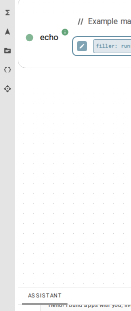

# Functions explorer

The Functions explorer holds every function your App can call. It is the first tab of the Explorer, and what you drag onto the Flowboard comes from here.

<figure><figcaption></figcaption></figure>

## The tree

The tree goes agent, class, function. A class that works with instances lists its instances, and the functions that act on one hang under the instance.

* [**Connectors**](../../reference/functions/connectors/README.md): industrial protocols and external systems. These run in the platform, so the target has to be reachable over the network.
* [**Storage**](../../reference/functions/storage/README.md): the relational database and the timeseries database, with the built-in PostgreSQL and InfluxDB, and the lightweight stores: data store, buffer, accumulator.
* [**Utilities**](../../reference/functions/utilities/README.md): data processing, timers, cron, counters, barcodes, PDF, simulation.
* **Custom**: your own building blocks, the [subflows](../../concepts/subflows.md) of this App and the classes an [add-on](../../reference/functions/add-ons/README.md) brings.

Every [agent](../../concepts/agents-and-where-code-runs.md) you installed appears as its own entry, under its name, holding the connectors that were chosen when it was built. The same class on two agents means the same functions in two networks.

The platform's own agents and its control classes are not building blocks and stay hidden. Switch **Debug Backend** on in the [App Builder settings](../README.md#settings) to see them.

## Building a flow from it

* **Drag a function onto the Flowboard**: it becomes an [executor](../../concepts/executors-and-instances.md) there, with its arguments as inputs and its documentation on hover.
* **A class that needs an instance** lists *create* and *delete* first. Drag *create* onto the board, name the instance, and the instance functions can address it. See [How instances live](../../concepts/executors-and-instances.md#how-instances-live).
* **Right-click an instance** for **Registrations…**, who is listening to it, and **Remove**.
* **Right-click an agent** for its host and build, **Restart agent**, **Show log…** and **Open in App Manager**.

## The toolbar

The icons at the top of the panel:

* **Add agent**: agents are built, updated and rolled out in the Manager. The icon opens its [Agents](../../app-manager/agents/README.md) screen in a new tab, ready to build one.
* **Install Extension**: adds an [add-on](../../reference/functions/add-ons/README.md), an optional module that runs as its own container and brings new classes. It asks for the image and its environment.
* **Start onboarding new agents**: pairs external clients, such as IoT devices, with your workspace. See [agent onboarding](../../app-manager/integrations.md#agent-onboarding).
* **Collapse All**: folds every open entry.
