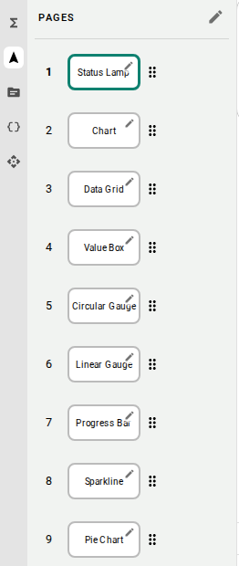
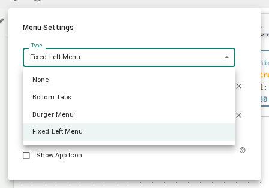
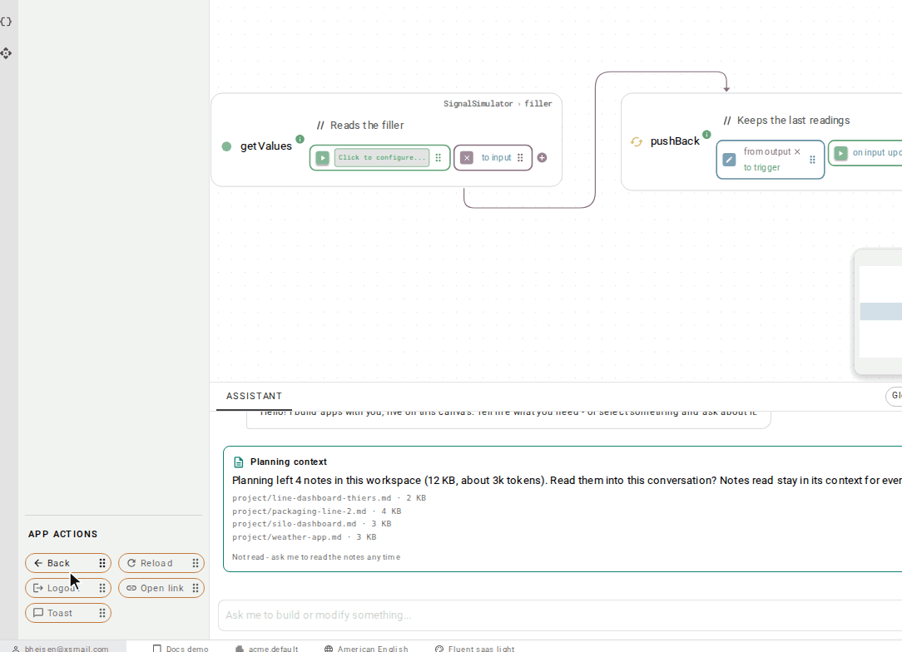
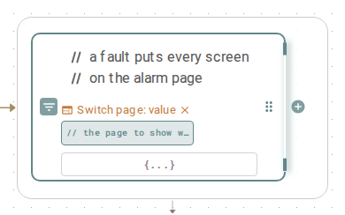

# Pages and actions explorer

A page is one screen of your App, built from widgets. The Pages and actions explorer holds them all, in the order users see them, together with the App's navigation menu and the App actions.

Open it with the **Pages and actions** icon (<i class="fa-location-arrow-up">:location-arrow-up:</i>) in the Explorer's icon rail.

<figure><figcaption></figcaption></figure>

## Pages and subpages

* **Pages**: the top-level pages, one row each, numbered. They fill the navigation menu.
* **Subpages**: they hang off one top-level page, to the right of it in its row, and stay out of the menu. A subpage is reached by a link, so they suit detail views, settings and dialog-like screens. Pages nest one level: a subpage has no subpages of its own.

### Creating and deleting pages

Right-click any page for **New Page**, **New Subpage**, **Duplicate Page** and **Delete Page**. The App's first page cannot be deleted. Deleting a page takes its subpages and every widget on them along.

### Reordering pages

Click a page's number to pick up its row, then drag the row where you want it. A top-level page travels with its subpages, and the new order is the order of the navigation menu.

### Per-page settings

Click the small pencil icon inside a page's representation to open its settings, where you set:

* The page name shown in the menu
* The menu icon

Both are shared across screen sizes until you pin one: hover the field and click the pin to give the selected screen its own value. A page has no title of its own: a page heading is a text box on the page.

## The navigation menu

The navigation menu is how users move between top-level pages. To configure it, click the menu icon next to the **Pages** title at the top of the panel (*Configure the navigation menu*).

<figure><figcaption></figcaption></figure>

### Menu types

* **None**: no navigation menu. This is what a new App starts with.
* **Bottom Tabs**: a fixed tab bar at the bottom of the screen, the usual look on a phone.
* **Burger Menu**: a burger button in a top corner of every page; the menu slides in over the page and dims it (or pushes the page aside, from the left or the right, as wide as you like). There is no bar: the page keeps its full height, so a title bar is your own band of widgets laid under the burger.
* **Fixed Left Menu**: a permanent side menu on the left. Its rail and the page share the screen's width, so lay the page out in what is left.

There is no top bar menu type. A title bar of your own, with a logo, a title, or a logout button, is built from widgets on each page: a [card](../../reference/widgets/display/card.md) as the band, an [image](../../reference/widgets/trigger/image.md) for the logo, a text box for the title, and a [button](../../reference/widgets/trigger/button.md) carrying the Logout [App action](#app-actions). Group them to move them as one, switch the group's *Sticky* on (General tab) so the band stays on screen while the page scrolls beneath it, then copy the group to the other pages.

**Sticky widgets.** Every widget on a page has a *Sticky* switch on its General tab. A sticky widget stays where the screen puts it while the page scrolls: a band at the top is a header, a bar at the bottom of the screen a footer, a small button in a corner a "back to top". Sticky widgets draw above the page's content, and the page scrolls under them. The Page editor marks a sticky widget with a badge and keeps it in place on the page, which is where it will sit on the screen; the test run and the deployed App are where it sticks. Like other settings, *Sticky* is shared across screens until you pin it on one. A widget inside a group follows its group, so the group is what you make sticky.

### Per-screen menu type

The menu settings are shared across all activated screen sizes until you pin one. Switch to the screen size you want to configure in the [Page editor](../page-editor.md), open the menu settings, hover a field and click the pin to give that screen its own value for the field alone: a fixed left menu on large screens and bottom tabs on the phone is one shared menu type plus one pin. A faded pin shows the field is pinned on another screen; click a solid pin to share the field again. This is the same pin you know from widget settings and page settings.

## App actions

Some things a user wants are not pages, functions, or widgets: leave the App, start it over, go back a step, see a short message. Heisenware calls these **App actions**. They act on the App itself in the browser, they take no place on a page, and they are linked exactly like pages: you drag them and drop them.

<figure><figcaption></figcaption></figure>

The App actions sit in a row at the foot of the Pages and actions explorer:

* **Back**: returns to the page shown before the current one. Does nothing at the start of the visit history.
* **Reload**: restarts the App in this tab with cleared caches.
* **Logout**: forgets this device's credentials for the App and starts the App afresh. Apps with [individual registration](../../app-manager/users-and-access.md) land on the sign-in screen, Apps with a master password ask for it again, public Apps continue as a new anonymous user. Use it for shared devices and shift changes.
* **Open link**: opens a URL: the same App in another language (`/app/<domain>/<appId>`), a manual, an external site, an e-mail (`mailto:`). In this tab the App is left; with "Open in a new tab" the App stays open next to the link.
* **Toast**: pops a short message over whatever page is shown, as info, warning, error or success, then fades away. See [Toast](../../reference/widgets/display/toast.md) for Apps that still had the toast widget.

Switching pages is an App action too. Its chip is the page itself.

An action that needs settings (the URL of Open link, the message of Toast) asks for them in a dialog when you drop it. On the Flowboard, click the action's chip to open the dialog again; on a page link, click *switch page* to pick another page.

### On a widget

Turn any [button](../../reference/widgets/trigger/button.md), [icon](../page-editor.md), or image into a page-switch or action trigger.

* **How to link**: Drag a page or an App action from the Pages and actions explorer and drop it directly onto a button, icon, or image on your page.
* **Use case**: The primary way to let users open subpages (e.g., a "Machine Details" button opening the corresponding detail view), to navigate in Apps that have no main menu, or to offer a Logout button wherever you like. No top bar is required.
* **Order**: A click fires the executors linked to the button first. Logout and Reload wait for them, so a button that saves and logs out saves first.

### From your logic

Your backend logic can also switch pages and run actions on its own.

* **How to link**: Drag a page or an App action from the Pages and actions explorer onto an executor's output, modifier, filter, or error handler.
* **Use case**: If an executor detects an error or a successful form submission, the backend pushes the user to an error or success page automatically. A Timer output with Logout ends a session after a fixed time; a filter that detects an alarm switches to the alarm page.
* **What fires it**: Every truthy value the output produces after the App has loaded. Falsy values, such as a filter that blocks, never fire.
* **Who is reached**: The action reaches the users the value reaches. When a user's click started the flow, only that user: a Timer that the user started ticks for that user alone, so "logout after ten minutes" is per user with nothing to configure. When no user started the flow, a poll or a listener fired by the backend, every connected user: an alarm switches every screen, a backend-fired Logout ends every session.
* **Back** cannot be dropped on an output. Walking every user's history at once makes no sense, so it lives on widgets only.

#### The value as the action's setting

Toast, Open link and Switch page have one main setting: the message, the URL, the page. Dropped on an output, the dialog offers *Take … from the live value* above that setting. Switched on, the value the output produces becomes the setting, and the field in the dialog goes grey:

* A **Toast** on an error handler shows the error itself: "Saving failed, because: connection lost". On an output it shows the text (or number) your logic produced.
* An **Open link** opens the URL your logic built. Only web addresses (`https://`), `mailto:` and addresses on this platform open; anything else does not.
* A **Switch page** opens the page your logic named, by its id or its name.

The other settings (type, position, new tab) still come from the dialog. A value that does not fit, such as a list for a toast or a page that does not exist, opens nothing; the browser console of the App says why. With the switch off, the value only decides that the action runs.

<figure><figcaption>
Switch page link
</figcaption></figure>

The browser's back and forward buttons, and the back gesture of a phone, walk your App's pages the same way the Back action does. The App's URL never changes.


Need more vertical space on a page? Use the page height setting in the [Page editor toolbar](../page-editor.md#the-toolbar).

