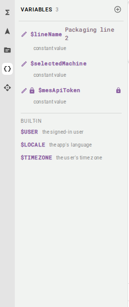

# Variables explorer

A variable is a named value of the App, written `$name`. The Variables explorer lists them all, with what each one holds right now.

Open it with the **Variables** icon in the Explorer's icon rail. What a variable is for, and when to use one instead of a wire, is in [Variables and endpoints](../../concepts/variables-and-endpoints.md).

<figure><figcaption></figcaption></figure>

## The list

The panel shows how many variables the App has, then the variables themselves and, at the foot, the built-ins:

* A pencil icon and *constant value* mark a variable nobody writes. These come first.
* A bolt icon marks a variable an output or an extension writes, and the line below the name says which function feeds it.
* A lock marks a secret.
* Under **Built-in** stand `$USER`, `$LOCALE` and `$TIMEZONE`. The platform computes them, they are the same in every App, and you cannot change them.

Every row shows the variable's live value on the right, as it is at this moment. A secret never shows one: its value is not read back, not even here.

Hover a row and the Flowboard lights up every item that writes or reads this variable. Hover the name alone to see its description.

## Creating one

Click **+** (New variable) at the top of the panel:

* **Name**: camelCase, unique in the App. The `$` is not part of the name.
* **Description**: what the value is for. Other members and the assistant read it.
* **Secret**: the value is encrypted and masked everywhere. Use it for every credential. A variable that is secret stays secret.
* **Default value**: read like YAML. `42` is a number, `'42'` is text, `[a, b]` is a list, anything else is plain text. The type matters: a database column of text does not match the number `42`.

Click **Create**. The variable exists from that moment, with its default as its value.

The faster way for a value your logic produces: right-click the output, the modifier, the filter or the error handler that produces it and choose **Make variable…**. The dialog asks for a name and a description only, and the item becomes the variable's producer.

## Using a variable

* **In an input**: `$machine` as the whole value, or `${machine}` inside a text, as in `Line 2: ${machine} stopped`. Right-click the input and use **Insert Variable** to pick one from the list, which writes the braced spelling, safe in either place. Dragging the row onto an input writes `$machine`.
* **In an expression**: `$machine` is a value you compute with, not text that is pasted in. The editor of a [modifier](../flowboard/modifier.md) or a [filter](../flowboard/filter.md) has a **$** button that inserts one.
* **In an address**: type `$machines` into the agent or instance box of a dynamic address. See [Addresses](../../concepts/executors-and-instances.md#addresses-where-a-call-goes).
* **To feed it**: drag the row onto an output or an extension. That item then publishes its value into the variable, the same as **Make variable…** does.

A variable never runs anything. An executor reacts to a new value only through a hot input that reads it. See [Triggers and wires](../../concepts/triggers-and-wires.md).

## Renaming and removing

Both start on the row, with **Edit** and **Delete**.

A rename moves everything that was wired to the variable, because that wiring points at the variable itself, not at its name. Text does not move: a `$name` you typed into an input or an expression keeps its old text and stops resolving. The dialog lists every such place before it renames, and you can go back.

A delete does the same in reverse: the items that fed the variable are unassigned, and the typed references stay as they are and resolve to nothing. The dialog lists both before you confirm with **Remove**.


A secret is not part of an exported [bundle](../test-and-deploy.md). After an import you enter it again.

