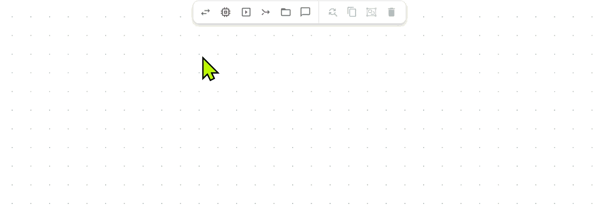
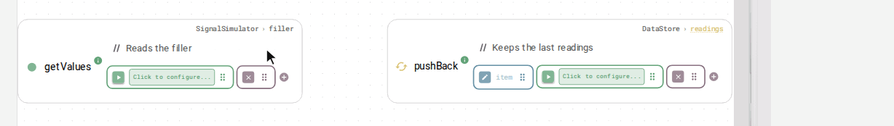

# Flowboard

The Flowboard holds the logic of the whole App: what it fetches, computes, stores, and sends to machines and other systems. It runs even when nobody has a page open.

You build it by dragging functions onto the board, where each becomes an [executor](../../concepts/executors-and-instances.md), and wiring the executors together.

## Putting executors on the board

* **From the Explorer**: drag a function out of the [Functions explorer](../explorers/functions.md) and drop it on the board.
* **From the toolbar**: **New Echo Executor**, the first icon, drops an `echo`, the carrier that hands a value on unchanged. The other everyday functions sit in the Functions explorer under *Utilities*: [Data Processing](../../reference/functions/utilities/data-processing.md) holds `combine`, `jsonParse` and the rest, [Event Simulation](../../reference/functions/utilities/event-simulation.md) the impulses.
* **Duplicate**: select executors or a section and use **Duplicate** in the toolbar.

<figure><figcaption></figcaption></figure>

## Wiring

Drag from an item of one executor and drop it on an item of another. What the wire does depends on where it lands:

* **Output to input**: the value arrives at that argument. That alone does not run anything.
* **Output to trigger**: the second executor runs when the first produces. No value is handed over.
* **Own input to its own trigger**: a **hot input**. Every value that arrives there runs the executor, whoever wrote it: a wire, a widget, the Player.

<figure><figcaption>
First the wire, then the same input dropped on its own trigger
</figcaption></figure>

Dropping on a trigger adds the source with *update* and opens its menu at once, so you can switch to *change*, *true* or *all updated*. A page dropped on a trigger makes it *on page load*; a widget dropped on it makes a widget event.


A value arriving at an input never runs an executor by itself. Something has to trigger it. See [Triggers and wires](../../concepts/triggers-and-wires.md).


What happens when several wires meet, and which user sees which value, is in [When streams meet](../../concepts/when-streams-meet.md) and [Scopes](../../concepts/scopes.md).

## What sits on an executor

* The **trigger** on the left: the list of reasons to run. Right-click it for **App Start** with its interval, **App Stop**, **Process One By One**, **Delay execution**, and on a subflow blueprint **Time out**. A click runs the executor once.
* The **inputs**, in the order of the function's arguments. Right-click one for **Secret Input**, **Insert Variable** or **Clear Content**.
* The **outputs** on the right: the return, and one event output per value an event or a callback delivers. See [Backend events](../../concepts/backend-events.md).
* **Extensions** on any output: [modifier](modifier.md), [filter](filter.md), [recorder](recorder.md) and [error handler](error-handler.md). The **+** on the output adds one.
* The [**status dot**](../../concepts/executors-and-instances.md#status) on the header, and the executor's **comment**, the line you write to say why the node is there. Right-click the executor for **Add Comment**, **Publish as Endpoint…**, the address entries, **Clear Cache** and **Delete Executor**.

## Sections

A section is a titled, colored frame around the executors of one stage. Select two or more executors and click the group icon in the toolbar; with a section selected as well, the same icon adds them to it, and selecting framed executors lets it release them again. An executor belongs to at most one section.

A frame can be collapsed, and the toolbar folds or unfolds every section at once. Sections are a visual aid: the logic never sees them, and a released App does not carry them.

A section can become a reusable executor of its own: **Activate Subflow** on its title bar. **New Subflow** in the toolbar drops an empty one, a section with its blueprint ready. See [Subflows](../../concepts/subflows.md).

<figure><figcaption></figcaption></figure>

## Annotations

Place documentation cards anywhere on the board with the annotation tool, for example to sketch the architecture of an App, explain a path that spans several executors, or leave instructions for other members.

A card holds rich text: headings, lists, tables, quotes, code blocks, links, and pictures from the media library. Double-click a card to edit it; a code block in the `mermaid` language is drawn as a diagram. **Card colour** in the editor's header tints it, for example in the color of the section it explains. Cards keep the width you give them and grow with their content. Zoomed out, the text lifts a little to stay legible but never leaves its card.

Annotations say what no single node can say. Why one executor is there belongs in its comment.

<figure><figcaption></figcaption></figure>

## Finding your way

* **Panning**: trackpad, the mouse wheel for vertical and Shift with the wheel for horizontal movement, or the WASD keys.
* **Zooming**: pinch, Ctrl with the mouse wheel, the toolbar's **Zoom In** and **Zoom Out**, or the Q and E keys.
* **Fit**: **F**, or the fit icon. With something selected it frames the selection.
* **Trace**: select one executor or extension and the toolbar offers **Trace Upstream** (left Alt and click), **Trace Downstream** (right Alt and click) and **Trace Full Stream**. The board then highlights what feeds this node, what it feeds, or both.

Pan and zoom behave the way the [App Builder settings](../README.md#settings) say.

## Tidying up

The board previews every layout change before it keeps it: moved nodes turn orange, and the toolbar offers **Accept Layout Shifts** (the check) and **Discard Layout Shifts** (the arrow).

* **Clear Collisions**: moves nodes just far enough apart to remove overlaps.
* **Auto-Format All**: rebuilds the whole layout, grouping connected logic into islands. With a selection it formats the selection alone.
* A new node that lands on top of others pushes them aside the same way.

## Search and replace

Select at least two executors to activate **Replace** in the toolbar, then replace a string across the whole selection, for example a machine's IP address or an instance name.


The replacement runs over everything the selected executors hold, their cached values included. Search for something distinctive, and look at the result before you build on it.


<figure><figcaption></figcaption></figure>
