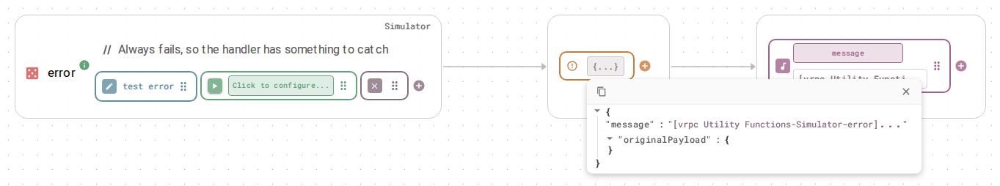

# Error handler

An error handler catches a failed call. It stays silent while the function works and carries the failure the moment one happens, so that a person hears about it or the flow takes another path.

Add it with the **+** on an output and choose **Error Handler**. It sits on an output itself, never behind another extension; a modifier, a filter or a recorder may follow it.

<figure><figcaption>
Error simulator executor with captured error message and a JSONata modifier
</figcaption></figure>

## What happens when a call fails

* The executor's status turns red and shows the message.
* Every error handler on its return receives the failure.
* The executor produces **no output**. Nothing behind it runs, and the branch ends there.

So an error never travels down the flow as a strange value. It either reaches an error handler or the branch stops.

Once the call works again, the handler's content is cleared.

## What the handler receives

An object with three fields:

* `message`: what went wrong, as text.
* `cause`: the reason behind it, as text, where the error names one.
* `originalPayload`: the error itself, for a modifier behind the handler. Outside the backend, in a widget or a toast, it arrives empty, so what people are to read must travel in `message` and `cause`.

An error handler on an **event output** catches the failures of that output's own pipeline instead, and receives `message` and the value that was being worked on.

## What to do with it

The handler is an output like any other. Wire it to an executor's trigger, link it to a widget, publish it into a [variable](../explorers/variables.md) with **Make variable…**, or chain a [modifier](modifier.md) behind it to reshape the message.

* **Tell the user**: drag the **Toast** [App action](../explorers/pages.md#app-actions) onto the error handler, switch **Take message from the live value** on and set **Type** to **Error**. The toast then reads "Saving failed, because: connection lost". See [Pages and App actions](../../concepts/pages-and-app-actions.md#on-a-value).
* **Keep it**: wire the handler to a `Database` or `DataStore` function to write the failure away.
* **Take another path**: wire it to the trigger of whatever should happen instead.

Right-click the handler for **Make variable…**, **Clear Content**, **Add Comment** and **Delete**.

## Who else hears of the error

A failure that no handler takes does not vanish, but who notices depends on what started the run:

* a run started by a trigger source swallows it: only the status and the log hold it;
* a run that someone called, an [endpoint](../explorers/endpoints.md) among them, gives the error back to the caller;
* a [subflow](../../concepts/subflows.md) call fails its caller at once, with the first failure no error handler took inside it;
* inside a loop, a failing element becomes its error message in the list of results and the loop goes on.

A deployed App writes every failed call to its own log, with the executor and the message.


Prevent what you can: give inputs a default, or put a [filter](filter.md) in front, where a missing value would make the function fail. Retry with a `Timer` or an `Event Simulation` instance, never by wiring an output back into its own start.

