# Modifier

A modifier reshapes a value. It sits on an output and turns what arrives into what the next step needs, before it reaches another executor, a database, a widget or the next extension.

To add one:

1. Click the **+** on the right of an output, an event output or an extension.
2. Choose **Modifier**.
3. Click the new node (*Click to edit…*) to open the editor and write your expression.

A modifier speaks either [JSONata](modifier.md#jsonata) or [JavaScript](modifier.md#javascript-expressions). Right-click it and pick **Jsonata** or **Expression** under *Select Modifier Type*; which one a new modifier starts in is an [App Builder setting](../README.md#settings).

Click the icon on the left of the node to evaluate the modifier while you build. Its last result shows below the expression. The right-click menu also offers **Make variable…**, **Add Comment** and **Delete**.

<figure>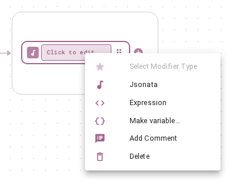<figcaption><p>A modifier extension node</p></figcaption></figure>

## The expression contract

* **One expression, not a script.** `{ a: x.a }` is an object. A `const`, an `if`, a `for` or a `return` at the top is an error. For several steps, wrap them in a function that runs at once: `(() => { const rows = x.filter(...); return rows.map(...) })()`.
* **The value arrives as `x`** (`input` works as well).
* **Variables are values.** `$machine` in an expression is the [variable's](../explorers/variables.md) value, never text that is pasted in: `x.filter(row => row.machine === $machine)`. The **$** button in the editor's header inserts one, with its current value beside the name. The built-ins `$USER`, `$LOCALE` and `$TIMEZONE` work the same way.
* **What else is there**: Luxon's `DateTime`, `Duration`, `Interval` and `Info`, `crypto`, and JavaScript's own `Date`, `Intl`, `JSON` and `Math`. There is no `require`, no `fetch` and no `new Function`.
* **Write it for a human.** Line breaks, indentation and `//` comments are free and expected. A long one-liner is a defect, not a style.
* **Keep it quick.** A JavaScript expression holds its backend while it runs: every other executor of that backend waits meanwhile. One that runs over 1 second is a warning in the log. One that runs over 30 seconds ends its backend, which restarts by itself; the log names the executor, the item and the expression.


Tell the [assistant](../assistant.md) what arrives and what you need, and it writes the modifier onto the output. That helps most with large JSON objects.


## JSONata

JSONata is a query and transformation language designed for JSON data. It is the preferred method for structural changes, filtering, and simple math. For a complete guide, see the [official JSONata documentation](https://docs.jsonata.org/overview.html).

* **Reference**: Use the `$` sign to refer to the value from the preceding output.
* **Implicit arguments**: JSONata modifiers automatically process the incoming data if the parentheses are left empty. For example, `$uppercase()` is equivalent to `$uppercase($)`.
* **Variables**: a variable is available under its own name, `$machine`, exactly as in a JavaScript expression.

### JSONata examples

<details>

<summary><strong>Example 1: Path selection and math</strong></summary>

Extracts a specific nested value from a PLC object and performs a calculation.

Data:

```json
{
  "payload": {
    "sensors": {
      "temp_c": 25
    }
  }
}
```

Modifier content:

```
payload.sensors.temp_c * 1.8 + 32
```

Return of the modifier:

```
77
```

<figure>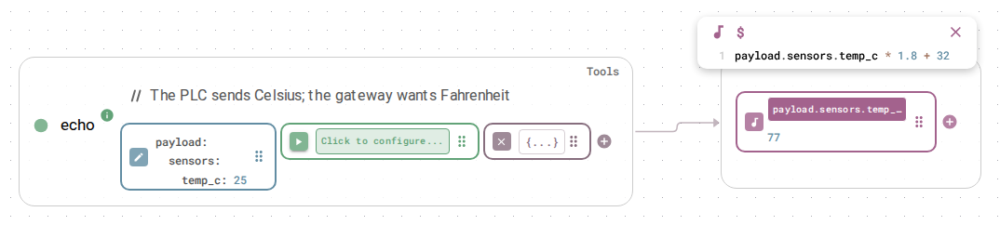<figcaption></figcaption></figure>

</details>

<details>

<summary><strong>Example 2: Wrap a value in an object</strong></summary>

Takes the incoming value (`$`) and wraps it inside a JSON object with a key named `temp_sensor_1`.

Data:

```json
25.4
```

Modifier content:

```
{ "temp_sensor_1": $ }
```

Return of the modifier:

```json
{ "temp_sensor_1": 25.4 }
```

<figure>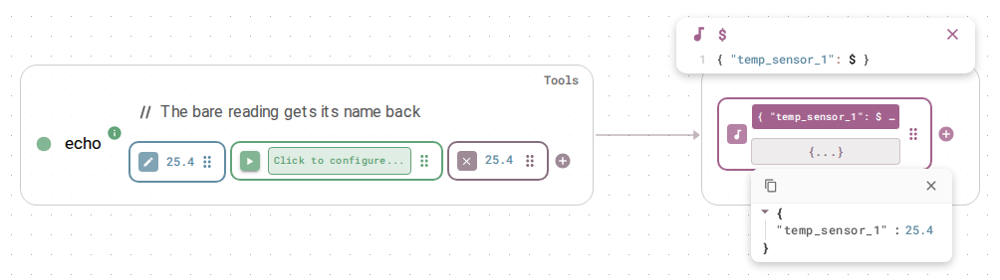<figcaption></figcaption></figure>

</details>

<details>

<summary><strong>Example 3: Implicit function usage</strong></summary>

Trims whitespace and converts a raw string to uppercase without explicitly naming the input variable.

Data:

```json
"maintenance_required"
```

Modifier content:

```
$uppercase()
```

Return of the modifier:

```json
"MAINTENANCE_REQUIRED"
```

<figure>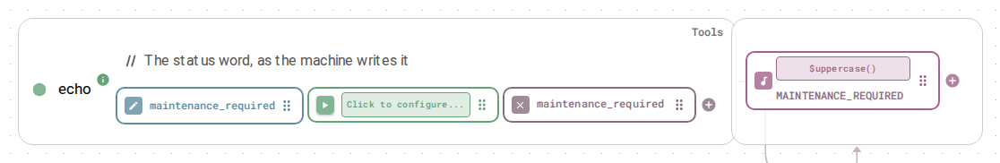<figcaption></figcaption></figure>

</details>

<details>

<summary><strong>Example 4: Filtering an array</strong></summary>

Returns only the objects from a list that meet a specific status condition.

Data:

```json
[
  { "id": "A1", "status": "OK" },
  { "id": "B2", "status": "ERROR" }
]
```

Modifier content:

```
$[status="ERROR"]
```

Return of the modifier:

```json
{ "id": "B2", "status": "ERROR" }
```

<figure>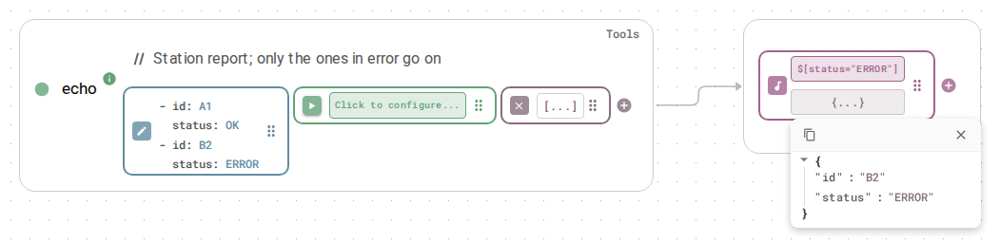<figcaption></figcaption></figure>

</details>

## JavaScript expressions

This modifier type accepts any standard JavaScript expression that evaluates to a new value. Use `x` to access the value from the preceding output. For more information, see the MDN documentation on [JavaScript expressions and operators](https://developer.mozilla.org/en-US/docs/Web/JavaScript/Guide/Expressions_and_operators).

### JavaScript expression examples

<details>

<summary><strong>Example 1: Conditional status (ternary)</strong></summary>

Determines a status string based on a numeric threshold.

Data:

```json
85.5
```

Modifier content:

```javascript
x > 80 ? "Critical" : "Normal"
```

Return of the modifier:

```
"Critical"
```

<figure>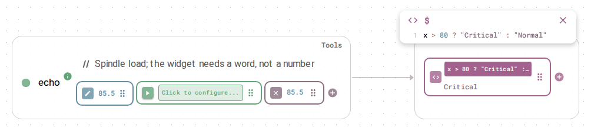<figcaption></figcaption></figure>

</details>

<details>

<summary><strong>Example 2: Array mapping and enrichment</strong></summary>

Iterates through an array of objects to add a new property or modify existing ones using `.map()`.

Data:

```json
[
  { "part": "Bolt", "qty": 10 },
  { "part": "Nut", "qty": 5 }
]
```

Modifier content:

```javascript
x.map(item => ({
  ...item,
  available: item.qty > 0,
  lastChecked: DateTime.now().toISODate()
}))
```

Return of the modifier:

```json
[
  { "part": "Bolt", "qty": 10, "available": true, "lastChecked": "2026-11-16" },
  { "part": "Nut", "qty": 5, "available": true, "lastChecked": "2026-11-16" }
]
```

<figure>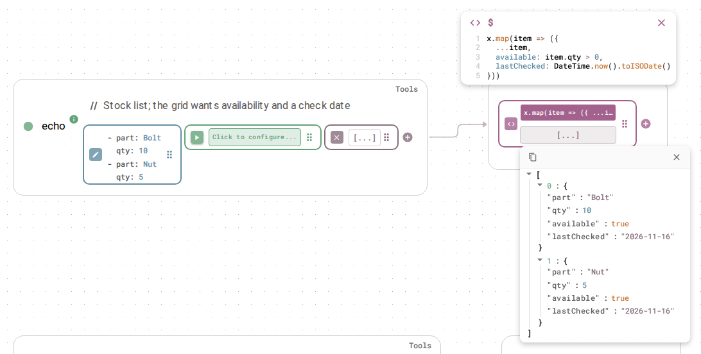<figcaption></figcaption></figure>

</details>

<details>

<summary><strong>Example 3: Multi-step logic (IIFE)</strong></summary>

Modifiers only support expressions. For more elaborate logic involving temporary variables, use the Immediately Invoked Function Expression (IIFE) pattern.

Data:

```json
{ "raw_value": 1024, "multiplier": 0.5 }
```

Modifier content:

```javascript
(() => {
  const base = x.raw_value;
  const factor = x.multiplier;
  const offset = 10;
  return (base * factor) + offset;
})()
```

Return of the modifier:

```json
522
```

<figure>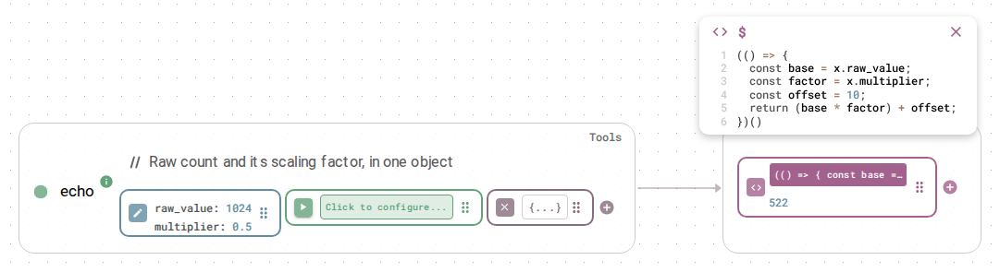<figcaption></figcaption></figure>

</details>

<details>

<summary><strong>Example 4: Removing and adding properties in an array</strong></summary>

Use the spread operator (`...`) to reproduce existing entries while selectively removing or adding properties.

Data:

```json
[ { "a": 1, "b": 1, "c": 1 }, { "a": 2, "b": 2, "c": 2 } ]
```

Modifier content:

```javascript
x.map(y => ({
  ...y,         // Reproduces existing entry
  c: undefined, // Removes property c
  d: 'cool'     // Adds property d
}))
```

Return of the modifier:

```json
[ { "a": 1, "b": 1, "d": "cool" }, { "a": 2, "b": 2, "d": "cool" } ]
```

<figure>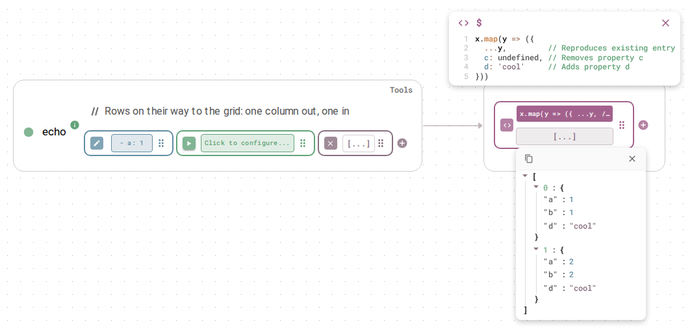<figcaption></figcaption></figure>

</details>

<details>

<summary><strong>Example 5: Processing multiple inputs (using <code>combine</code>)</strong></summary>

When using the `combine` function, the IIFE pattern cleanly handles multiple input sources stored in the `x` array.

Data (combined by the `combine` function):

```json
[
  [ { "name": "User1" } ], // x[0]
  [ { "asset": "CNC" } ]   // x[1]
]
```

Modifier content:

```javascript
(() => {
  const users = x[0]
  const assets = x[1]
  return {
    assigned_users: users,
    active_assets: assets
  }
})()
```

Return of the modifier:

```json
{
  "assigned_users": [ { "name": "User1" } ],
  "active_assets": [ { "asset": "CNC" } ]
}
```

<figure>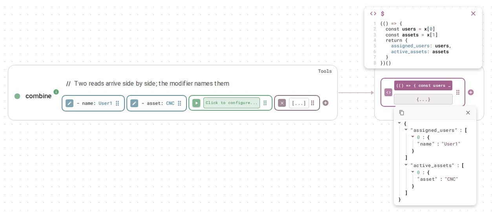<figcaption></figcaption></figure>

</details>

<details>

<summary><strong>Example 6: Date calculations (using Luxon)</strong></summary>

[Luxon](https://moment.github.io/luxon/) is available in every expression through `DateTime`, `Duration`, `Interval` and `Info`.

Here are some common modifier patterns:

#### 1. Calculating future or past dates (addition and subtraction)

Data:

```json
[
  { "startDate": "2026-01-01", "days": 5 },
  { "startDate": "2026-01-10", "days": 2 }
]
```

Modifier content:

```javascript
x.map(y => ({
   ...y,
   dueDate: DateTime.fromISO(y.startDate).plus({ days: y.days }).toISODate()
}))
```

Return of the modifier:

```json
[
  { "startDate": "2026-01-01", "days": 5, "dueDate": "2026-01-06" },
  { "startDate": "2026-01-10", "days": 2, "dueDate": "2026-01-12" }
]
```

<figure>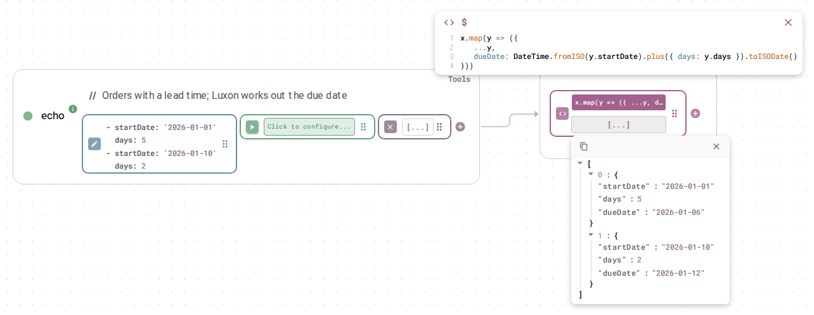<figcaption></figcaption></figure>

#### 2. Calculating downtime (time differences)

Find the exact duration between two timestamps, such as a machine fault start and end time.

Data:

```json
[
  { "machine": "Press A", "faultStart": "2026-03-12T08:00:00Z", "faultEnd": "2026-03-12T10:15:00Z" }
]
```

Modifier content:

```javascript
x.map(y => ({
   ...y,
   downtime: DateTime.fromISO(y.faultEnd)
      .diff(DateTime.fromISO(y.faultStart), ['hours', 'minutes'])
      .toFormat("h 'hrs' m 'mins'")
}))
```

Return of the modifier:

```json
[
  { "machine": "Press A", "faultStart": "2026-03-12T08:00:00Z", "faultEnd": "2026-03-12T10:15:00Z", "downtime": "2 hrs 15 mins" }
]
```

***

#### 3. Formatting decimal labor hours

Convert raw decimal hours from timesheets or logs into standard `HH:mm` timecode using the `Duration` object.

Data:

```json
[
  { "worker": "Alice", "loggedDecimal": 8.75 },
  { "worker": "Bob", "loggedDecimal": 7.1 }
]
```

Modifier content:

```javascript
x.map(y => ({
   ...y,
   standardTime: Duration.fromObject({ hours: y.loggedDecimal }).toFormat("hh:mm")
}))
```

Return of the modifier:

```json
[
  { "worker": "Alice", "loggedDecimal": 8.75, "standardTime": "08:45" },
  { "worker": "Bob", "loggedDecimal": 7.1, "standardTime": "07:06" }
]
```

***

#### 4. Validating events against shifts (intervals)

Check if a specific event (like a sensor trigger) occurred within a defined time window or shift using the `Interval` object.

Data:

```json
[
  { "eventTime": "2026-03-12T14:30:00Z", "shiftStart": "2026-03-12T06:00:00Z", "shiftEnd": "2026-03-12T18:00:00Z" },
  { "eventTime": "2026-03-12T20:00:00Z", "shiftStart": "2026-03-12T06:00:00Z", "shiftEnd": "2026-03-12T18:00:00Z" }
]
```

Modifier content:

```javascript
x.map(y => ({
   ...y,
   occurredDuringShift: Interval.fromDateTimes(
      DateTime.fromISO(y.shiftStart),
      DateTime.fromISO(y.shiftEnd)
   ).contains(DateTime.fromISO(y.eventTime))
}))
```

Return of the modifier:

```json
[
  { "eventTime": "2026-03-12T14:30:00Z", "shiftStart": "...", "shiftEnd": "...", "occurredDuringShift": true },
  { "eventTime": "2026-03-12T20:00:00Z", "shiftStart": "...", "shiftEnd": "...", "occurredDuringShift": false }
]
```

***

#### 5. Converting UTC sensor data to local time

IoT devices typically send data in UTC. Convert this to a readable local format for your pages.

Data:

```json
[
  { "sensorId": "Temp-01", "utcTimestamp": "2026-03-12T07:43:50Z" }
]
```

Modifier content:

```javascript
x.map(y => ({
   ...y,
   localFormatted: DateTime.fromISO(y.utcTimestamp).toLocal().toFormat("dd. MMM yyyy, HH:mm:ss")
}))
```

Return of the modifier:

```json
[
  { "sensorId": "Temp-01", "utcTimestamp": "2026-03-12T07:43:50Z", "localFormatted": "12. Mar 2026, 08:43:50" }
]
```

</details>

<details>

<summary><strong>Example 7: Round robin (using <code>combine</code>)</strong></summary>

Sometimes you want to extract items of an array in a round-robin fashion. Use a `combine` executor and wire the modifier's output back to its second input:

<figure>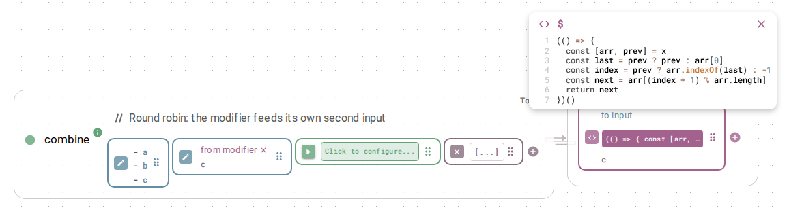<figcaption></figcaption></figure>

Data:

```yaml
[a, b, c]
```

Modifier content:

```javascript
(() => {
  const [arr, prev] = x
  const last = prev ? prev : arr[0]
  const index = prev ? arr.indexOf(last) : -1
  const next = arr[(index + 1) % arr.length]
  return next
})()
```

Return of the modifier:

```
a // when triggered first time
b // second time
c // third time
a // fourth time
```

</details>

<details>

<summary><strong>Example 8: Dates and numbers in the App's language (using <code>$LOCALE</code> and <code>$TIMEZONE</code>)</strong></summary>

Text a modifier produces for people should follow the App, not a language or time zone written into the code. Two built-in variables carry both: `$LOCALE` is the App's language (such as `de-DE`), `$TIMEZONE` the time zone of the user's browser (such as `Europe/Berlin`). The server does not sit in the user's time zone, so a time printed without `$TIMEZONE` shows the wrong hour.

Data:

```json
{ "measuredAt": "2026-10-01T06:30:00Z", "weight": 1234.5 }
```

Modifier content:

```javascript
({
  // 01.10.2026, 08:30 in a German App opened in Berlin
  measuredAt: new Intl.DateTimeFormat($LOCALE, {
    timeZone: $TIMEZONE ?? 'UTC',
    dateStyle: 'medium',
    timeStyle: 'short'
  }).format(new Date(x.measuredAt)),
  // 1.234,5 in German, 1,234.5 in English
  weight: x.weight.toLocaleString($LOCALE)
})
```

Return of the modifier:

```json
{ "measuredAt": "01.10.2026, 08:30", "weight": "1.234,5" }
```


`$TIMEZONE` is empty in a run without a user, such as an app start or a polling trigger, hence the fallback `?? 'UTC'`. `$LOCALE` is always set. In a translated copy of an App, the same modifier speaks the copy's language.


</details>

## Letting the assistant write it

Tell the [assistant](../assistant.md) what arrives and what the next step needs: it writes the expression, picks the language that fits and puts the modifier on the output. Select the output first, so it knows which one you mean.

For an AI outside Heisenware, hand it this page: the Copy button at the top of the page, or **Open in ChatGPT** and **Open in Claude** in the top navigation bar.
