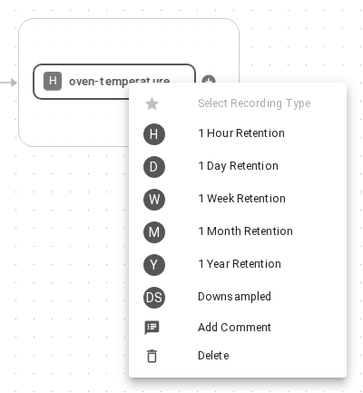

# Recorder

The recorder keeps the history of an output. It stores every value it sees as timeseries data in the [internal InfluxDB](../../reference/functions/storage/timeseries-database.md#quick-start-the-internal-instance), to chart in your Apps or to analyze later. It records while you test the App in the Builder and while the deployed App runs.

Add it with the **+** on an output and choose **Recorder**.

## Settings

* **Measurement name**: Fill the **Data Point Name** box with a unique name. You need this name to find and read the recorded data.
* **Recording type**: Right-click the recorder to select how long the data is stored: 1 hour (H, default), 1 day (D), 1 week (W), 1 month (M), 1 year (Y), or downsampled (DS) for long-term storage in [downsampled form](../../reference/functions/storage/timeseries-database.md#downsampling-pipeline).

A recorder has no value of its own: you cannot wire or link from it. It does hand the value on unchanged, so a [modifier](modifier.md) or a [filter](filter.md) may follow it.

<figure><figcaption></figcaption></figure>


If the [Industrial Blockchain](../../reference/functions/add-ons/industrial-blockchain.md) add-on is available in your account, an additional Blockchain (BC) recording type appears. It stores the data in the blockchain instead of InfluxDB.


## Reading recorded data

Click the letter icon inside the recorder to generate a matching readout executor directly on the Flowboard, preconfigured with your measurement name. Depending on the recording type, it calls the `read` or `readDownsampled` function of the internal InfluxDB (or the blockchain `read` function).
