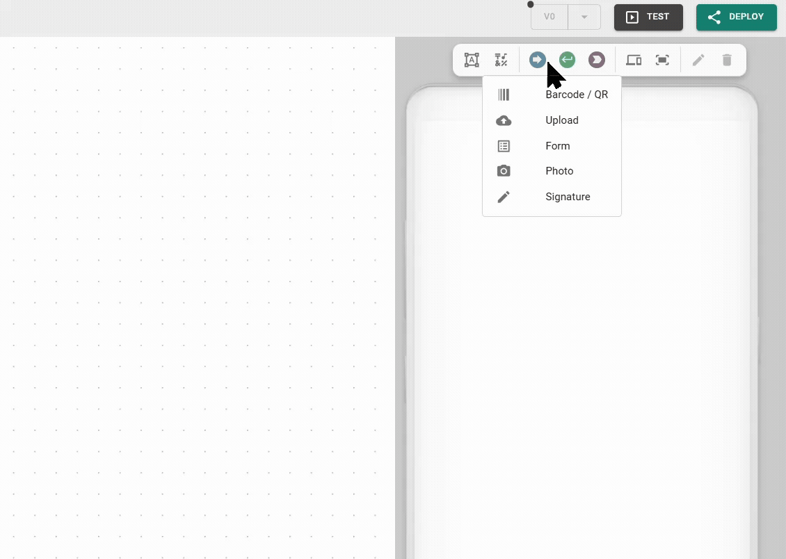

# Page editor

The Page editor is where you design the pages of your App: you place widgets on a screen, arrange them, and link them to your logic. It sits on the right of the App editor, next to the [Flowboard](flowboard/README.md).


#### Pages are optional

An App does not need any. A data bridge between a PLC and a SQL database runs with an empty Page editor: the Flowboard holds the logic, and it runs whether a page is open or not.


Read [Screens and layouts](../concepts/screens-and-layouts.md) and [Widgets and links](../concepts/widgets-and-links.md) first: they explain the model this page shows you how to drive.

## The toolbar

<figure><figcaption></figcaption></figure>

From left to right:

* **Text Box** and **Icon**: place static text or an icon. The icon button opens the icon library first.
* **Input Widgets**, **Trigger Widgets**, **Display Widgets**: the three widget menus. Every widget of the [reference](../reference/widgets/README.md) is in one of them. Pick one, then click the page to place it.
* The screen you are editing, as a split button: click the icon to walk to the next enabled screen, click the caret for **All screens & settings**. Next to it, **Fit to view** scales the canvas back into the panel.
* **Page height**: how tall this page is on this screen.
* **Configure Widget** (pen) and **Delete Widget** (trash): both work on the selected widget, and are grey while nothing is selected.

Zoom with Ctrl and the mouse wheel, pan by dragging with the right mouse button. **Fit to view** undoes both and keeps the canvas fitted while the panel is resized.

## Placing and moving

Place an element by picking it in the toolbar and clicking the page. Then:

* **Move and resize**: drag the element, or use the handles on its corners and edges. Snaplines appear by themselves; hold Shift while dragging to ignore them.
* **Nudge**: the arrow keys move the selection 10 pixels, Shift and an arrow key 1 pixel.
* **Copy**: Ctrl+C and Ctrl+V. **Delete** or Backspace removes the selection, Escape drops it.
* **Open the settings**: double-click the widget, or select it and click the pen.
* **Link**: drag an executor's output, input or trigger from the Flowboard onto the widget. While you drag, every widget that takes that kind of item is marked. Dropping a picture from the [Files explorer](explorers/files.md) on the page places an image widget; dropping a file on a widget that takes one, such as a media view, links the file to it.

Geometry belongs to the screen you are editing. Moving a widget on the desktop does not move it on the phone.

<figure><figcaption>Placing a widget</figcaption></figure>

## The context menu

Right-click a widget:

* **Copy**, **Paste**, **Delete**.
* **Order**: **Bring to front**, **Bring forward**, **Send backward**, **Send to back**. Stacking is kept dense by the platform; a card lands at the back by itself, so a widget on a card is where it belongs, not an overlap to fix.
* **Unlink all**: removes every link of this widget at once.
* **Toggle multitenancy**: switches the widget between writing into the user's own [scope](../concepts/scopes.md) and the shared one.
* **Widget info**: the widget's id and type, and every executor item it is linked to.
* **Full width**: stretches the widget across the screen you are editing.
* **Reset position to auto**: drops this screen's own layout for the widget, so it follows its reference screen again. It is offered only on a screen that has its own layout and is not the reference.
* **Rescan data**: on a widget that builds its columns or series from the data it receives, such as the data grid, the chart, the timeline and the kanban board, reads them from the linked output's shape again.

Select several widgets and the menu offers **Group**; on a group it offers **Ungroup**.

## Screens

The screen icon in the toolbar is the screen you are editing. Click it to walk to the next enabled screen. The caret opens the picker with all five.

<figure><figcaption></figcaption></figure>

In the picker, a dot on a screen says how the selected widget stands on it:

* **a copper dot**: this is the widget's reference screen, the one its other screens derive from;
* **a grey dot**: the widget has its own layout here;
* **no dot**: the layout here is derived.

A derived screen is not a scaled picture of the reference. Between two screens of similar shape the design is projected proportionally and centred. From a wide screen to the phone or the upright tablet it is laid out again in reading order: rows that still fit stay side by side, the others are stacked. Either way it is a draft until you arrange it yourself.

Right-click a screen icon for its settings:

<figure><figcaption></figcaption></figure>

* **Disable this view** and **Enable this view**: which screens the App serves. A disabled screen is never drawn for a user and cannot be designed. At least one screen has to stay on.
* **Left-align app on wide screens** and **Center app on wide screens**: on the laptop and the desktop, where the page sits in a window that is wider than the screen it was designed for.

The editor never stays on a disabled screen. Disable the one you are looking at and it moves to the enabled screen nearest in width.


The screen picker's tooltips still name the screens **Extra Small** to **Extra Large**, the old sizes. The widget settings already call them Phone, Tablet, Tablet R, Laptop and Desktop, which is what they are.


## Pin a setting to one screen

Position and size are always kept per screen. Every other setting is shared across screens until you pin it: hover a field in the widget's settings and click the pin (<i class="fa-thumbtack">:thumbtack:</i>) to give the screen you are editing its own value for that one field. A solid pin marks a field pinned on this screen; a faded pin marks one pinned on another screen, and its tooltip names them. Click a solid pin to share the field again.

Some settings are pinned by nature, because their right value depends on the screen and not on the data: column counts, font sizes, spacing, legend placement, chart orientation. These always belong to the screen you set them on, and the other screens keep the widget's default until you set them there. Their pin is shown but cannot be switched off.

Switches at the top of a widget's **General** tab carry what every widget shares:

* **Visible on `<screen>`**: pinned by nature. Switch it off to drop the widget from the screen you are editing; it stays on every other one. A hidden widget takes no space in the deployed App, and in the Builder it stays as a faded ghost you can still select and switch back on. Hiding a group hides its children with it; a child of a group follows its group.
* **Sticky**: the widget stays where this screen puts it while the page scrolls beneath it. A band of widgets grouped and made sticky is the App's header; a bar at the bottom edge is a footer. A child of a group follows its group here too, so the group is what sticks.
* **Animate**, on the widgets that show data: eases the display to a new value in one second. Switch it off for fast live data, so every update is drawn at once.

Each of them carries its own pin, except **Visible**, which is always this screen's.

Widgets inside a [group](../reference/widgets/layout/group.md) have no pins at all: the tile is one thing on every screen (a narrow screen shows it zoomed down), so every setting of a child is shared, the ones pinned by nature included. Grouping keeps what you see: the values pinned on the screen you group on become the children's shared values, and pins on other screens go. See [Groups and tiles](../concepts/groups-and-tiles.md).


#### How to work

1. **Start on the reference screen**: design on the screen the App is mainly used on. Every other screen follows it.
2. **Visit each enabled screen**: move and resize where the derived layout is not good enough. That screen keeps its own layout from then on.
3. **Pin what differs**: where the phone needs one column and a large font while the desktop needs three and a small one, the setting is pinned by nature, so set it on each screen. Pin any other field yourself when one screen needs its own value.


## The widget settings

Double-click a widget to open its settings on the right. The first tab is **General** and is the same for every widget; the others come from the widget itself and are named for what they hold, such as **Content** and **Look & feel**. The [widget reference](../reference/widgets/README.md) lists every tab of every widget.

The General tab lists the widget's properties under **Receives** (values it shows) and **Emits** (values and events it hands over). One row per property:

* **The dots on the left** say what the property is linked to: a hollow dot for nothing, one filled dot per link, in the colour of the item type. The executor's name is the hover text, and hovering highlights that exact item on the Flowboard.
* **Drop a Flowboard item on a row** to link it to that property: an output, a modifier or a filter on a *Receives* row, an input or a trigger on an *Emits* row. A page or an App action chip from the [Pages and actions explorer](explorers/pages.md) links the same way. Dropping on the widget itself instead takes the first property that fits, so the row is the precise way.
* **Expand a row** for the property's description and its value.

What a row shows when expanded depends on the link:

* **Live value**: a linked *Receives* property shows the value the widget holds right now, with the time of the last update. Updates can lag up to a second. Before anything arrives it says `no value received yet`.
* **Demo payload**: an unlinked *Receives* property offers an editor filled with the property's example, checked against its value schema while you type. **Inject** puts it into the widget so you can see the page with content while you build, **Reset** brings the example back, **Clear demo** removes it. A row with demo data carries a `demo` chip, and `demo data active - clear all` beside **Receives** clears every one at once. Demo data lives in your browser only: it never reaches a user and never leaves this tab's session.
* **Example payload**: an unlinked *Emits* property shows the shape it will hand over.

## How tall a page is

**Page height** opens a small panel for the screen you are editing:

* the page's height right now, in pixels and in screens, and where the content ends;
* **Screens**: the height you author, 1 or more. A page is as tall as its content and never shorter than this.
* **Fit to content**: sets the height to exactly what the page holds.
* the quick picks **1×**, **1.5×**, **2×**, **3×**.

Dashed lines on the canvas mark the folds, and the canvas' bottom edge can be dragged. The height is pinned by nature, so each screen carries its own: the phone scrolls while the desktop stays one screen.

Lowering the height below the content changes nothing, because the content decides. Move or delete what sits too low first.

## The navigation menu takes room

The [navigation menu](../concepts/pages-and-app-actions.md#the-navigation-menu) is drawn around your page, in the editor as in the App:

* a **left menu** takes its width from the page. Its rail and the page share the screen: a 240 pixel menu on the desktop leaves the page about 1680 pixels, and a widget placed past that edge is cut off. The menu is 300 pixels wide unless you say otherwise.
* **bottom tabs** lie over the bottom edge. The page keeps its full size, and at the end of a scroll its last widget stands above the bar, but whatever you place along the bottom edge of a page that does not scroll is covered by it.
* a **drawer** takes nothing. It adds a burger button of 48 pixels, fixed to the screen, in the top corner of the side it opens from. The page keeps its full width and height underneath, so leave that corner free. The burger can be moved to the bottom corner or offset inwards.

There is no built-in title bar. A band with a logo, a title and a logout button is widgets of your own, grouped and made sticky.

## Text, icons and images

* **Text box**: static text in Markdown, for titles, labels and instructions. Its **Content** tab is the editor, **Look & feel** sets how the text sits in its box. See [Text Box](../reference/widgets/display/text-box.md).

<figure><figcaption></figcaption></figure>

* **Icon**: a symbol from the Font Awesome library, picked when you place it. Drag a page from the Pages and actions explorer onto an icon and a click on it switches to that page. See [Icon](../reference/widgets/trigger/icon.md).

<figure><figcaption></figcaption></figure>

* **Image**: upload the file to the [Files explorer](explorers/files.md), then drag it from there onto the page. See [Image](../reference/widgets/trigger/image.md).

<figure><figcaption>Add an image to a page</figcaption></figure>


An uploaded file is not only for the page: your logic can read it too. See [Files, data and dates](../concepts/files-data-and-dates.md).

