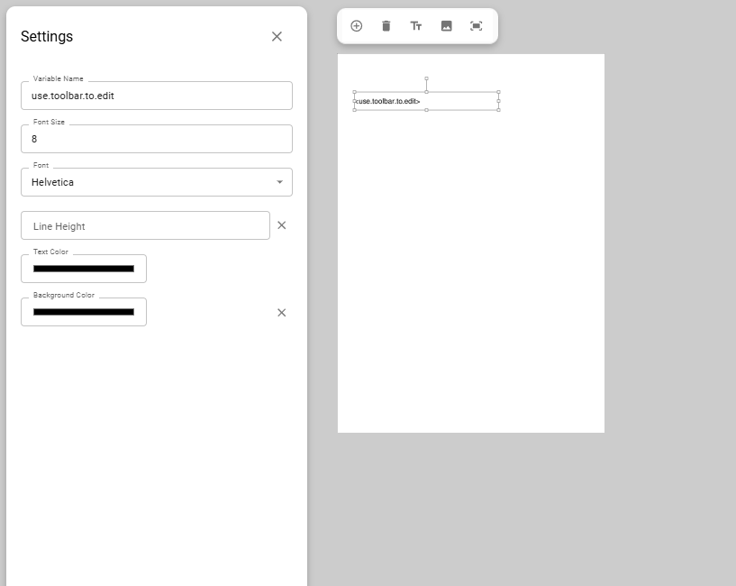

# Template editor

The Template editor is where you draw a PDF template: a page layout with named placeholders that your logic fills with values. A delivery note, an acceptance report, a label, a shift protocol. Open it with the template icon in the App Builder's top bar. 

Each template you draw becomes an instance of the `PdfTemplate` class, under **Utilities** > **PDF Templates** in the [Functions explorer](explorers/functions.md). From a flow you use one function on it, [`fillTemplate`](../reference/functions/utilities/pdf-templates.md).

## Make a template

The panel on the left lists the templates of the workspace. **Add new template** asks for:

* **Template Name**: the instance's name, and what you address from the Flowboard.
* **Template Type**: `PDF`.
* **Page Format**: `A4`, `A5` or `Letter`.

**Create template** makes it, and the editor opens on an empty page of that size.

<figure><figcaption></figcaption></figure>

## Pages and backgrounds

The toolbar above the canvas holds **Add page** and **Delete last page**. A template is as long as its pages, one below the other.

To build on an existing document, upload it to the [Files explorer](explorers/files.md) and drag it from there onto a page:

* **a PDF** becomes the page's background, in full page size. Select it to set **Selected Page**, which is the page of the source document to show, and **Opacity**. One multi-page PDF therefore serves every page of your template.
* **a PNG or JPEG** becomes a picture of its own at the point you drop it, which you then move and resize.

To replace a background, select it and press Delete, then drop the new file.


#### Deleting a page is for good

**Delete last page** takes the page, its background and every placeholder on it. There is no undo.


## Placeholders

A placeholder is a box that your logic fills at run time.

* **Add Text Variable** and **Add Image Variable** in the toolbar place one: pick the tool, then click the page.
* Select a placeholder and click its gear (**Settings**) to give it a **Variable Name**. For text there are also the font, its size, the line height, the text colour and a background colour.
* Resize the box to say how much room the value has.


#### The name is the contract

The variable name is the key your logic hands over: a placeholder named `invoiceNumber` takes the `invoiceNumber` of the object you pass to `fillTemplate`. Dots nest, so `customer.city` reaches into a nested object.


**Auto generate variables** appears in the toolbar when you select a PDF background that carries form fields. It places a text variable for every form field of that page, at its place and in its size, named after the field. A fillable PDF becomes a template in one click.

<figure><figcaption></figcaption></figure>

## Moving and arranging

* Drag an element to move it, use the handles to resize, the arrow keys to nudge it (40 pixels, or 4 with Shift).
* **Ctrl+C** and **Ctrl+V** copy an element, **Delete** removes it, **Escape** drops the selection.
* Right-click an element for its stacking: **Bring to front**, **Send to back**, **Move up**, **Move down**. A placeholder has to lie above the background to be seen.
* **Scaling** in the toolbar zooms the canvas, between 10 and 200 %. Its **auto-scale** fits the page into the panel, and the checkbox next to it keeps it fitted while you work.

## Filling it from a flow

Place an executor for the template's `fillTemplate` on the [Flowboard](flowboard/README.md): **Utilities** > **PDF Templates** > your template > `fillTemplate`. Wire one object into `values`, with a key per placeholder, and trigger it once when the document is due. The executor shows the rendered page on its output, so you see the result while you build.

From there the document travels on as a value: as the attachment of an [email](../reference/functions/connectors/email.md), into a [media view](../reference/widgets/display/media-view.md), or into the workspace's files so a user can download it.

See [PDF templates](../reference/functions/utilities/pdf-templates.md) for the function, and [Automating PDF reports](../labs/automating-pdf-reports.md) for the whole way.

## Deleting a template

The trash icon next to a template's name in the left panel removes it, after a question. The pencil renames it.


Removing a template removes its instance. Every executor on the Flowboard that calls it stops working, so check the Functions explorer for who uses it first.


<figure><figcaption></figcaption></figure>
