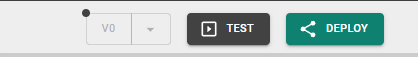
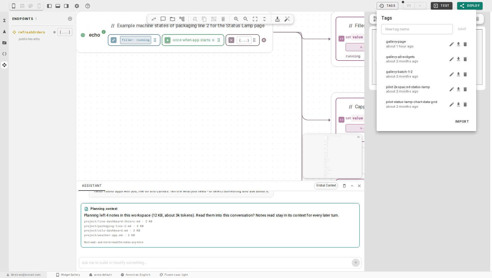

# Test and deploy

Building is half the work. The App Builder's top right corner holds the rest: run the App yourself, save versions to go back to, move an App between workspaces as a bundle, and release it to your users.

<figure><figcaption></figcaption></figure>

## Test

**Test** starts the App in the Builder, with its logic live: executors that run at App start run, polling starts, instances are created, widgets become clickable and every link carries values.

* The top bar changes colour while the test runs, and the four editors are locked. Stop the test to go on building.
* **Stop** ends the run. A test App keeps running and keeps polling until you stop it.
* Clicking an executor's trigger on the [Flowboard](flowboard/README.md) runs that executor by hand, during a test and outside it.
* Users see nothing of this. The test runs on the Builder's own backend, against the real agents, databases and machines.


A test is real. It writes into the same databases, sends the same emails and moves the same machines as the deployed App.


## Versions

A **version** is a saved state of your App, taken on the spot. There are two kinds, and they sit in one list:

* a **checkpoint**, saved while you build, by you or by the assistant, to go back to;
* a **release**, saved by every deploy and named `v1-release`, `v2-release` and so on.

The list opens with the **Tags** button in the top bar.

<figure><figcaption></figcaption></figure>

* **Save a version**: type a name and click **Save**. A name takes lower-case letters, digits and hyphens.
* Each entry shows its name and its age. The icons rename it, export it as a bundle, or delete it.
* **Go back**: click an entry and confirm **Switch**. The version is laid on top of the App as it is now; no history is rewritten, so every version in the list, the newer ones included, stays there to switch to.


Save a version before you switch to an older one. What you have built since the last version is kept in the App's history, but only a version you saved has a name and a row in the list.


### What a version holds

A version holds the App's records: its pages and widgets, its executors with their extensions, sections and annotations, the definitions of its variables and endpoints, and its theme.


#### What a version does not hold

The [data model](database-editor.md) and the rows of your tables, and the files in the [Files explorer](explorers/files.md). Those belong to the workspace, not to the App: going back to an earlier version never changes a table or brings back a deleted file.


### What a rollback changes, and what it does not

Switching to a version changes the App in the Builder. It does not change what your users run: they keep the released version until you deploy again.

## Bundles

A **bundle** is an App in a file, with the extension `.hwt`. It is how an App moves between workspaces, accounts and servers.

A bundle carries:

* the App's records, as a version holds them;
* every file in `uploads/` and `project/` that the App references, and the App's icons. Code that builds a file name at run time, such as `'/shared/uploads/icons/' + name`, takes the whole `icons` folder along, so keep such files in a folder of their own rather than directly under `uploads`;
* the shape of the tables the App's functions name, with the tables they relate to.

It does not carry rows, runtime files, backups or secrets.

### Export

The export icon on a version row writes the `.hwt` file to your computer and then reports what it packed: how many referenced files went along, which ones were referenced but not found, which secrets the other side will have to enter, and which tables travel.


The export packs your App **as it is now**, not the version whose row you clicked. Save a version and export it straight away if you want the two to match.


### Import

**Import** at the bottom of the list takes a `.hwt` file. The bundle becomes a new version named after the file; your App does not change until you click that version and confirm the switch.

The import report says what happened:

* **Files**: restored, already here, kept unchanged where this server's copy differs, or missing.
* **Tables**: what was added to the workspace's data model. Nothing is removed and nothing is changed: where the workspace holds a field with another type, it keeps its own and the report says so.
* **Secrets to enter**: secret variables and secret inputs arrive empty, named one by one.
* **Agents not present on this server**: the agents the App addresses that this platform does not know yet.

A bundle exported by a platform older than v93 is upgraded to the current record schema while it is imported. What such an App still does the old way is a separate question: ask the assistant to check it. See [Upgrading from v92](../self-hosting/upgrading-from-v92.md).


Save a version of your App before you switch to an imported one. It is your way back if the bundle is not what you expected.


## Deploy

**Deploy** makes the current build the one users get. It is the only action here that users notice.

Deploying does three things: it stops the App's own backend, saves a release version, and starts the backend again with the new build. A deployed App runs on a backend of its own, `app-backend-<appId>`, separate from the Builder's.

* Deploy is greyed out while a test runs. Stop the test first.
* An App that has open users loses its connection for the moment the backend takes. Their pages stay on screen with their last values, under a *Restoring the connection* badge, and come back by themselves. Then the Player notices the new version and reloads itself: nothing a user has typed and not sent survives that.
* **Nothing from the test run carries over.** The new backend starts empty: no instance exists, no value has been read. Every display needs a source of its own that runs on App start, on page load or at an interval. See [Triggers and wires](../concepts/triggers-and-wires.md#reading-data-when-the-app-opens).

After the deploy the **Distribute Your App** dialog shows the App's link and its QR code. The version button in the top bar, `v1`, `v2`, …, opens it again whenever you need it. Before the first deploy it reads `v0` and does nothing.

<figure><figcaption></figcaption></figure>

### The running App

The caret next to the version button tells you how the deployed App is doing, and lets you act:

* **RUNNING**, with **Stop App**: the App is up. Stopping it takes it off the air; its users see *Under maintenance*.
* **EXITED**, with **Start App**: it is stopped. **Start App** brings it back.
* **UNAVAILABLE**, **Requires Deployment**: nothing has been released yet.
* **RESTARTING**, **Problem Encountered**: the App's backend cannot stay up. Ask the [assistant](assistant.md) to read its log.

### Your plan decides

How many Apps may run at once, and whether they may run at all, is part of the account's plan. A deploy on an expired plan opens the plan dialog instead of releasing. On the free plan the App carries a watermark, and **Get license** in the top bar leads to the shop. See [Plan and billing](../app-manager/plan-and-billing.md).
