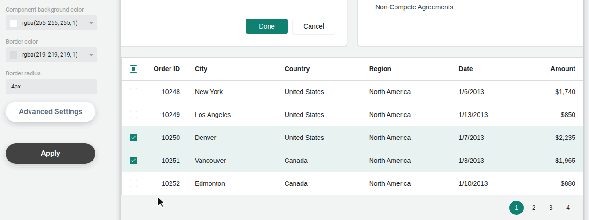

# Theme editor

The Theme editor sets the look of one App: its colors, its font, its corner radius, the shape of every widget on every page. Open it with the palette icon (<i class="fa-palette">:palette:</i>) in the App Builder's top bar; the phone icon at the start of that group, **App editor**, takes you back.

## One theme, not two layers

An App's look is one thing: a **base theme** plus the variables you changed on it. Whatever you tune by hand here and whatever the [assistant](assistant.md) sets are the same theme, compiled by the same compiler. Nothing of your design leaves the platform: the compiler runs on your own server.

The editor opens on the App's current theme, so you continue where you left off.

## Choose a base theme

The base theme decides the shape of everything: how a button is drawn, how dense a grid is, how a form looks.

* **Fluent**: the platform default, in the system font.
* **Material**: Roboto, served from the platform.
* **Generic**: the plainest of the three.

Each comes in color schemes, light and dark among them, shown as a colored circle. Pick one, then tune it. **Base size** switches the whole theme between **Normal** and **Compact**, which is the same theme with less air, for panels that have to carry a lot.


Choosing another base theme starts clean. What you had changed on the old one is gone, so change the base first and tune afterwards.



A dark base theme wants its backgrounds left alone. Change the accent and the font first, and override a background only when you really mean to.


## Change the variables

The left side holds the base variables, and these are the ones a corporate design is made of:

* **the accent**: the color of buttons, links and selection, and what a widget set to *Automatic* follows;
* **the page background** and **the component background**: the page background paints the page and the band around it, the component background paints every widget surface, such as grids, forms, cards and bars. White cards on a tinted ground is a page background alone; a component background repaints every widget. Material and Generic paint both with their one background.
* **the text color**, **the border color** and **the border radius**;
* **the font family**;
* **success**, **warning** and **danger**, and the hover, focus and selected states.

**Advanced Settings** opens the variables of each widget kind, searchable by name: the data grid, the scheduler, the buttons, the form editors. Touch these only for something the base variables cannot express, and only after the base is right.

The right half of the editor previews the widgets as you change them. **Apply** compiles the theme and hands it to the App; the button reads *Generating…* while it works, and the Builder swaps its stylesheet in place when it lands, with no reload. A page you had open keeps its state.

<figure><figcaption></figcaption></figure>


The theming engine is DevExtreme's. For what a single variable does, see the [DevExtreme theme documentation](https://js.devexpress.com/Documentation/Guide/Themes_and_Styles/Predefined_Themes/).


## A widget's own color

Most [widgets](../reference/widgets/README.md) have color settings of their own, and they start on **Automatic**: the widget takes its color from the theme and follows it when the theme changes.

The color picker offers, in this order:

* **Automatic / Reset**: back to the theme's color.
* **Transparent**: no fill at all.
* **Theme**: the ten colors of the App's current theme, named accent, text, background, surface, temperate, border, success, info, warning and error. *Background* is the component background, *surface* a card's default fill, and the theme's danger color is *error*. A widget set from this row keeps the color's name, so it follows the theme when the theme changes. Its field shows the name, *Accent* for example, with the theme's swatch, and the hover says *Follows the theme (currently #…)*.
* **Standard** and **Pick a custom color**: a fixed color that no theme change touches.

The names work wherever a widget takes a color, a chart's palette included, and as a value your logic sends: a status lamp that receives `error`, or a value box whose text color receives `warning`, paints the theme's color. A hex value does not follow the theme; a name does. Colors inside a custom HTML widget never follow it.

## The theme travels with the App

* It is part of every **version**: it goes along when you export a [bundle](test-and-deploy.md#bundles), when you import one, and when you roll back.
* Users get it with the **next deploy**, not before. A theme change in the Builder does not reach the running App.
* The App Builder's footer names the base theme the App's look is compiled from.

To go back to the platform default, which is Fluent with the Heisenware palette, ask the assistant to reset the theme. The editor has no reset of its own: choosing a base theme again starts from that theme's own colors, not from the platform's.
