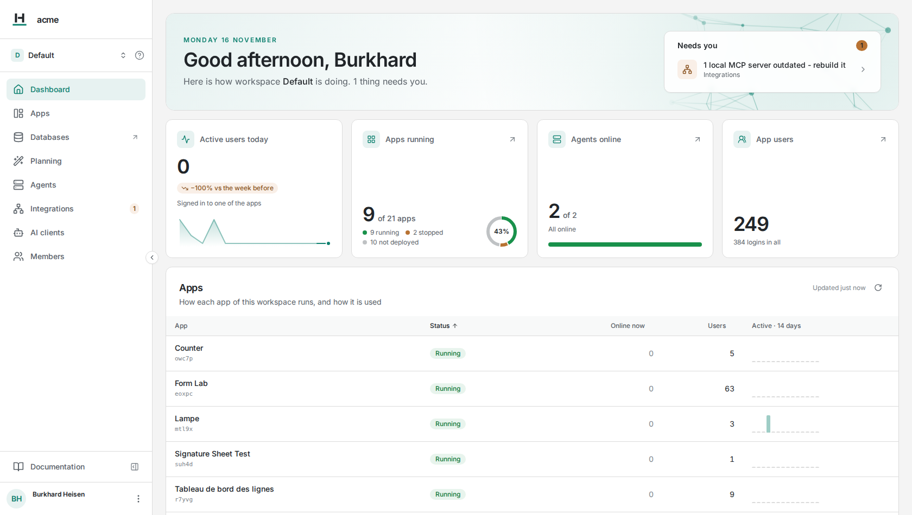

# App Manager tour

The App Manager is where you create Apps, watch them run, and look after the workspace and the account around them. It opens on the Dashboard.

<figure><figcaption></figcaption></figure>

## The menu

Every screen of the Manager hangs in the menu on the left. The arrow on its edge folds it to icons.

* [**Dashboard**](README.md#dashboard): what needs you in the workspace, and how its Apps run and are used.
* [**Apps**](apps.md): the workspace's Apps. Create one, set its name, language and [access](users-and-access.md), run or stop it, and open it in the App Builder.
* [**Databases**](../app-builder/database-editor.md): opens the workspace's Database editor in a tab of its own. It belongs to the workspace, not to an App.
* [**Planning**](planning.md): the assistant's planning seat, where you plan a whole set of Apps before building any of them. It is there only where the installation has the assistant.
* [**Agents**](agents/README.md): build, update, restart and roll out the [agents](../concepts/agents-and-where-code-runs.md) that run on your own hosts.
* [**Integrations**](integrations.md): logins for things outside that connect to the workspace: MQTT and VRPC clients, local MCP servers, Microsoft 365 Copilot agents.
* [**AI clients**](ai-clients.md): connect your own AI, such as Claude or ChatGPT, by the workspace's MCP address, and see or end every connection.
* [**Members**](members.md): the people who build in this account, and what each of them reaches.
* [**Plan & Billing**](plan-and-billing.md): the plan, the quotas, the credits the assistant spends and the workspaces. Owners of the account see this entry; nobody else does.

An entry carries a badge when its screen wants you: Apps that are not running, agents that are offline or behind their fleet's build, an outdated local MCP server. The Dashboard names the same items.

## Around the menu

* **Workspace switcher**: at the top, showing the [workspace](workspaces.md) you are in. It lists the workspaces you reach with their domains, switches between them, and lets an owner of the account add one.
* **Documentation**: at the foot, opens these pages beside the screen. The panel reads full width or as a column you can drag wider; the **?** beside a title opens the page about that title. Your choice of light or dark follows into the panel.
* **Account menu**: the three dots beside your name, with **Dark mode** and **Log out**.

## Dashboard

The Dashboard is where the App Manager opens. It shows what needs you in the workspace, and how its Apps run and are used:

* **Needs you** lists the Apps deployed to run that are not running, the agents that are offline or behind their fleet's build, and outdated local MCP servers, each linked to its page. The same items carry a badge in the menu. When nothing needs you, it says *All clear*.
* **Active users today** counts the users who signed in to one of the Apps, with the last 14 days and the change against the week before. **Apps running** counts the Apps running of all the workspace holds, and **Agents online** the agents connected. An owner of the account sees the **credits**, every other member the number of **App users**. Every figure but the active users opens its page.
* **Apps** lists every App of the workspace with its status, how many users are online now, how many it has, and a bar per day over the last 14 days. Click a column header to sort, and a row to open the App.
* A new workspace sees its **first steps**, ticked from what it already holds, until you put them away. An owner of the account also sees the plan and how many Apps it allows.

The Dashboard reads again when you come back to it, or when you click Refresh.
