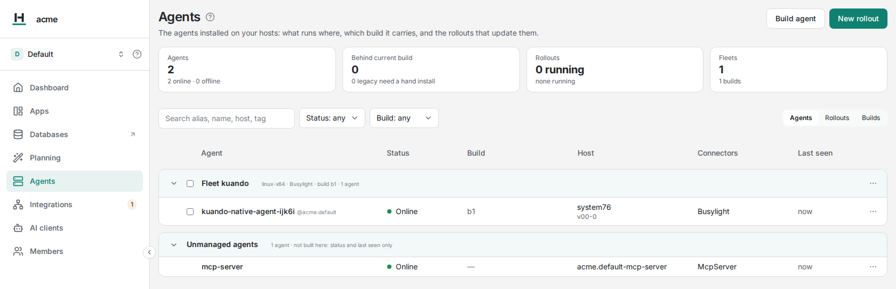

# Agents

The Agents panel shows every [agent](../../concepts/agents-and-where-code-runs.md) connected to your workspace: what runs on which host, which build it carries, and the rollouts that update it. Native agents are built here, updated from here and restarted from here. The App Manager owns the machine; the [App Builder](../../app-builder/explorers/functions.md) uses the agent's functions.

<figure><figcaption></figcaption></figure>

The panel has three tabs, **Agents**, **Rollouts** and **Builds**, and above them four tiles: how many agents there are and how many are online, how many are behind the current build, how many rollouts run, and how many fleets with how many builds.

## What you see

The **Agents** tab groups the rows into cards:

* **Fleets**: native agents built under one fleet name. The card's line says what the fleet runs, which build is current, how many agents it has, and how many of them are behind or legacy.
* **Single agents**: native agents built without a fleet name. Each has builds of its own.
* **Unmanaged agents**: everything else that connects as an agent, for example a [Docker agent](docker-agent.md), an [LXC agent](lxc-agent.md) or your own [VRPC](../../developers/vrpc/README.md) adapter. The panel shows their status and when they were last seen; their software is not built here, so nothing updates them.

Every row carries the agent's alias or name, whether it is online, its build, its host, the connectors it carries and when it was last seen. Click it for the details:

* **Build**: what it runs, what is current for its fleet, the target and the platform version, and the last update.
* **Host**: load, memory, free disk and CPUs, plus system, Node version, executable and work directory.
* **Readiness for updates**: the checks the agent made itself: update channel, disk, service, writable executable, clock, signing key, runtime.
* **Platform certificates**: what this agent verifies the platform by: the certificate baked into its build and every one it adopted since. An agent adopts a changed certificate by itself, once the platform has signed it.
* **Connectors**, a **timeline** of what happened to the agent (online, offline, restarts, updates) and **Show log…**, which fetches the last lines from its host.

Search by alias, name, host or tag, and filter by status and build state. **Set alias…** gives an agent a name people recognize, **Tags…** gives it words to filter by, such as a line or a hall.

### Build states

| State | Meaning |
| --- | --- |
| **current** | The agent runs the fleet's current build. |
| **behind** | A newer build is current. Update it, or roll the build out to the fleet. |
| **ahead** | The agent runs a build newer than the one marked current. |
| **legacy** | The agent was built before builds could be updated remotely. Install the current build on its host by hand once; every build after that arrives remotely. |
| **unmanaged** | Not built by this platform. Status and last seen only. |

## Building an agent

**Build agent** opens the form:

* **Connectors**: what this agent carries. Below the list the dialog says what each ticked connector can do on the host; those sentences also go into the requirements for IT.
* **Target OS**: Windows, macOS, Linux, Alpine or ARM 64.
* **Package**: only where the target offers a choice, which is Linux and ARM 64: a Debian package for a host with systemd, or a **ctrlX OS app** to install on a ctrlX CORE as a snap, see [Running on a ctrlX CORE](native-agent.md#running-on-a-ctrlx-core).
* **Note**: what this build is for. It shows with the build and in every rollout of it.
* **Fleet name**: lowercase letters and digits, for one build on several hosts. Empty means a single agent.

Compiling takes a minute or two and goes on when you close the dialog. The build appears under **Builds** as soon as it is ready, and its requirements sheet opens by itself.

Every build has a number within its fleet, `b1`, `b2`, and so on. The newest is the fleet's **current** build: the one an update or a rollout installs unless you pick another. Under **Builds** you can **Make current** an older build, open the **Installer** of any build, read its **Requirements for IT**, or **Delete** builds you no longer need. **Rebuild** compiles a fleet again with its connectors on the platform's current version, after a platform update for example.

The first build of a fleet is installed on every host by hand (see [native agent](native-agent.md)). Every build after that reaches the hosts remotely.

## Requirements for IT

Every build comes with a requirements sheet: the host name and the two ports the agent needs (outbound only, nothing inbound), the service it installs, its paths, the disk space an update needs, what the platform can do on the host through the agent, and what the connectors of this build can do there. Every value is specific to your platform and this build. Hand it to the people who run the hosts and the network before the first installation. The same text ships inside the installer archive as `REQUIREMENTS.md`.


#### One more port

Agents already need outbound TCP 8883 to the platform host for their data channel. Updates add outbound TCP 443 to the same host, used only while a build downloads. An HTTP proxy in the path stops both: the agent needs direct egress.


## Updating agents

Select the agents that are behind and click **Update to current**, or click **Update fleet to b7** on a fleet's card. Either way a **rollout** starts: the platform tells each agent which build to take, the agent downloads it from the platform, verifies it, installs it next to the running executable and restarts. An agent that is offline waits in the rollout until it connects.

An agent installed as a ctrlX OS app is the exception: its executable is read-only inside the app, so it takes no remote update and the rollout dialog leaves it out. The panel still shows which build it runs; the next build is installed on the device under **Apps**, as the first one was.

The rollout dialog asks four things: which agents, which build, how careful, and a review of the waves it will run. In the first step it shows each agent's readiness: whether it reaches the update channel, has enough disk, runs as a service and can write its executable. **Leave out agents that are not ready** is ticked, so an agent that is not ready stays out with its reason named.

### Rollout strategies

* **All at once**: every online agent updates now. Fine for a handful.
* **Canary first** (the default): a few agents update first; the rest follow once those have been healthy for a while.
* **In batches**: batches of a chosen size, the next after the previous is healthy.

**Pause on the first failure** is ticked: an agent that fails to update or rolls back stops the rollout until you resume or cancel it. Without it, the running wave finishes and the rollout pauses before the next one. Agents that stay offline longer than **Give up on offline agents after** (24 hours by default) are skipped. A rollout can **Start now** or at a chosen time.

### What happens on the host

1. The agent downloads the build over HTTPS with a link that expires after twelve hours.
2. It verifies the size, the checksum and the platform's signature. Anything else is discarded.
3. It swaps the executable; the previous one stays next to it.
4. It restarts through the service manager, about ten seconds without connection. Identity, cache and connector state stay in the work directory.
5. Once it has been online for a minute, the build is committed. If the new build does not connect within five minutes, or does not stay up, the host swaps the previous executable back by itself.

The **Rollouts** tab shows every rollout with its progress, each agent's phase (waiting, queued, updating, restarting, verifying, healthy, rolled back, failed) and what went wrong where. Pause, resume, cancel, or retry the failed agents from there.

## Restart and log

**Restart** stops the agent process; the service manager starts it again within seconds, and a counter or connector state survives it. **Show log** fetches the last lines of the agent's log from its host. Both also exist in the App Builder's Functions explorer, in the agent's context menu, for a member whose connector hangs.

## Removing an agent

An offline agent can be removed: its credentials, its records and its retained information on the platform go. A host that still runs it cannot connect any more. **Delete fleet** removes every build of a fleet and its credentials; agents that run its builds keep running until they are removed.
