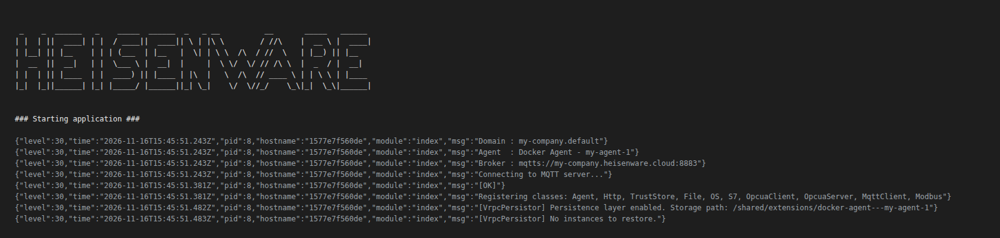

# Docker agent

The Docker agent carries the same connectors as the [native agent](native-agent.md), but runs as a container. It is the right choice for an edge gateway or a server whose software you already manage with Docker.

## How it differs from a native agent

* **A container, not a service**: Docker starts and restarts it, not systemd or the Windows service manager.
* **Credentials from outside**: the native agent carries its own credentials; the Docker agent gets them as environment variables at start.
* **Not built by the platform**: the image comes from Docker Hub, so the App Manager neither builds it nor updates it. In the [Agents panel](README.md) it shows under **Unmanaged agents**, with its status and when it was last seen. A newer version is a newer image tag, pulled and started by you.
* **Hardware and network access through Docker**: host networking for a local network, a device mapping for a USB device, a volume for data that must survive.

## Where to get it

```
heisenware/docker-agent:v93
heisenware/docker-agent:v93-slim
```

Both are built for `linux/amd64`, `linux/arm64` and `linux/arm/v7`. The tag is the platform version; use the one your platform runs.

* **`v93`** carries every connector a container can hold: HTTP, trust store, ctrlX Data Layer, file, OS, InfluxDB, S7, OPC UA client and server, relational database, GraphQL, MQTT client, Zebra, serial, busylight, Heidenhain, MIP, Modbus, label, Allen-Bradley and the GPIO classes.
* **`v93-slim`** is the small image for a gateway with little room: HTTP, trust store, file, OS, S7, OPC UA client and server, MQTT client and Modbus. It also caps its heap at 128 MB.

Every version is listed on [Docker Hub](https://hub.docker.com/r/heisenware/docker-agent).

## Credentials

The agent logs in with the credentials of a **VRPC client** [integration](../integrations.md#integration-types) of the workspace. Create one in the App Manager, copy its username and password, and hand them to the container.

## Starting the container

```bash
docker run -it \
-e HW_DOMAIN=<account>.<workspace> \
-e HW_BROKER=mqtts://<account>.heisenware.cloud:8883 \
-e HW_USERNAME=<name>@<account>.<workspace> \
-e HW_PASSWORD=<password> \
-e HW_AGENT_ID=<unique-id> \
heisenware/docker-agent:v93-slim
```

`HW_AGENT_ID` names this container. The agent appears on the bus, in the Agents panel and in the [Functions explorer](../../app-builder/explorers/functions.md) as `Docker Agent - <HW_AGENT_ID>`, so give every container an id of its own. Without one the agent picks a random id at every start and shows up as a new agent each time.

<details>

<summary>Example</summary>

For the account `my-company`, an integration named `agentRunner` in its `default` workspace and the password `secret`:

```bash
docker run -it \
-e HW_DOMAIN=my-company.default \
-e HW_BROKER=mqtts://my-company.heisenware.cloud:8883 \
-e HW_USERNAME=agentRunner@my-company.default \
-e HW_PASSWORD=secret \
-e HW_AGENT_ID=my-agent-1 \
heisenware/docker-agent:v93-slim
```

</details>

Once the connection stands, the container prints which classes it registered and that its persistence layer is up.

<figure><figcaption></figcaption></figure>

## Persisting data

Instances the agent holds, such as a database connection or a counter, are kept under `/shared`. Mount it so they survive a restart or a new image:

```bash
-v /path/on/host:/shared
```


#### Outbound 8883, nothing inbound

Like every agent, the container needs outbound TCP 8883 to the platform host and no inbound rule at all. If it starts but never appears in the Agents panel, a firewall on that port is the usual reason.

