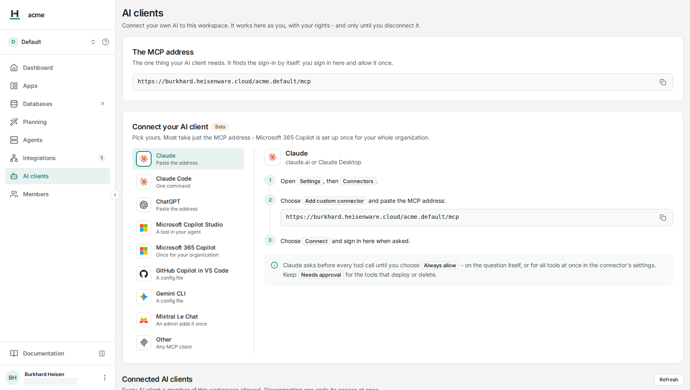

# AI clients

<figure><figcaption></figcaption></figure>

Connect your own AI to a workspace: Claude, ChatGPT, Microsoft Copilot, Gemini, Le Chat or any client that speaks the [Model Context Protocol](https://modelcontextprotocol.io). It gets the same tools the [assistant](../assistant/mcp-server.md) uses, creating Apps, wiring executors, placing widgets, verifying the result, and works in the workspace **as you, with your rights**, until you disconnect it. You spend your own AI subscription; nothing runs through Heisenware's models.

Nothing is installed: your AI client reaches the workspace at its **MCP address** and you sign in with your App Manager login. For an AI client on your own computer that should work with your local files, a [local MCP server](integrations.md#integration-types) is the alternative.


Connecting AI clients is in **beta**, and the **Connect your AI client** card says so.


The invited users of an App connect their AI client by the App's own address instead, with a reach of its own: see [Ask](ask.md).

## The MCP address

Open **AI clients** in the App Manager. The first card shows the workspace's MCP address:

```
https://<your platform host>/<account>.<workspace>/mcp
```

For example `https://acme.heisenware.cloud/acme.default/mcp`. Every AI client takes this one address; it finds the sign-in by itself.

## Connect your AI client

The card below lists the clients by their logo. Pick yours and it gives the numbered steps in that client's own words, with the address, or the line to paste, right in the step that takes it. In short:

| AI client | Where the address goes |
| --- | --- |
| **Claude** (claude.ai, Claude Desktop) | Settings, Connectors, **Add custom connector**, paste the address, **Connect**. |
| **Claude Code** | `claude mcp add --transport http heisenware <MCP address>` in a terminal, then `/mcp` and **Authenticate**. |
| **ChatGPT** (on the web) | Plugins, **+**, **Add custom MCP server**; the address as the server URL, authentication **OAuth**. In a ChatGPT workspace an admin or owner may have to add it. |
| **Microsoft Copilot Studio** | In your agent: Tools, Add a tool, New tool, **Model Context Protocol**; authentication **OAuth 2.0** with **Dynamic discovery**. Nothing to set up in Heisenware. To use the agent in Microsoft 365 Copilot, publish it from Copilot Studio (Channels, Teams and Microsoft 365 Copilot). |
| **Microsoft 365 Copilot** | Set up once for your whole organization, see [below](#microsoft-365-copilot). |
| **GitHub Copilot in VS Code** | `.vscode/mcp.json` in your project, or your user settings: `{ "servers": { "heisenware": { "type": "http", "url": "<MCP address>" } } }` |
| **Gemini CLI** | `~/.gemini/settings.json`: `{ "mcpServers": { "heisenware": { "httpUrl": "<MCP address>" } } }` |
| **Mistral Le Chat** | An administrator of your Le Chat organization opens Connectors and adds a custom connector (an MCP server): the address, authentication **OAuth 2.1**. Everyone then signs in with their own account. |
| **Other** | Any MCP client that connects by an address (streamable HTTP): paste the address and sign in when asked. |

A client that cannot sign in at all, a script or an automation tool, cannot connect yet.


#### The server is named after its workspace

Every line the page hands you registers the server under the name of the workspace: `heisenware` for the `default` workspace, `heisenware-<workspace>` for any other. Your client puts that name in front of every tool (`mcp__heisenware__describe_app`) and every prompt, so two workspaces can live in one client without colliding.



#### Your AI plan decides

The AI vendors offer custom MCP servers on some plans only, and they change this often. As of November 2026: Claude's free plan allows one custom connector; ChatGPT's free plans offer no custom MCP server, its Business, Enterprise and Edu plans do. Check your vendor's current terms.


## Sign in and allow

The first time your AI client needs the workspace, your browser opens Heisenware's own page: it names the AI client, the workspace, your login and where the browser returns afterwards. You choose what it may do:

* **Build apps**: everything you can do in this workspace: create and change Apps, run them, read their data.
* **Only look**: read Apps and their data. It changes nothing; the platform's broker refuses every call that would.

The choice is yours, not your role's: every member who reaches the workspace may pick either. **Allow** connects the client; **Cancel** sends it back empty-handed.

## Tool approval in your AI client

Your AI client may ask you before every tool call. That is the client's own safeguard, not Heisenware's, and the platform cannot switch it off:

* **Claude** asks until you choose **Always allow**, on the question itself or for every tool at once in the connector's settings (Always allow, Needs approval or Blocked, per tool or per group). Owners of Claude Team and Enterprise organizations can set defaults.
* **ChatGPT** asks before every change it makes in the workspace.

The tools tell your client which of them only read and which cannot be undone, so the clients group them accordingly. A sensible setting: allow everything without asking, except `deploy_app`, `end_registration` and `reshape_data_model`, and `delete_entity` on a whole App. Those also need an explicit `confirm: true` on Heisenware's side, which your AI client has to ask you for.

## Connected AI clients

The table at the bottom of the page lists the connections: the AI client and where it returns after a sign-in, its access (**Full access**, **Read-only access**, or _Ask in app_ for an [Ask](ask.md) connection of an App user), when it was connected and when it was last used. You see your own connections; owners of the workspace see every member's, with the login beside each.

**Disconnect** ends a connection at once: the next call of that client is refused, and it can connect again only after someone signs in and allows it anew. A connection nobody has used for 90 days is dropped the next time the member's access changes, and a member holds at most 20 at a time: the least recently used goes first.

## Files

The workspace has no access to the files on your computer, nor to your AI client's. Files travel through the workspace's shared files instead:

* `export_app` keeps the bundle in the workspace; `import_app` takes that bundle, or a `.hwt` file uploaded to the workspace.
* `fetch_shared_file` hands a file from the shared files to the client: a picture as a picture, a PDF as its text, or one page of it as a picture for a scan or a drawing, an Excel (XLSX) or Word (DOCX) file and a text file as their text. Other formats cannot travel to it.
* `open_file` does the same for a file a table row points to ([Files in a table](../reference/functions/storage/relational-database.md#files-in-a-table)).
* `upload_shared_file` brings a file into `uploads/` or `project/` of the shared files, in one of three ways:
  * from a public https address. Addresses in a private network are refused.
  * as the file's content in the call, up to 15 MB. Your client writes out every byte, so this suits small files only.
  * by an upload address: the client sends the file there itself, and the file never passes through the AI model. An address takes one file, once, within 15 minutes. This is the way for a client that runs commands on your computer, such as a coding assistant in your terminal.

A file none of these reaches, such as an attachment in a chat in your browser, you upload in the Builder's [Files explorer](../app-builder/explorers/files.md) and tell your AI client its name.

## The platform law

Building a good App follows rules no single tool can carry. A connected AI client gets them as the **platform law** through the tool `get_platform_law`, and the server tells every client to read it before its first build action. A client that skips it makes mistakes the law prevents: if yours does, ask it to read the platform law first.

## Reach from outside (on-premise)

AI clients run in their vendor's cloud. A Heisenware cloud account and a server installation answer on public hosts, so nothing more is needed. An **on-premise installation** inside your company network is out of their reach until you publish it:

1. Publish the platform through a door to the internet: Microsoft Entra Application Proxy, or your own reverse proxy. Publishing the path `/<account>.<workspace>/mcp` is enough; you may let through only your AI provider's servers.
2. Enter the public address the door gives you under **Reach from outside**, at the bottom of the AI clients page (owners of the account).

The page then shows the published MCP address beside the inside one, and hands the published one to every client that calls from a cloud. Signing in stays inside your network: the browser that opens the consent page is yours.

## Microsoft 365 Copilot

Microsoft 365 Copilot is the one AI client that does not connect by the address alone: it does not register itself, so an admin of your Microsoft 365 registers its sign-in once, by hand, for your whole organization. Any member who builds in the workspace sets it up in [Integrations](integrations.md#set-up-microsoft-365-copilot), together with that admin. Picking **Microsoft 365 Copilot** on the AI clients page shows where it stands:

* **Not set up yet**: the reason, the four steps, and **Set it up**.
* **Setup not finished**: the registration ID from Microsoft is still missing; **Continue the setup** opens it.
* **Ready**: your organization has the agent. Once your Microsoft 365 admin has deployed it to you, open it among your agents in Microsoft 365 Copilot and sign in here the first time it asks.
