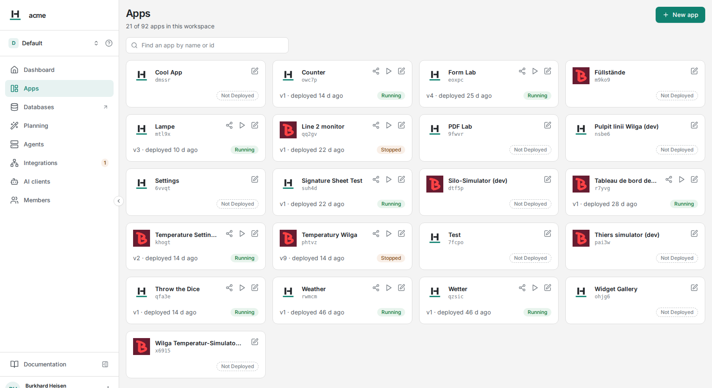

# Apps

The **Apps** screen holds the Apps of the workspace you are in. Each one is a card; opening a card opens the App's page, with its settings, its access and its users.

The heading counts what the workspace may hold, for example *3 of 5 apps in this workspace*. From seven Apps on, a search field finds one by name or id.

<figure><figcaption></figcaption></figure>

## Create an App

**New app** offers two ways:

* **Blank app**: an empty App, named `App 1`, `App 2` and so on. It opens at once.
* **From a file**: an App from a [bundle](#bundles) (`.hwt`), exported from another App, workspace or server.

An App is born in the workspace and registered for its users in the same step. It has an id of five characters that never changes, and a name you can change whenever you like.

A workspace with no Apps yet shows the same two ways side by side, and takes a `.hwt` file dropped straight onto the card.


How many Apps you may have is part of your [plan](plan-and-billing.md), counted over the whole account. When the workspace is full, **New app** is disabled and says so, and the assistant's `create_app` refuses, naming the plan and the limit. An App beyond the quota cannot be opened by anyone: the platform refuses to register it for access, and its page says so instead of loading. Delete an App or raise the plan under **Plan & Billing** (**Plan & License** on your own server), and the waiting App is registered within a minute.


## What a card tells you

* The App's **icon**, its **name** and its **id**.
* The **version** it runs and when that was deployed, once it has been deployed at all.
* Its [**state**](#what-an-app-can-be), as a badge. Hover it to read why.
* In the corner: **Share the app** (the link with its QR code, to copy or hand on), **Open the app**, and **Edit in App Builder**. Each opens in a new tab. The first two appear once the App has been deployed.

## What an App can be

An App is said to be one of six things, in the same word and the same colour everywhere: on the card, on the App's page, on the Dashboard and in the menu's badge.

| State | What it means |
| --- | --- |
| **Running** | The App is live and reachable at its URL. |
| **Not running** | It is meant to run and its backend does not. This wants you; the badge names what the backend is doing. |
| **Restarting** | It is meant to run and its backend is restarting. |
| **Stopped** | A member stopped it on purpose. |
| **Unknown** | Its backend could not be asked. It may well be running. |
| **Not deployed** | It has never been deployed, so there is no backend to speak of. |

## When the Apps cannot be listed

The Apps come from the workspace's engine, the backend that holds them. When the engine is not reachable, the screen says *The workspace's engine is not reachable* in place of the cards, with **Try again**, and goes on by itself once the engine is back. The **Apps** entry in the menu and **Needs you** on the Dashboard name it too.

When the engine is reachable but does not answer, the screen says *The apps of this workspace could not be loaded*, and **Try again** asks it afresh. A screen that already shows its Apps keeps them.

## The App's page

### Development

The version the App runs, when it was created, its state, and a switch that runs or stops it. Stopping takes the App offline for its users; starting brings it back. A switch is only there once the App has been deployed. When the platform refuses a start or a stop, a message names the App and says why, for example that the plan has expired or that the Free plan runs one App, and stays until you close it; the switch stays as it was. **Start App Builder** opens the App in the [App Builder](../app-builder/README.md).

### Distribution

The link users open, and the same link as a QR code to scan with a phone. The link always serves the latest deployed version, so a user who installed the App gets updates without doing anything.

### General Settings

* **App Name**: the title on home screens, in browser tabs and in the Player. At most 20 characters, and no two Apps of a workspace share a name. Keep it short: a long name is cut off under a home-screen icon.
* **Language**: the one language the App speaks, including the texts of its widgets, the Player's own screens (sign-in, connection notices, the install prompt) and the documents it makes. The browser's language plays no role once the App is known. This is the only place it is set; the App Builder and the assistant read it.
* **Description**: one line, at most 120 characters. It travels in the App's web manifest, so it is what a user reads when they install the App.
* **Icon**: the favicon and home-screen icon. A square image works best, with padding around the logo, since phones often cut it to a circle.
* **Delete app**: removes the App and everything in it. When the platform cannot remove the App's deployed backend, nothing is deleted: a message says *The app could not be deleted* and why, and you can try again.


#### Deleting an App cannot be undone

The App, its pages and flows, its data and its deployed backend go, and so do the App users who hold no other App. Export it as a [bundle](#bundles) first if you want to keep the work.


### Access Settings

Who may open the App, the master password where one is needed, and the **Ask** switch. See [App users and access](users-and-access.md) and [Ask](ask.md).

An App built outside the App Manager, by the assistant or a local MCP server, may not be registered for access yet. The card then says so and offers **Register app**; until you press it, nobody can open the App.

### App users

Everyone who uses the App, and the invite field for an invite-only App. See [App users and access](users-and-access.md).

## Bundles

A bundle is an App in a file: a `.hwt` carrying its records, the files they use and the shape of the tables its executors name, but no rows and no secrets. You export one from the App Builder's version menu.

**New app** → **From a file** reads the bundle, shows what it holds and the name it suggests, and creates the App. When it is done it names what you still have to do before the App runs:

* **Secrets**: credentials the export left out, to enter again as secret variables.
* **Agents**: agents this platform does not have, which the App's executors address.
* **Tables**: tables the import added or found different.

To offer one App in several languages, make one App per language: export the reference App as a bundle, import it as a new App with its own URL, set that App's language, and translate its texts. The assistant does the translating for you. Then link the Apps to each other.

## Switching between Apps

**All apps** goes back to the overview. The App's name at the top is also a switcher: it lists the workspace's Apps, takes typing to narrow them, and the arrow keys and Enter to pick one.
