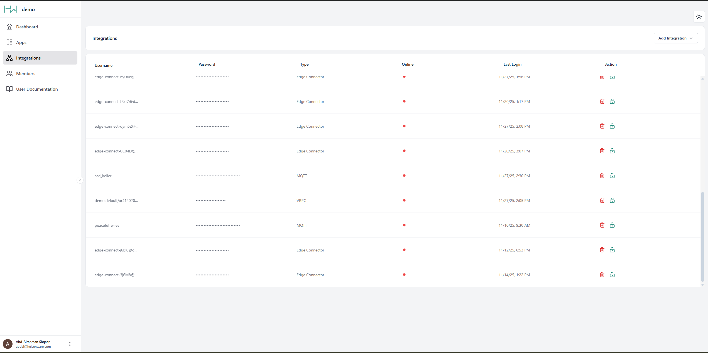

# Integrations

The Integrations panel gives you a central overview of every inbound data connection from external systems: an IoT sensor, a custom Python script, an MCP client, or an agent in Microsoft 365 Copilot. Native agents have their own panel, [Agents](agents/README.md), where they are built, updated and restarted.

<figure><figcaption>
Integrations panel
</figcaption></figure>

## Integration types

**Add Integration** offers the kinds in two groups: *for your programs* (MQTT client, VRPC client) and *for your AI* (local MCP server, Microsoft 365 Copilot). Agents connect on their own.

### Native or Docker agent

[Agents](../concepts/agents-and-where-code-runs.md) securely bridge data from private networks (on-premises servers, local databases) to the cloud.

* **Setup**: You create and deploy native agents directly in the App Builder. You download and deploy Docker agents via Docker.
* **Management**: Once deployed, an agent entry appears in the Integrations panel for monitoring. No manual credentials required.

### MQTT client

The standard choice for general IoT use cases. Use this for sensors or devices that push data to Heisenware's MQTT broker. Inside your Apps, the [MQTT client connector](../reference/functions/connectors/mqtt-client.md) handles these messages. For a full walkthrough, see [Connect an external MQTT client](../labs/connect-an-external-mqtt-client.md).

### [VRPC](../developers/vrpc/README.md) client

An advanced method for connecting custom code and proprietary libraries, the most powerful option for specialized software integrations.

### Native agent

Native agents are built, listed and updated in the [Agents panel](agents/README.md). Their credentials are created there too; this panel does not show them.

### Local MCP server

Lets your own AI client on your computer (Claude Code, Claude Desktop, any MCP client) drive the platform, with your local files; see [MCP server](../assistant/mcp-server.md). An AI client that needs no files of yours connects without any package, by the workspace's MCP address: see [AI clients](ai-clients.md). The panel builds a package with the integration's credentials inside and hands you the lines to paste. Each member makes their own, named after them — the field offers your first name — so one can be removed without touching the others. Tick _read-only_ for a production-support server that cannot change anything.

### Microsoft 365 Copilot

Heisenware as an agent in your organization's Microsoft 365 Copilot: each user works with the workspace as themselves, with their own rights. Other AI clients connect by the MCP address alone ([AI clients](ai-clients.md)); Microsoft 365 Copilot does not register itself, so an admin of your Microsoft 365 registers its sign-in once, by hand - see [Set up Microsoft 365 Copilot](#set-up-microsoft-365-copilot) below.

## The integration and its executable

A local MCP server is an integration with a package attached. The **Executable** column shows the file the platform built; click it to see its size and build time, download it, or copy a link with a twelve-hour access ticket, together with the lines to paste into the client.

The **Executables** list below the integrations shows every package the platform serves from its `mcp` zone, whether or not an integration claims it. Each can be shown, downloaded and deleted from there; deleting a file does not touch the clients that already installed it, and it can be built again. The view also offers **Rebuild**: after a platform update the package is built again with the current platform version, with the same credentials, so the client only needs a fresh link. Changing the password or the name rebuilds the package, deleting the integration deletes it, and deactivating the integration stops the package at its next login. Every integration holds one authority, shown in the **Access** column: full access to its workspace, or read-only access for a read-only local MCP server.

## Usernames

An integration's username ends in its workspace: `<name>@<account>.<workspace>`, e.g. `burkhard@my-company.default`. The **Username** column lets you edit the name and shows the workspace beside it; the copy button next to it copies the whole username, which is what a client logs in with. Only the owners and managers of a workspace see and change its integrations.

## Set up Microsoft 365 Copilot

A member of the workspace sets the agent up, best together with an admin of your Microsoft 365; it takes a few minutes. On an on-premise installation, publish the platform first ([Reach from outside](ai-clients.md#reach-from-outside-on-premise)): Microsoft 365 Copilot calls from Microsoft's cloud.

Choose **Add Integration**, **Microsoft 365 Copilot**, name the agent as your users will see it in Microsoft 365 Copilot, and **Create**. The setup that opens has four steps; the AI clients page shows every member which of them are done.



#### Register the agent's sign-in

In Microsoft's [Teams Developer Portal](https://dev.teams.microsoft.com/tools/oauth-configuration), Tools, **OAuth client registration**, register a client. The setup shows every value under the portal's own field names, each with a copy button:

| Portal field | Value |
| --- | --- |
| Registration name | the agent's name and the workspace |
| Base URL | the workspace's MCP address |
| Restrict usage by org | My organization only |
| Restrict usage by app | **Any Teams app** - with an existing Teams app ID, Copilot answers every tool call with an error |
| Client ID, Client secret | issued by the workspace (the secret is hidden until you choose Show) |
| Authorization endpoint, Token endpoint, Refresh endpoint | the workspace's MCP server |
| Scope | `build` |
| Enable Proof Key for Code Exchange (PKCE) | on - leave it as it is |

Save. The portal then shows an **OAuth client registration ID**.



#### Enter the registration ID

Paste that ID into the setup and save it.



#### Deploy the agent

**Download the agent package** - a zip file Heisenware builds for this agent. In the [Microsoft 365 admin center](https://admin.microsoft.com), open Agents, All agents, **Upload custom agent**, choose the file, check the name and the icon, finish the deployment and choose the users or groups who build with Heisenware.



#### Sign in once

Everyone chosen finds the agent among their agents in Microsoft 365 Copilot. The first time it needs Heisenware, each of them signs in on Heisenware's page and decides what it may do. Their connections show on the [AI clients](ai-clients.md#connected-ai-clients) page, where each can be ended.



The integration's row shows **Ready to deploy** once the registration ID is saved, **Registration ID missing** before; **Open** or **Continue the setup** reopens it. **Remove** stops the agent at once for everyone who uses it and ends their connections; in Microsoft 365, remove its registration in the Teams Developer Portal and the agent in the admin center too.

## Connecting MQTT and VRPC clients

Agents connect automatically, but MQTT and VRPC clients need authorization one of two ways:

### Method 1: Manual credential creation

Use this method to pre-configure your external client with a fixed username and password.



#### Create

Click Create in the Integrations panel.



#### Select type

Select if you need an MQTT or VRPC client.



#### Edit/copy credentials

Copy the generated credentials or edit them to your needs.



#### Connect

Paste these credentials into your external client's configuration.



### Method 2: Smart onboarding

The preferred, passwordless method. The external client sends a request, and you approve it in the App Builder. For a detailed guide, see the [smart onboarding section](../app-builder/explorers/functions.md).

## Integrate custom code via VRPC

To integrate your code, write a [code adapter](../self-hosting/README.md#code-adapters-add-ons) around your existing functions, then load it as a custom add-on.

* **Supported languages**: Arduino (ESP32), C++, Node.js, and Python.
* **Use cases**: Integrating legacy systems, running complex algorithms, or using specialized software libraries.


#### Technical implementation

For details, examples, and adapter setup, visit our [VRPC developer section](../developers/vrpc/README.md).

