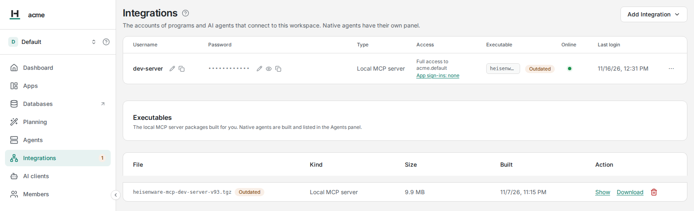

# Integrations

An integration is a login for something outside that connects to a workspace: a device or a program of yours, or an AI. The Integrations panel holds those accounts, their authority and the packages the platform built for them. [Agents](agents/README.md) have a panel of their own, where they are built, updated and restarted; they never show here.

<figure><figcaption></figcaption></figure>

## Integration types

**Add Integration** offers four kinds, in two groups.

*For your programs:*

* **MQTT client**: the usual choice for a sensor or a device that pushes data to the workspace's MQTT broker. Inside your Apps the [MQTT client connector](../reference/functions/connectors/mqtt-client.md) handles those messages. For a walkthrough see [Connect an external MQTT client](../labs/connect-an-external-mqtt-client.md).
* **VRPC client**: for your own code and for software the platform does not ship: a program that offers its functions to the workspace over [VRPC](../developers/vrpc/README.md). A [Docker agent](agents/docker-agent.md) and an [LXC agent](agents/lxc-agent.md) log in with these credentials too.

*For your AI:*

* **Local MCP server**: lets your own AI client on your computer (Claude Code, Claude Desktop, any MCP client) drive the platform, with your local files; see [MCP server](../assistant/mcp-server.md). The panel builds a package with the integration's credentials inside and hands you the lines to paste. Each member makes their own, named after them: the field offers your first name, so one can be removed without touching the others. Tick _read-only_ for a production-support server that cannot change anything. An AI client that needs no files of yours connects without any package, by the workspace's MCP address: see [AI clients](ai-clients.md).
* **Microsoft 365 Copilot**: Heisenware as an agent in your organization's Microsoft 365 Copilot, where each user works with the workspace as themselves, with their own rights. Other AI clients connect by the MCP address alone; Microsoft 365 Copilot does not register itself, so an admin of your Microsoft 365 registers its sign-in once, by hand, see [Set up Microsoft 365 Copilot](#set-up-microsoft-365-copilot).

## The table

One row per integration: its **Username** and **Password**, its **Type**, its **Access**, the **Executable** the platform built for it, whether it is online, and when it logged in last. Every member who builds in the workspace, owner or editor, sees and changes its integrations.

* **Access** says what the integration may do: full access to its workspace, or read-only access for a read-only local MCP server.
* **Executable** shows the file the platform built. Click it for its size and build time, to download it, or to copy a link with a twelve-hour access ticket, together with the lines to paste into the client.

Below the table, **Executables** lists every package the platform serves, whether or not an integration claims it. Each can be shown, downloaded and deleted from there; deleting a file does not touch the clients that already installed it, and it can be built again. A package built by an older platform version is marked _outdated_: **Rebuild** builds it again with the current version and the same credentials, so the client only needs a fresh link. Changing the password or the name rebuilds the package, deleting the integration deletes it, and deactivating the integration stops the package at its next login.

## Usernames

An integration's username ends in its workspace: `<name>@<account>.<workspace>`, for example `burkhard@acme.default`. The **Username** column lets you edit the name and shows the workspace beside it; the copy button next to it copies the whole username, which is what a client logs in with.

## App sign-ins

An App that asks its users to sign in does not open for a local MCP server by itself. **App sign-ins** on the integration's row names the App users it may open such Apps as: the dialog takes an App and one of its users, and from then on what the local MCP server renders, clicks and reads in that App is that user's. No password is involved and none is kept; removing a sign-in closes the App to it at once. A read-only integration has no App sign-ins.

## Connecting MQTT and VRPC clients

An MQTT or VRPC client needs credentials, in one of two ways.

### Fixed credentials

For a client you configure yourself with a username and a password.



#### Add the integration

**Add Integration**, then **MQTT client** or **VRPC client**.



#### Take the credentials

Copy the username and the password from the row, or edit the name and set a password of your own.



#### Connect

Put them into the client's configuration. The row's dot turns green when it logs in.



### Agent onboarding

The passwordless way: the client connects with a username and a password of its own choosing, and you let it in. In the App Builder's [Functions explorer](../app-builder/explorers/functions.md), switch **Start onboarding new agents** on. Every client that tries to log in while it is on appears in the **Agent Onboarding** card with its name; confirm it and the workspace creates the account from the credentials the client used. Switch onboarding off again when you are done.

## Your own code

To bring your own functions into the platform, wrap them in an [add-on](../developers/custom-add-ons.md): a small program that offers them over VRPC, in Arduino (ESP32), C++, Node.js or Python. It runs inside the platform as its own container, or outside it on a machine of yours with a VRPC client integration's credentials. Use it for legacy systems, for algorithms of your own and for specialized libraries.


#### How it is written

Examples and the adapter's setup are in the [VRPC developer section](../developers/vrpc/README.md).


## Set up Microsoft 365 Copilot

A member of the workspace sets the agent up, best together with an admin of your Microsoft 365; it takes a few minutes. On an on-premise installation, publish the platform first ([Reach from outside](ai-clients.md#reach-from-outside-on-premise)): Microsoft 365 Copilot calls from Microsoft's cloud.

Choose **Add Integration**, **Microsoft 365 Copilot**, name the agent as your users will see it in Microsoft 365 Copilot, and **Create**. The setup that opens has four steps; the AI clients page shows every member which of them are done.



#### Register the agent's sign-in

In Microsoft's [Teams Developer Portal](https://dev.teams.microsoft.com/tools/oauth-configuration), Tools, **OAuth client registration**, register a client. The setup shows every value under the portal's own field names, each with a copy button:

| Portal field | Value |
| --- | --- |
| Registration name | the agent's name and the workspace |
| Base URL | the workspace's MCP address |
| Restrict usage by org | My organization only |
| Restrict usage by app | **Any Teams app**. With an existing Teams app ID, Copilot answers every tool call with an error |
| Client ID, Client secret | issued by the workspace (the secret is hidden until you choose Show) |
| Authorization endpoint, Token endpoint, Refresh endpoint | the workspace's MCP server |
| Scope | `build` |
| Enable Proof Key for Code Exchange (PKCE) | on, leave it as it is |

Save. The portal then shows an **OAuth client registration ID**.



#### Enter the registration ID

Paste that ID into the setup and save it.



#### Deploy the agent

**Download the agent package**, a zip file Heisenware builds for this agent. In the [Microsoft 365 admin center](https://admin.microsoft.com), open Agents, All agents, **Upload custom agent**, choose the file, check the name and the icon, finish the deployment and choose the users or groups who build with Heisenware.



#### Sign in once

Everyone chosen finds the agent among their agents in Microsoft 365 Copilot. The first time it needs Heisenware, each of them signs in on Heisenware's page and decides what it may do. Their connections show on the [AI clients](ai-clients.md#connected-ai-clients) page, where each can be ended.



The integration's row shows **Ready to deploy** once the registration ID is saved, **Registration ID missing** before; **Open** or **Continue the setup** reopens it. **Remove** stops the agent at once for everyone who uses it and ends their connections; in Microsoft 365, remove its registration in the Teams Developer Portal and the agent in the admin center too.
