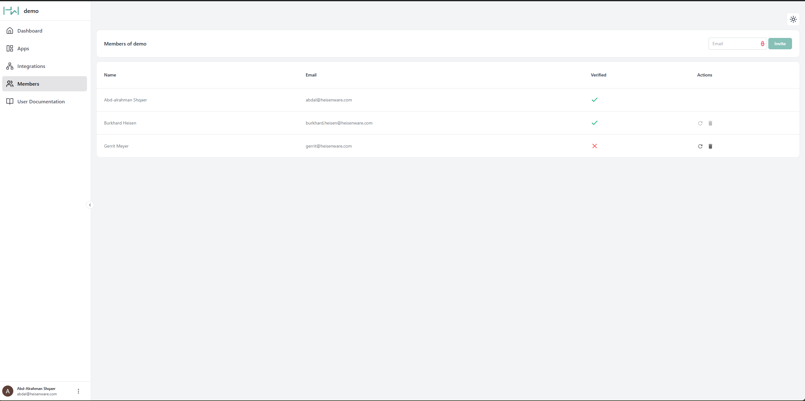

# Members

Members are the people who build and manage Apps in a Heisenware account. Open the Members panel to manage your team. It shows the owners of the account, and then each [workspace](workspaces.md) you reach with the people who hold it.


#### Members vs. users

Members build the Apps. Users are the people who use your Apps in the App Player. To manage permissions for your users, see [Users and access](users-and-access.md).


## Access

Every member holds access to one or more workspaces, or owns the account:

| Access | What it gives |
| ---------------------- | ------------------------------------------------------------------------------------------------ |
| **Owner of the account** | Every workspace, the plan and billing, all members, and adding and deleting workspaces. |
| **Owner of a workspace** | Builds in that workspace and chooses who else does. |
| **Editor** | Builds in that workspace, its integrations included. |

**Plan & Billing** is shown to owners of the account only. Everyone sees the owners of the account, since those reach their workspace too.

## Manage members

In the Members panel you can:

* **Invite**: Enter an email address in the top-right box, choose what the invitation grants and click **Invite**. Owners of the account can grant any workspace and the account itself, owners of a workspace their own workspaces. Someone who is a member already gets the access at once, without an email.
* **Change access**: Choose **Owner** or **Editor** on a member's row in a workspace.
* **Verify**: If a member didn't receive their invite email, click the resend icon (<i class="fa-arrow-rotate-right">:arrow-rotate-right:</i>).
* **Remove**: Click the trash icon (<i class="fa-trash">:trash:</i>) to take a member out of a workspace. Owners of a workspace do this in their own workspaces, owners of the account in any, and owners of the account can also remove an owner of the account. Someone who holds nothing else leaves the account; if they are still a user of an App, they stay that, without the App Manager.

Every change works at once: a member who loses access to a workspace loses their connection to it, however long their sign-in lasts.

An account keeps at least one owner. To change what an owner of the account holds, remove them and invite them again.

<figure><figcaption></figcaption></figure>
