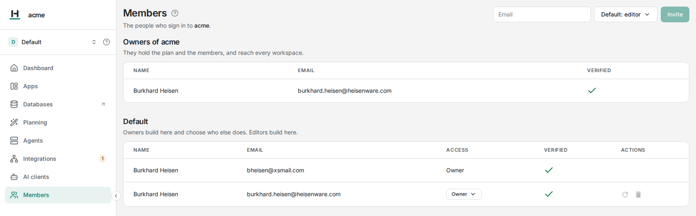

# Members

Members are the people who build and manage Apps in a Heisenware account. The **Members** screen lists them in groups: first the owners of the account, then each [workspace](workspaces.md) you reach with the people who hold it.


#### Members vs. users

Members build the Apps. Users are the people who use them in the App Player. See [App users and access](users-and-access.md) for those.


## What a member holds

Every member owns the account, or holds one or more workspaces:

| Access | What it gives |
| ---------------------- | ------------------------------------------------------------------------------------------------ |
| **Owner of the account** | Every workspace, the plan and billing, all members, and adding and deleting workspaces. |
| **Owner of a workspace** | Builds in that workspace and chooses who else does. |
| **Editor** | Builds in that workspace, its integrations included. |

**Plan & Billing** is shown to owners of the account only. Everyone sees the owners of the account, since those reach their workspace too. A workspace nobody has been invited to yet says so: only the account's owners reach it.

Each row shows the member's name, their email, their **Access** in that workspace, and whether their address is **Verified**.

## Invite someone

Enter an email address in the box at the top right, choose what the invitation grants, and click **Invite**. An owner of the account can grant any of its workspaces or the account itself; an owner of a workspace only their own workspaces.

What the invited address already has decides what happens:

* **New to the platform**: an invitation email with a link that sets a password. Taking it up asks for a first and last name and a password, or for a Google account under the invited address.
* **A user of one of your Apps, but no member**: the same invitation email. Being a user of an App gives nobody the App Manager.
* **A member already**: the access is added to what they hold, at once and without an email. This is how someone reaches a second workspace: it is there at their next look.
* **A member who never took up their invitation**: a fresh invitation email. The row shows the resend icon until they do.

## Change what someone holds

* **Access**: choose **Owner** or **Editor** on a member's row in a workspace.
* **Send invitation again**: the circular arrow on the row, for a member who never took up their invitation. Any link sent before stops working.
* **Remove from a workspace**: the trash icon on a member's row in a workspace. They lose that workspace at once, with the connections they have open, and keep whatever else they hold. A member left holding nothing is no member any more; if they are still a user of an App, they stay that, without the App Manager.
* **Delete member**: the trash icon on a member's row under the owners of the account. This removes them from the platform and from every App where their address was the username. It cannot be undone; you can always invite them again.

Every change bites at once, however long the member's sign-in would otherwise last.

An account keeps at least one owner. There is no way to take account ownership away again in the Manager: delete the member and invite them back with the access they should have.

<figure><figcaption></figcaption></figure>
