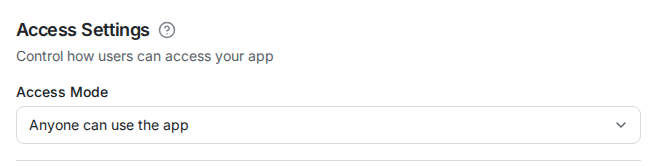
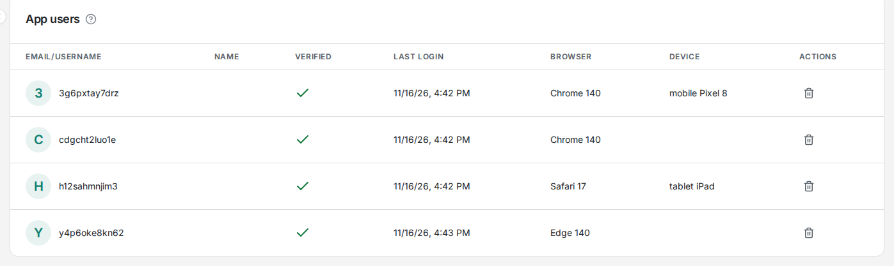

# App users and access

Every App decides for itself who may open it, even when several Apps sit in the same workspace. You set that on the App's page in the App Manager, under **Access Settings**, and you see everyone who uses the App under **App users**.


#### Users vs. members

This page is about the users of your Apps. The people who build the Apps are members: see [Members](members.md).


## Access modes

**Access Mode** offers five choices. A change applies at once, to everyone who has the App open, so do not change it more often than your users can follow.

<figure><figcaption></figcaption></figure>

### Anyone can use the app

The App is open. Whoever has the link or scans the QR code is in, with no sign-in. The Player still gives each device an identity of its own, a generated name it remembers, so your logic can tell one terminal from another.


#### Up to 10 000 devices

An App open to anyone, or behind a master password, takes up to 10 000 devices. A device not seen for 90 days is let go when a new one needs the room, and at a restart; when it comes back it is written again under the name it remembers. Past the limit a new device is refused, and the Player says *This app takes no more new devices*. A device the App knows still gets in. Removing devices under **App users** makes room.


### Users must provide a master password

One password, shared by everyone allowed in. You set it under **Master Password**, in the same card. The browser keeps the answer, so a user types it again only on another device, in a private window, or after clearing the browser's data.

### Users have to sign-up

Every user has an account of their own, with an email and a password or their Google account. Heisenware keeps the accounts; you do not have to create them. The browser keeps the sign-in until the user logs out or clears its data. To offer a way out, drop the Logout [App action](../app-builder/explorers/pages.md#app-actions) onto a button, or onto an executor's output.

### Users have to sign-up and provide a master password

Both of the above: a personal account and the shared password.

### Only previously invited users can login

Only the addresses you invite can get in. The App's page then shows an invite field beside **App users**.

* **Programmatically**: the [`users` class](../reference/functions/utilities/users.md) makes an access link from a flow, so another App can hand one out.
* **Ask**: only in this mode can an App be opened to [Ask](ask.md), where its users question the workspace's data with an AI. Switching to another mode ends Ask for the App; the Manager asks before it does.

## Inviting users

Type the address and click **Invite**. What happens depends on what the address already has:

* **New to the platform**: an invitation email with a link that sets a password.
* **Known, but never set up a way in**: a fresh invitation email. The link sent before stops working, except the very first invitation's, which keeps working until one of the two sets a password.
* **Known, with a password of their own**: no password link. They get an email saying this App is now open to them.
* **Already a user of this App**: nothing is sent, and the Manager offers to send them a password reset instead. Use it for someone who cannot get in.

A row with **Invitation pending** has never been taken up. Its icon sends the invitation again.

## App users

The table shows everyone the App holds, 25 at a time:

| Column | What it shows |
| --- | --- |
| **Email/Username** | The address of a user with an account, or the name a device remembers for itself. |
| **Name** | The first and last name, where the user gave one. |
| **Verified** | Whether the address has been confirmed. |
| **Last Login** | When they were last in, or **Invitation pending**. |
| **Browser**, **Device** | What they came with. |

In an open App or one behind the master password, the rows are devices rather than people: one row per device that ever opened the App, by the name it remembers.

<figure><figcaption></figcaption></figure>

In the sign-up modes and the invite-only mode they are people: the **Email/Username** column holds the address, **Name** the name the user gave, and a user who signs in from several devices with the same address stays one row.

The trash icon removes a user, person or device alike: their record goes, their session ends, and their [Ask](ask.md) conversation goes with them. A person who holds nothing else in the account, neither another App nor a membership, is deleted altogether.


#### Managing users from a flow

The [`users` class](../reference/functions/utilities/users.md) lists an App's users from the Flowboard and makes an access link for one. Inviting and removing happen here, on this screen.


## Using who is there

Your logic reads the user of the scope it runs in from the `$USER` [variable](../concepts/variables-and-endpoints.md): the address of a signed-in user, the device's name in the open modes, and empty where no person is involved. Use it to greet by name, to filter a query so each user sees only their own rows, or to record who did something.

If a table keeps each row's owner in an `email` field, a `getTableData` executor filters for the signed-in user's own rows:

```yaml
# name
orders
# options
filter: [email, =, $USER]
```

On a kiosk the same mechanism names the terminal: the device's `$USER` becomes the machine it stands at, and every query takes that as an input.
