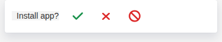

# Open and install an App

The App Player is what your users run: the deployed version of an App, in a browser or installed on a device. There is nothing to roll out and no app store. You share a link, and the App is there.

This page is about what a user meets. How you get an App there is [Test and deploy](../app-builder/test-and-deploy.md).

## The App's link

Every App has its own permanent address:

```
https://<account>.heisenware.cloud/app/<domain>/<appId>
```

The domain is the workspace's technical name, `<account>.<workspace>`, and the App id is the short name the App was born with, so acme's line 2 panel reads `https://acme.heisenware.cloud/app/acme.default/ln2pk`. You find the link in the App Builder, by clicking the version button in the top bar, and on the App's page in the [App Manager](../app-manager/README.md). The dialog shows the link and a QR code for it, which is the quickest way onto a phone or a tablet on the shop floor.

The address never changes while the App runs, not even while a user walks through its pages. You can therefore put the App into another website or an intranet portal with a plain HTML `<iframe>`. The browser's back button and the phone's back gesture still walk the pages the user came from, not out of the App.

**Open a specific page** by adding `?page=` and the page's name or its id:

```
https://acme.heisenware.cloud/app/acme.default/ln2pk?page=changeover
```

The name is matched loosely, so `Röstung`, `röstung` and `rostung` all find the same page; an id wins over a name, and a subpage can be named too. That is a starting point, not an address: once the App is open it keeps the page to itself, and the link stays as it is. A reference that matches no page opens the first one.

## Signing in

What a user has to do depends on the App's access mode, which you set in the App Manager under [App users and access](../app-manager/users-and-access.md):

* **anyone**: the App opens. The device gets an identity of its own, which it remembers.
* **a master password**: one password screen, once per device and browser.
* **sign-up**: the user's own account, with an email and a password or a Google account.
* **sign-up and a master password**: the password screen first, then the sign-in.
* **invited users only**: sign-in only, for the people you invited.

The sign-in screens speak the App's language from the first paint, and an email link, such as a password reset or an invitation, lands on the App.

**Logging out** forgets the device's credentials, ends the session and starts the App afresh: a sign-in App lands on its sign-in screen, a master-password App asks again, an open App mints a new anonymous identity. There is no logout button unless you place one: drop the logout [App action](../concepts/pages-and-app-actions.md) onto a button.

## Which screen a device gets

The Player draws one of the App's [screens](../concepts/screens-and-layouts.md), scaled into the window:

* A **phone or tablet** chooses by what it is and how it is held: a phone upright draws Phone and turned sideways Laptop, a tablet upright draws Tablet and sideways Tablet rotated.
* **Every other browser**, a PC or the panel at a machine, chooses by size: of the screens that fill enough of the window, the one that needs the least scaling.
* A screen you switched off is never drawn. The device falls back to the nearest one that is on.

**Upright scrolls, landscape fits.** Phone and Tablet fill the width of the window and the page scrolls. Tablet rotated, Laptop and Desktop are fitted into the window whole, so a page meant as one screen stays one screen.

An App speaks one language, the one set in the App Manager, and that includes the Player's own screens. See [Languages and time zones](../concepts/languages-and-time-zones.md).

## Installing the App

Installed, the App gets its own icon on the home screen or in the taskbar, opens without the browser's address bar, and carries the App's name, its icon and its accent colour.

### The prompt

On a browser that offers it, the App asks by itself a few seconds after the first visit.

<figure><figcaption></figcaption></figure>

The three answers are **Install**, **Not now**, which asks again on the next visit, and **Never ask again**, which does not.

### By hand

<table data-header-hidden><thead><tr><th width="132"></th><th width="174"></th><th></th></tr></thead><tbody><tr><td><strong>Platform</strong></td><td><strong>Browser</strong></td><td><strong>Steps</strong></td></tr><tr><td>Desktop</td><td>Chrome / Edge</td><td>Click the install icon in the address bar. <a href="https://support.google.com/chrome/answer/9658361">Learn more</a>.</td></tr><tr><td>Desktop</td><td>Safari (macOS)</td><td>File &gt; Add to Dock. <a href="https://support.apple.com/en-us/104996">Learn more</a>.</td></tr><tr><td>Android</td><td>any browser</td><td>Browser menu (⋮) > Add to Home Screen.</td></tr><tr><td>iOS</td><td>any browser</td><td>Share icon > Add to Home Screen.</td></tr></tbody></table>

For a panel that has to come up by itself after a power cut, see [Kiosk on a Waveshare HMI](waveshare-kiosk.md).


#### The app stores

You do not need them, but an App can be packaged for the Apple App Store or Google Play. [Write to us](mailto:support@heisenware.com) if you want that.


## When the App does not open

The Player says what is the matter instead of loading for ever, in the App's own language:

* **Under maintenance**: a member has stopped the App in the App Manager. Starting it brings the Player on.
* **This app is not available**, with the reason: it has not been released yet, the account's plan has expired, or the platform holds no entry for it. The Player keeps asking in the background and comes on by itself when the reason is gone.
* **This address does not lead to an app**: the workspace in the link does not exist. Check the link.

## When the connection goes

A page that is already on screen stays as it is, with its last values, behind a shield that swallows clicks and keystrokes, so that nothing is pressed into the void on a terminal. A badge in the corner says *Restoring the connection* and when the values on screen are from. After half a minute the page dims and says it in the middle. When the connection returns, the page carries on.

A new release ends the same way: the App notices it, clears its caches and reloads itself to the new version.

## Reports, files and Ask

* **Ask**: where you switched it on for an App, its users find an **Ask** button at the bottom of the page. It answers questions about the workspace's data in their own words and can run the App's endpoints for them. See [Ask](../app-manager/ask.md).
* **A report**: a document Ask made for a user. Its link opens the App with a card holding the report's name, its size and when it was made, and a **Download** button.
* **A file**: a file Ask pointed a user to opens the same way, with **Open**.

Both links sign the user in first if they are not: the report or the file waits in the tab while that happens.
