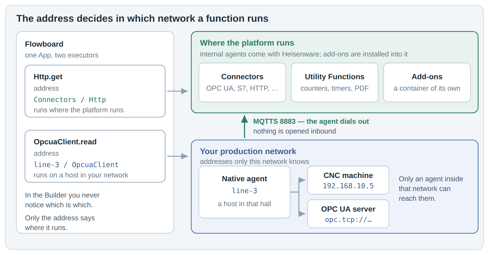

# Agents and where code runs

An agent is a program that offers classes to the platform. Some come with Heisenware and run where the platform runs; others you install inside your own network, where they reach machines and servers the platform cannot see. The agent named in an executor's [address](executors-and-instances.md#addresses-where-a-call-goes) decides in which network that function runs.

<figure><figcaption>
The same board, the same look. The address is what says in which network a function runs.
</figcaption></figure>

## The kinds

* **Internal agents** come with the platform: Connectors, Utility Functions, Templates and Media Server. Each workspace gets its own set, they run where the platform runs, and they need no installation.
* **[Native agents](../app-manager/agents/native-agent.md)** are built in the App Manager for one host and installed there as a service: Windows, macOS, Linux, Alpine, ARM 64 and ctrlX OS.
* **[Docker agents](../app-manager/agents/docker-agent.md)** and **[LXC agents](../app-manager/agents/lxc-agent.md)** carry the same connectors as a container: a Docker image for a gateway or a server you manage with Docker, an LXC packet for an INSYS icom router.
* **[Add-ons](../developers/custom-add-ons.md)** are not agents of this kind: they are optional modules that bring new classes of their own, your own code for example, and run as their own container.

In the App Builder you never notice which is which. A function from an agent looks and behaves like any other: drag it onto the Flowboard, wire it, configure it. Only its address says where it runs.

## Why an agent is needed

A machine on the shop floor answers at `192.168.10.5`, an OPC UA server at `opc.tcp://...`, a historian at a bare host name. Addresses like these exist only inside that network. An App deployed in the Heisenware cloud cannot reach them, however the firewall is set: there is no route.

An agent installed inside that network is the vantage point. It dials out to the platform over MQTTS on port 8883 and keeps that connection open, so nothing has to be opened inbound: no port forwarding, no VPN, no fixed address for the host. From then on its connectors appear in the [Functions explorer](../app-builder/explorers/functions.md) under the agent's name, and every executor addressed to it runs on that machine, next to the systems it talks to.

## Deciding where a function runs

1. **Where does the platform run?** A Heisenware cloud account, a server installation, or on-premise inside your own network. The assistant reads this with `get_deployment_info`.
2. **Is the address private or public?** Private: `192.168.x.x`, `10.x`, `172.16.x` to `172.31.x`, `opc.tcp://`, anything `.local`, a bare host name. Public: a name the internet resolves, an API over https.
3. **A cloud platform and a private address need an agent** inside that network. A public address does not: the platform's own connectors reach it.
4. **An on-premise platform reaches what its own network reaches.** For another network segment, the answer is an agent again.
5. **Prove it, do not assume it.** Create the executor and run a read-only call, a connect or a browse, never a write to a PLC. A timeout from the wrong side of the network is a diagnosis, not a reason to try again.

With no agent yet, the App Manager's [Agents panel](../app-manager/agents/README.md) builds one: it takes the connectors, the target platform and a fleet name, and writes a requirements sheet your IT can work from. Your IT installs it, the agent dials out, and it appears in the Builder.

## Fleets

Ten machines that need the same connectors should not need ten builds. A **fleet** is one build installed on many hosts: each installation joins under its own id, and a **rollout** brings a new build to all of them from the App Manager. See [Agents](../app-manager/agents/README.md).

## When one does not answer

An agent that is offline, behind its fleet's current build, or answering errors is diagnosed, not worked around. The Agents panel says why: the agent's own readiness checks, a timeline of what happened to it, and its log. The remedy lives there too, or on the host itself.


#### Agents are not building blocks

Restarting, updating and building an agent happen in the App Manager, never from inside a flow. The classes that manage a host do not appear in the Functions explorer and cannot be put on the Flowboard.

