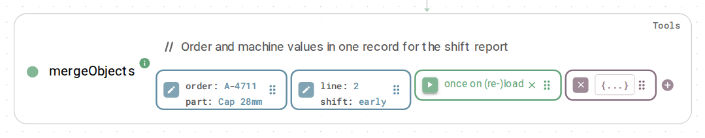
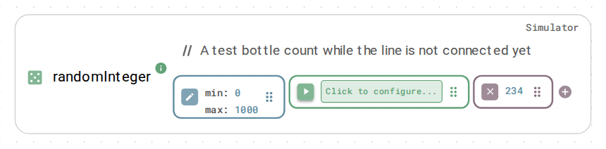
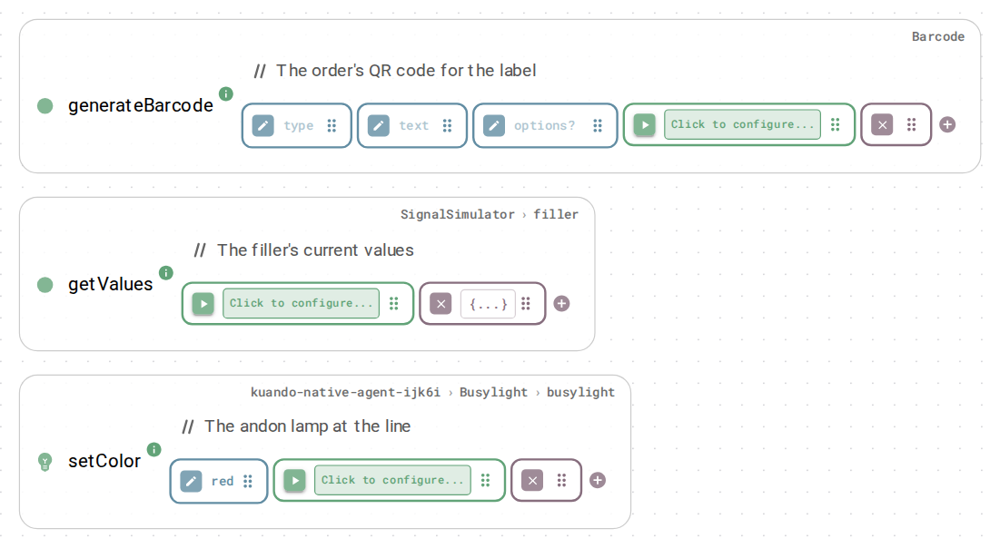

# Executors and instances

An App's logic is built from functions: read a value from a machine, write a row, send an email. A function you drag from the Functions explorer onto the Flowboard becomes an **executor**. The executor calls that one function and manages everything around the call: where it runs, what goes in, when it runs and what comes out.

Many functions belong to an **instance**: a living object such as a connection, a buffer or a counter. This page explains both.

## What an executor is made of

<figure><figcaption><p>An executor that merges two objects</p></figcaption></figure>

* **Address**: where the function lives: its agent, its class and, for an instance function, its instance. See [Addresses](executors-and-instances.md#addresses-where-a-call-goes).
* **Inputs**: the values the function receives, in the order of its arguments. An input gets a typed-in default, a [wire](triggers-and-wires.md), a [widget link](widgets-and-links.md) or a [`$variable`](variables-and-endpoints.md).
* **Trigger**: decides when the executor runs. A value arriving at an input does not run it by itself. See [Triggers and wires](triggers-and-wires.md).
* **Outputs**: the **return**, and an **event output** for each value an event function delivers. See [Backend events](backend-events.md).
* **Extensions**: steps attached to an output that reshape, gate, record or catch. See [Extensions, branching and errors](extensions-branching-and-errors.md).

Two texts belong to an executor. The **comment** is yours: a short note on the node that says why it is there. The **description**, shown on hover, is the function's own documentation and comes from its code.

## Kinds of functions

| Kind | What it does | Example |
| --- | --- | --- |
| **Static function** | Needs no instance. Takes its inputs, gives a result. | `echo`, `mergeObjects`, `mapRange` |
| **Constructor** | Creates an instance. Always named `create`. | `OpcuaClient.create` |
| **Instance function** | Acts on one instance. | `read`, `write`, `publish` |
| **Event function** | Listens to an instance and delivers values again and again. | `onChange`, `onMessage` |
| **Destructor** | Deletes an instance. Always named `delete`. | `OpcuaClient.delete` |
| **Subflow** | A section of your own logic, published as a function. See [Subflows](subflows.md). | |


**Example: the OPC UA client.** The class `OpcuaClient` is the blueprint. `create` makes an instance named `opcua-filler` with the filler's address and credentials. `read` and `write` on `opcua-filler` use its connection, and `onChange` on it reports every change of a node.


## How instances live

An instance belongs to its agent, not to an App. Its name is unique on that agent, and every App of the workspace reaches it there by that name.

* **Created once, deleted once.** Once created, an instance exists for the App Builder, every App Player and every App alike. It outlives deployments and platform restarts: the agent keeps the inputs it was created with and creates it again when it starts.
* **Created, never re-configured.** Changing a constructor's inputs and running it again changes nothing: creating a name that already exists does nothing. To change an instance, use the functions its class offers for that. Where only new constructor inputs will do, delete the instance and create it again.
* **A constructor on the Flowboard is a promise.** Give the constructor the trigger **App Start**, and the instance is part of the App. Instance functions for that name may be built before the instance exists: a call that finds no instance runs the constructor first, then calls.
* **Names connect Apps.** Two Apps that name the same instance work on the same object. Share state that way instead of copying logic. See [Suites of Apps](suites-of-apps.md).

Instances such as `Counter`, `Buffer` or `Timer` hold their state in memory. What must survive belongs in a database.

### One instance per user

Sometimes each user needs an own instance, such as a personal timer. Prefix the instance name with `<client>`, for example `<client>session`, on the constructor and on its instance functions. Each user's first call then creates that user's own instance. Such instances are not kept across restarts and need no trigger on the constructor.

### Many instances from one executor

The instance box of a constructor takes a list of names. One constructor then creates every instance in the list, and a new machine is a new row in a table, not a new executor. See [Addresses](executors-and-instances.md#addresses-where-a-call-goes) for lists, patterns and loops.

## Inputs

An input takes its value from one of four places:

1. **A default**: a fixed value typed into the input.
2. **A wire**: the output of another executor or of an extension.
3. **A widget link**: a value a user enters or selects on a page.
4. **A variable**: `$name` anywhere in the value.

A default is delivered to the function exactly as typed: a number as a number, an object as an object. An input that expects an object with several keys takes the whole object.

Right-click an input and choose **Secret Input** to mask its value everywhere. Credentials belong in a secret [variable](variables-and-endpoints.md) when more than one executor needs them.

### YAML

Defaults are typed in YAML, a readable format for structured data. Type a value and click away to save it. A value longer than a few lines folds to a one-line preview; click the preview to edit it in a popup editor.

<figure><figcaption><p>A static value, typed as YAML</p></figcaption></figure>

<details>

<summary><strong>YAML cheat sheet</strong></summary>

#### Simple values

* **Text**: `Hello world`. Use quotes when text looks like a number or a boolean: `'123'`, `'true'`.
* **Numbers**: `101` or `3.14159`.
* **Booleans**: `true` or `false`.
* **Nothing**: `null`.

#### Lists

```yaml
- filler
- capper
- labeler
```

or compact: `[filler, capper, labeler]`

#### Objects

```yaml
machine:
  name: filler
  line: 2
  limits:
    min: 0
    max: 400
```

or compact: `{ name: filler, line: 2 }`

#### Text over several lines

`|` keeps every line break, for example for a label printer layout:

```yaml
|
  ^XA^FO30,80^BQN,2,3^FDLA,{{assetId}}#{{date}}^FS
  ^FO120,140^A0N,22,22^FD{{assetId}}#{{date}}^FS
  ^XZ
```

`>` joins the lines into one paragraph; an empty line starts a new one:

```yaml
description: >
  This long description is written across
  several lines and arrives as one sentence.
```

</details>

## Addresses: where a call goes

An address has three parts: **agent**, **class** and, for instance functions, **instance**. The agent decides in which network the function runs; see [Agents and where code runs](agents-and-where-code-runs.md).

<figure><figcaption><p>A static function needs no instance; an instance function names one, and a function on an agent of your own names the agent too</p></figcaption></figure>

Normally each part is fixed. Right-click the executor's name and choose **Use Dynamic Address** to turn the parts into boxes that take a value at run time:

* **A name or a list of names.**
* **A pattern**: as agent, `line2-*` is every matching agent that is online; as instance, `*` is every living instance of the class.
* **A variable**: `$machines` holds the name or the list.
* **A wire**: drop an output onto the box.

What a list does depends on the loop:

* **Without a loop** the call goes to every target at once and returns one result per target.
* **With the zip loop** (**Process One By One** on all inputs) row 1 of the inputs runs on target 1, row 2 on target 2. This is how one executor serves ten machines: one instance name on ten agents, or ten instances on one agent.

A constructor works the same way. With a list it creates every instance in it; with the zip loop, row 1 of the inputs creates instance 1. A name with a pattern, such as `opcua-*`, creates nothing when triggered: it promises that any matching instance is created the moment a function asks for it.

An event function on instance `*` also listens to instances that appear later and tells you who sent each event: its first event output is the name of the sending instance.


**Moving between environments.** To move logic from a test device to the production machine, change the agent name instead of rewiring. Search and replace on the Flowboard changes an agent name in many executors at once.


## Status

The dot beside an executor's name shows how its last call went. Hover over it for details.

| Color | Meaning |
| --- | --- |
| Green | Ready, or the last call succeeded. |
| Blue | The call takes longer than two seconds. |
| Red | The last call failed. The message says why. |
| Yellow | The instance does not exist. |
| Purple | The agent is online but does not offer the class. |
| Gray | The agent is offline. |

Red stays until the executor runs again: a value written to one of its inputs does not clear it. While the agent is offline, gray shows over it, and the red comes back with the agent.
