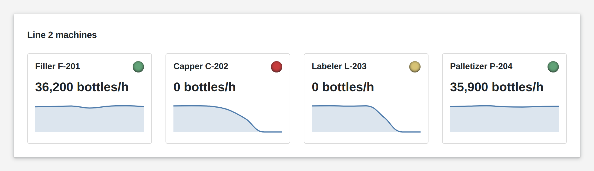

# Groups and tiles

A **group** is a widget that holds other widgets and **repeats** them: one **tile** per row of data. You design one tile, link a list to the group, and four machines give four tiles, forty give forty.

<figure><figcaption></figcaption></figure>

## Form a group, never create one

Place the pieces of one tile on the page first: a card, a heading, a lamp, a value. Check that they look right. Then select them and group them. A group cannot be created empty, and groups can be nested: group children of a group, and the new group sits inside it.

The children stay widgets in their own right. They keep their own settings and their own links to your logic. The group only renders them, once per row.

## Binding a row to the tile

Link an array of objects to the group's data, and each object becomes a tile. Inside the tile you say which field goes to which child: the row's `name` to the heading, its `status` to the lamp, its `history` to the sparkline. A child can also be handed the whole row.

A nested group is a child like any other: bind its data to a field that holds an array, and it repeats inside the tile. One tile per machine, each with its own list of alarms.

## Tiles talk back

Three things a group reports to your logic, each with the row it happened on:

* a **click on a tile**, with the row and its position in the list;
* a **click on a button** inside a tile, with the name of the button and the row;
* a **change in an input** inside a tile, with the row and the new value.

Link these to an executor's input and make that input hot, so the write also runs the executor. See [Widgets and links](widgets-and-links.md).

## When to group, and when not

**Group for repetition.** That is what a group is for.

**Do not group to tidy up.** Inside a group, positions are relative to the tile and are the same on every screen: the phone shows the desktop's tile, scaled down, never a phone layout. A card with its contents, a heading with its value, a row of buttons: leave them as separate widgets and design each screen. See [Screens and layouts](screens-and-layouts.md).

Two reasons to group anyway: a band of several widgets that must stay on screen while the page scrolls (a header or a footer), and widgets you want to move, copy or delete as one thing.

## The size of a tile

Nothing stores the tile's size: it is the bounding box of its children. Make the card bigger and every tile follows. The space between tiles is the group's own spacing, and the group itself is placed on the page like any other widget, per screen.

**Dissolving** a group returns the children to where they sat, visible and in order. Deleting a group deletes its children; deleting the last child takes the group with it.
