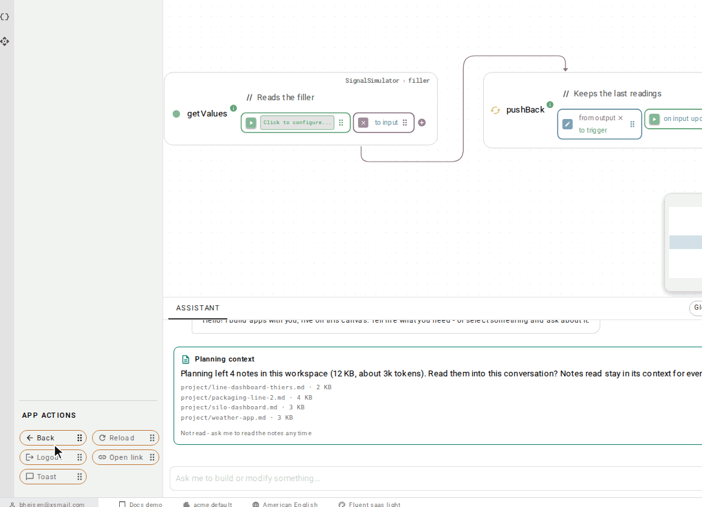

# Pages and App actions

## Pages

An App is a set of **pages**. Pages nest one level deep:

* **Top-level pages** fill the navigation menu.
* A **subpage** hangs off one top-level page, stays out of the menu and is reached by a link.

A page has no title of its own. A heading on a page is a text box, like any other content, which leaves you free to build the header the App needs.

A page is as tall as one screen unless you give it more. See [Screens and layouts](screens-and-layouts.md#how-tall-a-page-is).

## The navigation menu

How users move between top-level pages is one choice for the App:

* **none**: no menu. Navigation happens through your own buttons.
* **bottom tabs**: a bar at the bottom, as phone apps have.
* **left menu**: a rail beside the page. It takes its width from the page.
* **drawer**: a burger button in the corner; the menu slides over the page, which keeps its full width.

The menu is one setting for the App, and it can be pinned per screen: bottom tabs on the phone and a drawer on the desktop is one shared choice plus one pin.

There is no built-in top bar. A title bar with a logo, a heading and a logout button is widgets you place, grouped and made sticky so they stay while the page scrolls. See [Screens and layouts](screens-and-layouts.md#sticky-widgets).

## App actions

An **App action** is something the App does to itself in the browser. It has no place on a page and is not a widget:

| Action | What it does |
| --- | --- |
| **switch page** | opens another page of the App |
| **toast** | shows a short message |
| **open link** | opens a URL, in this tab or a new one |
| **log out** | forgets the device's credentials and restarts the App |
| **reload** | reloads the App |
| **back** | goes back in the browser's history |

An action runs in one of two ways.

### On a click

Drop a page or an action onto a button, an icon or an image. The click runs it. When the widget also fires executors, those run first, and an action that leaves the page (log out, open link, reload) happens after.

A toast carries its message, and optionally its kind (info, warning, error, success), how long it stays and where it appears. An open link takes a URL that must be `https://`, `mailto:` or a path on this platform; a path is how you link to the same App in another language.

### On a value

Drop a page or an action onto an executor's output, a modifier, a filter or an error handler. Then your logic runs it: **every value that is true runs the action, and a value that is false never does.** On a filter, everything that passes runs the action.

<figure><figcaption>
An action that needs settings asks for them where it lands
</figcaption></figure>

Two ways to use the value:

* **As a switch only**: the value decides whether the action fires. The message, the URL or the page is the one you set on the link.
* **As the parameter**: the value itself is the toast's message, the URL to open, or the page to go to. This is how an error handler becomes an error toast: link the toast to the error handler, take the message from the value, and set its kind to error.

**Back** works only on a click. Sending every user back through their own history would mean nothing.

### Who sees it

A value-driven action reaches the clients the value reaches, and that follows the [scope](scopes.md) of the run:

* A user started the chain: it happens for that user, in every tab they have open. A timer that user started also ticks in their scope, so "log out after ten minutes" is per user, with nothing to configure.
* Nobody started it, as with a poll or a machine event: it happens on every connected screen. That is how one signal switches every panel in the hall to the alarm page, or logs everyone out.

### Routing by a poll

Where a poll decides which page belongs on screen, let it act only when that decision **changes**, and treat the user's own navigation as part of the decision. Otherwise the next poll throws the user back to where they were a moment ago.

Keep page links in one place: one executor that says "go to this page", fed by every source of navigation, with one page link per page behind a filter.


**Logging out** forgets the credentials on the device, ends the session and restarts the App. An App with a login lands on its sign-in screen, an App with a master password asks again, and an App open to everyone gets a new anonymous user.

