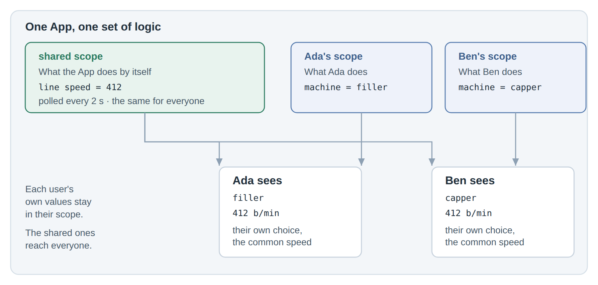

# Scopes: where values live

An App is used by many people at once, while its logic exists only once. Scopes keep their values apart. Every value on the Flowboard lives in a scope, and every run of an executor happens in one.

<figure><figcaption></figcaption></figure>

## The scopes

* **Shared**: one for the whole App. What the App does by itself runs here: App start, polling, an [endpoint](variables-and-endpoints.md) called without a user. A value in the shared scope is the same for everyone.
* **User**: one per connected user. What a user does runs here: a click, a typed value, a selected row. The result belongs to that user alone.
* **Call**: one per call of a [subflow](subflows.md). It keeps the intermediate values of parallel calls apart.

A [backend event](backend-events.md), such as a message from a machine, arrives in the scope its executor was listening in. For a listener started with the App, that means for everyone.

## What this means when you build

**A user's input is personal.** Two operators filter the same order list by different machines, and each sees an own result. Nothing has to be configured for that: a widget writes into its user's scope, and the executor a click runs reads and answers there.

**What the App does by itself is common.** An executor that polls the filler's speed every two seconds runs in the shared scope, and every open App Player shows the same value.

**A run reads the nearest value.** For each input, a run takes the value of its own scope. If that scope has none, it takes the shared one, and then the default typed into the input. A user who has not selected a machine yet sees the result for the default. One value comes before all of these: what a backend event that the whole App listens to delivered to that input.

**Results stay in the scope of the run.** A run started by a user yields that user's results; a run started by the App yields shared ones.

**Polling follows personal values.** When a polled executor reads a value that users write, such as the selected machine, it runs once for each connected user instead of once for all. Each user's display then refreshes with that user's own selection.

## Sharing on purpose

* **A shared widget.** A widget's values go to its user's scope unless you set the widget to write to the shared scope. Use this for a kiosk or a team board, where one person's choice is meant for everyone.
* **State for everyone** lives in a named instance, such as a `DataStore` or a database table, or in a [variable](variables-and-endpoints.md). An instance is the same object for every user and every App.

Wires never cross scopes. A value one user produced does not arrive in another user's run.

## Who is the user?

The built-in variable `$USER` names the user in whose scope a run happens, and `$TIMEZONE` that user's time zone. In the shared scope there is no user, and both are empty. That is not an error: a poll or a machine event is not a person.

Every user scope has an identity, also in an App that is open to everyone: the App Player gives an anonymous visitor a generated name.

Where logic that runs in the shared scope needs to know a user, take `$USER` on a path the user starts, such as a page load, and keep it in a variable. See [Variables and endpoints](variables-and-endpoints.md).
