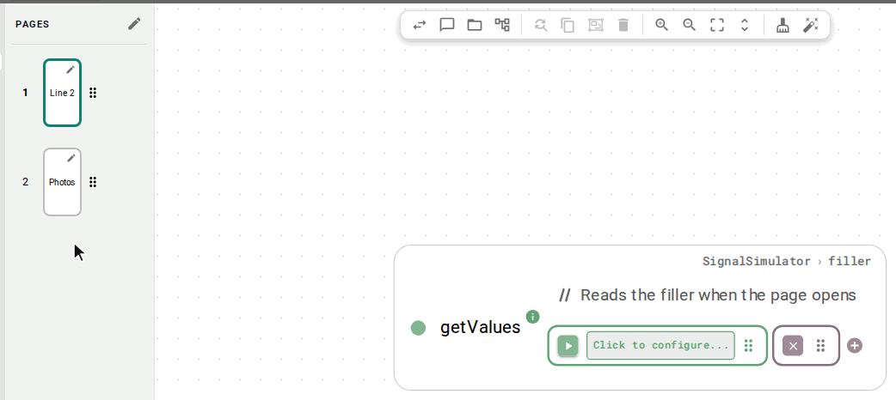
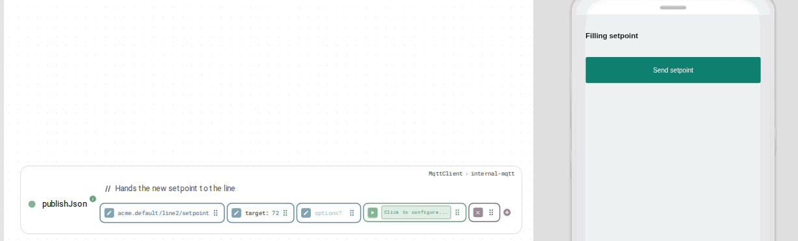
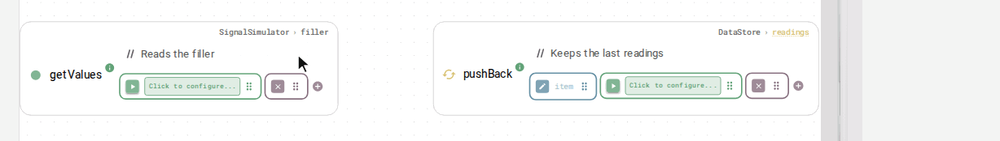
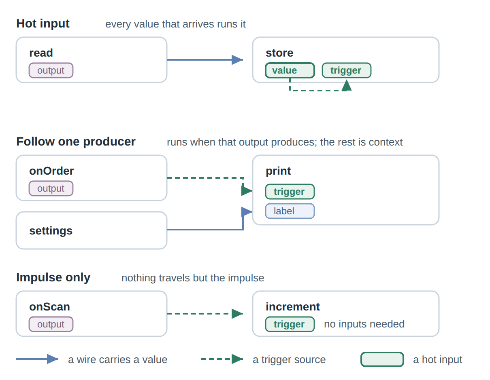

# Triggers and wires

Heisenware's logic follows one idea: **triggers carry the impulse, wires carry the values, variables carry named state.** Nothing runs in an endless loop. An executor waits until its trigger fires, runs once, and waits again.

## The trigger

Every executor has one trigger. The trigger holds a list of **trigger sources**, and the executor runs when any one of them fires, and for no other reason.


A value arriving at an input does not run the executor by itself. Without a trigger source, the value waits in the input until something else fires the trigger.


| Source | Fires when | In the App Builder |
| --- | --- | --- |
| **A value arrives** | an output of another executor, or an input of this one, receives a value | drop the output or the input onto the trigger |
| **App start** | the App starts: once, or again at a fixed interval (**polling**) | right-click the trigger: **App Start**, then *once on deploy* or an interval |
| **App stop** | the App stops | right-click the trigger: **App Stop** |
| **Browser reload** | a user opens or reloads the App | **App Start** > **once on (re-)load** |
| **Page load** | a user opens a page | drop the page onto the trigger |
| **Widget event** | a user clicks a button or submits a form | drag the trigger onto the widget in the Page editor |
| **Manual** | you click the play icon while building | |

App start, App stop and backend events are armed only while the App runs: under **Test** in the App Builder, or deployed.

### Update, change, true

A source that reacts to a value has a mode. Click the mode on the trigger to change it:

* **update**: every value fires, also the same one again.
* **change**: only a value that differs from the last one.
* **true**: only a value that counts as true. Use it for thresholds: fire when the temperature is too high, not on every reading.
* **all updated**: fire once when every input in this mode has received a new value. See [When streams meet](when-streams-meet.md).

<figure><figcaption>
A page dropped on a trigger runs the executor when that page opens
</figcaption></figure>

<figure><figcaption>
A button's click runs the executor
</figcaption></figure>

### Delay

**Delay execution** makes a trigger wait a moment before it runs the executor. It is a tool for pacing, such as letting an animation finish. It is never needed for correctness: a value is always in the input before the run it triggers reads it.

## Wires

A wire carries a value from an output to an input. Draw it by dragging the output onto the input. The value then waits there: what runs the executor is decided on its trigger, in one of three ways.

* **Hot input.** Drop the input onto its own executor's trigger. Every value the input receives now runs the executor, whoever sends it: a wire, a widget, a variable. This is the choice for pipelines, where each step feeds the next, and for inputs a widget writes.
* **Follow one producer.** Drop the upstream output onto the trigger. The executor runs when that output produces and reads its other inputs as they are. Use it when one stream drives and the others are context.
* **Impulse only.** An output dropped onto the trigger, without a wire to an input, passes nothing but the impulse: when the first executor has produced, the second runs with its own inputs. This is how to start an executor that takes no arguments, such as a counter's `increment` or a timer's `start`.

<figure><figcaption>
A wire, then a hot input
</figcaption></figure>

<figure><figcaption></figcaption></figure>

An input that is wired but not hot only keeps its value until something else fires the trigger.

## Reading data when the App opens

A table or a chart shows nothing until something runs the executor that reads its data. Give that executor a source that fires at the start:

* **Browser reload**: once when a user opens the App.
* **Page load**: each time the user opens the page.
* **Polling**: every few seconds from App start, for values that change.

A deployed App runs on its own. Nothing you ran while building carries over, so every display that should show something at first sight needs such a source.

## Polling

**App Start** with an interval runs an executor again and again from the moment the App starts, between every 0.1 seconds and once a day. Polling is the way to read a device that does not report changes by itself. Where a device or a class can report changes, prefer its [event function](backend-events.md): it costs nothing while nothing happens.

Everything else that depends on time is an instance with an event: a `Timer` counts down, a `Cron` follows a calendar, a `Trigger` debounces. See [When streams meet](when-streams-meet.md#building-blocks-with-memory-and-time).

## From a widget

A widget reaches your logic in two ways, and your logic reaches a widget in one:

* a **widget event**, such as a click, fires a trigger;
* a **value** the widget holds, such as a form's content, is written to an input;
* an output's value is shown by the widget.

When one click both writes values and fires a trigger, the values arrive first. See [Widgets and links](widgets-and-links.md).

## Choosing well

* Build a pipeline from hot inputs, one step feeding the next.
* When a value needs context, let one stream drive: the executor follows that producer, and the other inputs only hold their values.
* Use **change** or **true** when a step has an effect in the world, such as sending a message or writing to a machine, so that it does not repeat on every reading.
* Never build timing into the wiring: "this value arrives a moment after that one" breaks under load. When two values belong together, join them. See [When streams meet](when-streams-meet.md).
* When a value is needed in distant places, name it: use a [variable](variables-and-endpoints.md) instead of long wires.
