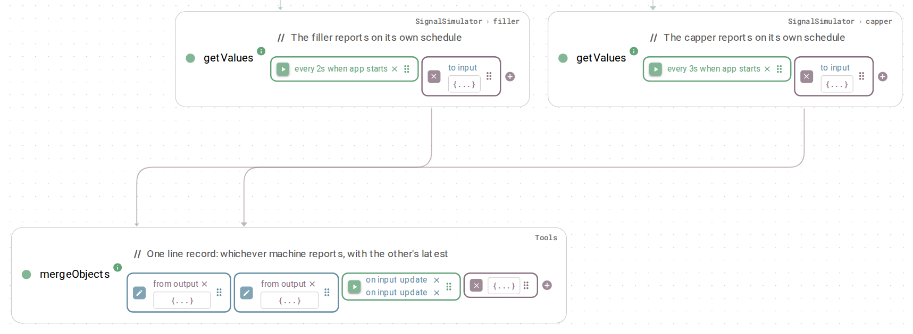

# When streams meet

One value flowing from step to step needs no thought. Questions start when an executor takes values from several places, or when one value is a list. This page gives the patterns.

## Six questions

Ask these for any executor with more than one input:

1. **What makes it run?** Decide which values drive the executor and which are only context. See [Triggers and wires](triggers-and-wires.md#wires).
2. **Where do the other values come from?** From nearby: wire them to the other inputs. From far away, or as state with a name: use a [variable](variables-and-endpoints.md).
3. **What if a value has not arrived yet?** Give the input a default, or guard the executor with a [filter](../app-builder/flowboard/filter.md). An input without any value is passed as missing, and many functions fail on that.
4. **The latest value, or each value once?** The latest value is what an input or a variable holds. To consume values one by one, or to collect them, use a building block with memory (below).
5. **How often may it fire?** Use **change** to ignore repeated values and **true** for thresholds. For real debouncing use the `Trigger` class.
6. **Once, or once per element?** A list is passed whole unless you loop over it (below).

## Merging independent streams

Two sensors report on their own, and a calculation needs both. Make both inputs hot: the executor then runs on every value of either stream, each time with the latest value of the other.

<figure><figcaption>
Two streams meeting: each arrival runs the executor with the latest of the other
</figcaption></figure>

This is right for anything that describes a state: a sum, a status, a display. Between two arrivals the result is briefly computed from one new and one old value, and that is fine for a state.

It is wrong for effects. If the result sends an email or writes to a machine, one cause would produce two effects, the first of them half updated. Put such a step behind a join, or let it fire on **change** or **true** only.

## Joining branches of one impulse

One click starts two calculations, and a third step needs both results. Set the trigger sources of the third step to **all updated**: it then fires once, when every one of them has delivered, with the values that belong together.


Never put a branch with a filter into such a join. When the filter blocks, that input stays silent and the join waits for it. There is no timeout.


The `combine` function of the tools is not a join. It returns the latest value of each of its inputs as one list, as a convenience.

## Loops: once per element

Right-click the trigger and choose **Process One By One**, then the input that holds the list. The executor then runs once per element, one after the other.

* The results come back as one list, in the same order.
* An element that fails becomes its error message in that list. The loop goes on.
* A delay between elements paces calls to a target that accepts only so many per second.

**On all inputs** is the zip loop: every input holds a list of the same length, and the lists are walked together, row by row. With a list of names in the [address](executors-and-instances.md#addresses-where-a-call-goes), row 1 runs on target 1, row 2 on target 2: ten machines, one executor, one row of inputs each.

A loop is for calling a function per element. To reshape a list, use a [modifier](../app-builder/flowboard/modifier.md): it maps a whole list in one step. When each element needs several steps, loop over the caller of a [subflow](subflows.md).

## Building blocks with memory and time

Memory or time with a shape is an instance of one of these classes, never a trick of wiring. All of them are [utility functions](../reference/functions/utilities/README.md) or [storage classes](../reference/functions/storage/README.md).

| Class | What it is | Its events |
| --- | --- | --- |
| [`Buffer`](../reference/functions/storage/buffer.md) | A fixed number of values: a sliding window, or a queue. | `onFull` |
| [`Accumulator`](../reference/functions/storage/accumulator.md) | One record assembled from parts that arrive separately. | `onComplete` |
| [`DataStore`](../reference/functions/storage/data-store.md) | A list of items, shared between Apps by its name. | `onChange` |
| [`Counter`](../reference/functions/utilities/counter.md) | A number that steps up and down. | `onChange` |
| [`Timer`](../reference/functions/utilities/timer.md) | A countdown. | `onTick`, `onTimeup` |
| [`Stopwatch`](../reference/functions/utilities/stopwatch.md) | Elapsed time and laps. | |
| [`Cron`](../reference/functions/utilities/cron.md) | A calendar schedule: every Monday at six. | `onTick` |
| [`Trigger`](../reference/functions/utilities/event-simulation.md) | Impulses: by hand, at an interval, debounced. | `onDebounced` and others |
| [`SignalSimulator`](../reference/functions/utilities/signal-simulation.md) | Realistic simulated signals of machines and processes. | `onTick` |

These instances keep their state in memory. What must survive a restart belongs in a [database](files-data-and-dates.md).

Three rules follow:

* **Time is a source like any other.** Polling is the trigger's own interval. Everything else that depends on time is one of these instances and an [event function](backend-events.md) on it.
* **Retry with a timer**, not by wiring an output back to its own input.
* **Simulated data comes from a `SignalSimulator`** that feeds the same place the real source will feed, so that replacing it later changes one executor.

## What not to build

Do not let one input's arrival stand for "the other values are there by now". Such logic bets on timing and loses under load. A join says what is meant, and so does an `Accumulator` when the parts come from different places at different times.
