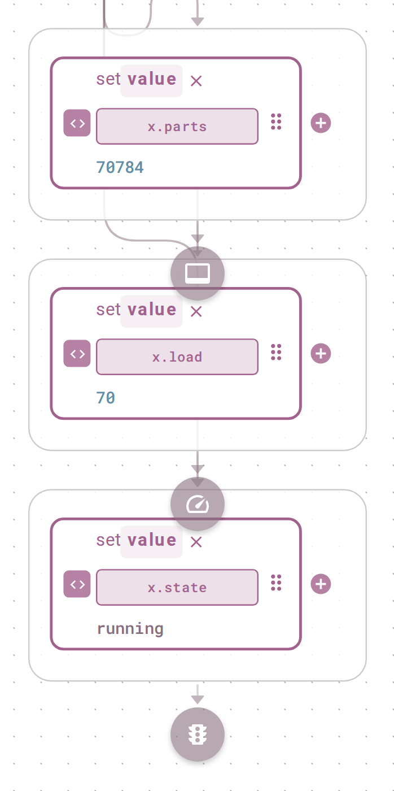

# Widgets and links

A page is built from **widgets**: a chart, a form, a button, a card. A widget shows data, takes input or starts something. There is no code between a widget and your logic. You **link** a widget's property to an item of an [executor](executors-and-instances.md), and the two are connected.

## Properties and settings

Two different things belong to a widget, and the difference matters:

* A **property** can be linked. It is a value the widget shows, a value it hands over, or an event it fires. The widget's **General** tab lists them under *Receives* and *Emits*.
* A **setting** is what you configure yourself: a colour, the number of columns, a scale. Settings are in the widget's other tabs.

A widget's properties are exactly the ones its General tab lists. There are no hidden ones.

## The three kinds of link

<figure><figcaption></figcaption></figure>

* **Out of your logic, into the widget.** Drop an executor's output, modifier or filter onto the widget, and the widget shows every value that item produces, live.
* **Out of the widget, into an input.** A form's content, a grid's clicked row, a field's text: the widget writes the value into an executor's input.
* **Out of the widget, into a trigger.** A click, a submit: the widget's event runs the executor.

A widget that writes a value runs nothing by itself. When the write should also run the executor, make that input hot. See [Triggers and wires](triggers-and-wires.md#wires).

When a widget both writes values and fires a trigger, the values arrive first. You never need a delay for that.

## Links fan out

Every link is a pair, and every cardinality is allowed:

* one click runs several executors, in no particular order, so never make one branch depend on another finishing first;
* one value is written into several inputs;
* one output is shown by several widgets;
* several widgets write the same input, and the last write wins.

## Personal or shared

What a user types or selects goes into that user's own [scope](scopes.md): their filter does not change anyone else's screen. Where the App is a kiosk or a team board and one person's choice is meant for everyone, set the widget to write to the shared scope instead.

When a page opens, a linked widget asks once for the item's current value, so it shows the last result straight away instead of staying empty. That only helps if there is a result: nothing has run yet in a freshly deployed App. A display that must show something at first sight needs an executor that runs on page load, on browser reload or at an interval. See [Reading data when the App opens](triggers-and-wires.md#reading-data-when-the-app-opens).

## What each kind of widget is for

The role of a widget is not decoration, it is meaning:

| Kind | What it does | Examples |
| --- | --- | --- |
| **Display** | shows values | chart, data grid, value box, status lamp, gauge |
| **Input** | takes something from the user | form, photo, signature, upload, barcode |
| **Trigger** | starts something | button, icon, image |
| **Layout** | holds other widgets and repeats them | [group](groups-and-tiles.md) |

A click that must carry a value is a **button** that fires an executor whose input holds that value. Do not press a display widget's click into that service.

A **text box** is static content: headings, labels, instructions, a fixed table. It takes Markdown. Live values belong to a display widget, pictures to the image widget, diagrams to the Flowboard's annotations.

A **toast** is not a widget. It is an [App action](pages-and-app-actions.md), because it belongs to no place on a page.

Every widget, with every property and every setting, is in the [widget reference](../reference/widgets/README.md).
