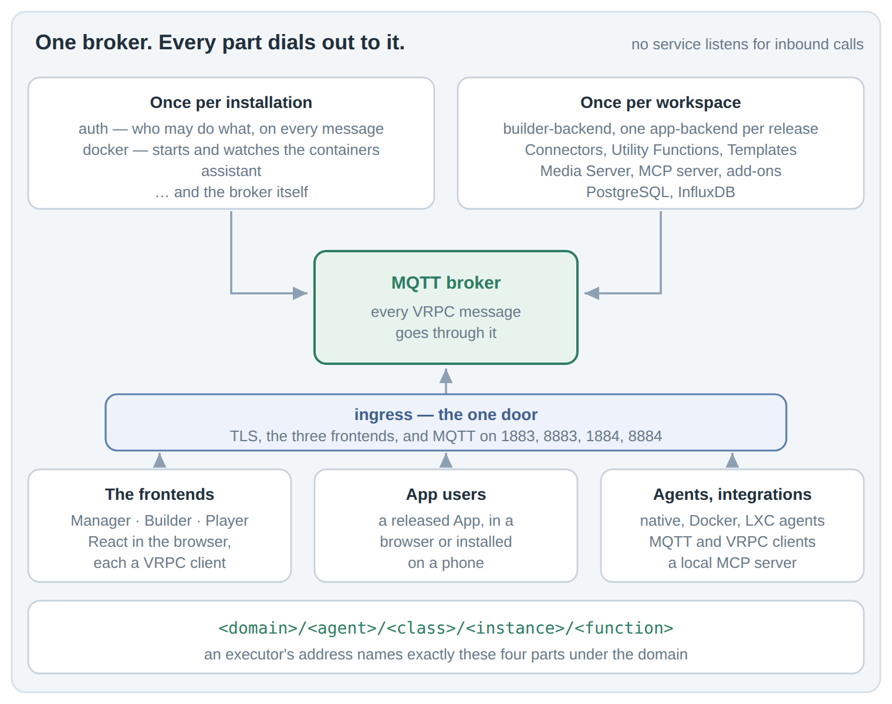

# Architecture

Heisenware is a set of Node.js services that talk to each other over one MQTT broker, using [VRPC](vrpc/README.md): every service offers its classes on the bus, and every other part calls them as if they were local. The frontends are React apps that speak the same protocol. There is no REST API between them.

This page is for developers and IT. If you build Apps, you need none of it.

<figure><figcaption><p>Every part connects out to the one broker, and addresses every other part the same way.</p></figcaption></figure>

## The services

Some services run once for the whole installation. The rest run once per workspace and are started when the workspace is first used.

### Once per installation

| Service | What it does |
| --- | --- |
| **ingress** | The one door. An Envoy proxy that terminates TLS and routes by host and path: `/manager`, `/builder`, `/app`, and each workspace's own services. It also carries the MQTT ports: 1883 and 8883 for the bus, 1884 and 8884 for plain IoT clients. |
| **broker** | The MQTT broker every VRPC message goes through. It asks the auth service about every connection, every publish and every subscription, so authorization is one answer in one place. |
| **auth** | Identity and authorization: accounts, workspaces, members, App users, integrations, plans and licences. It answers the broker's questions, mints the credentials agents and integrations use, and keeps its records in FusionAuth and PostgreSQL. |
| **docker** | Starts, stops and watches the containers a workspace needs. It is itself an agent on the bus, so the Manager asks it for a workspace's containers and their logs. |
| **manager**, **builder-frontend**, **app-frontend** | The three frontends: the [App Manager](../app-manager/README.md), the [App Builder](../app-builder/README.md), the [App Player](../app-player/README.md). React, served as static builds, each a VRPC client in the browser. |
| **theme-builder** | The theme editor's own UI, served into the Builder. The CSS it produces is compiled by the workspace's media server, so no design leaves the installation. |
| **assistant** | The AI that plans in the Manager and builds in the Builder, and answers [Ask](../app-manager/ask.md). It is not part of an [on-premise installation](../self-hosting/README.md). |

### Once per workspace

| Service | What it does |
| --- | --- |
| **builder-backend** | The engine, holding the design version of every App in the workspace: its executors, their state and their runs. It is the agent named `builder-backend` on the bus. |
| `app-backend-<appId>` | The same engine, one container per released App, running that release alone. Deploying an App starts one; stopping the App ends it. |
| **Connectors** | The classes that talk to machines and external systems: OPC UA, S7, Modbus, MQTT, databases, HTTP, files, and the rest of the [reference](../reference/functions/connectors/README.md). |
| **Utility Functions** | The classes that compute, convert, count, schedule and simulate. |
| **Templates** | Renders the PDF templates of the Template editor. |
| **Media Server** | The workspace's files: uploads, downloads, the file store behind file fields, compiled themes, reports, agent builds. |
| **MCP server** | The workspace's tools for an AI client of your own, at `https://<host>/<domain>/mcp`. See [MCP server](../assistant/mcp-server.md). |
| **PostgreSQL** and **InfluxDB** | The workspace's [relational database](../reference/functions/storage/relational-database.md) and [timeseries database](../reference/functions/storage/timeseries-database.md). |
| **add-ons** | One container per installed [add-on](../reference/functions/add-ons/README.md), the workspace's own classes among them. |

A workspace's containers run on a network of their own and mount one shared Docker volume at `/shared`. Nothing of one workspace reaches another.

## How they talk

Every service starts a VRPC agent, registers its classes, and connects out to the broker. A caller addresses a function by four parts under the workspace's domain:

```
<domain>/<agent>/<class>/<instance>/<function>
```

That is exactly what an executor's [address](../concepts/executors-and-instances.md) names, and why a function from a Connectors container, from a native agent on a shop floor and from an add-on of your own look identical on the Flowboard: only the agent part differs.

Nothing listens for inbound connections except the ingress. A service, an agent and a browser all dial out to the broker and keep one connection open, so a machine behind a firewall needs no port opened and no fixed address.

A function's documentation travels with it. VRPC reads the JSDoc of every registered class and publishes it with the class, which is where the Functions explorer gets its descriptions, where an executor gets its inputs, and how an AI client learns what the platform can do.

## Account, workspace, domain

On the bus there is one unit: the **domain**, `<account>.<workspace>`, for example `acme.default`. It is the first topic level of every message.

The auth service grants every connection a pattern over exactly that domain, in the same four parts:

* `vrpc:agent:acme.default/*/*/*/*` lets a connection serve functions as an agent of the workspace. An agent, an integration and an add-on get this.
* `vrpc:client:acme.default/*/*/*/*` lets a connection call them. A member in the Builder, a released App and an AI client with build access get this.
* `vrpc:client:acme.default/*/*/*/@nosideeffects` lets a connection call only the functions that declare they change nothing. A read-only AI client gets this. See [Declare what changes nothing](vrpc/README.md#declare-what-changes-nothing).

An App user's grant is narrower still: the one released App's agent, and the few platform functions that App needs. Because the domain is the first level, a credential of one workspace cannot reach another: it is not a filter the services apply, it is what the broker lets through.

## Agents

An [agent](../concepts/agents-and-where-code-runs.md) is simply a program that offers classes on the bus, so the services above are agents too. The ones you install are the same thing in another network:

* **Native agents, Docker agents and LXC agents** carry the Connectors classes and run inside your network, where they reach machines the platform cannot. They are built in the Manager with the credentials of their workspace inside.
* **Add-ons** carry classes of their own. Inside the platform they run as a container the platform starts; outside, as a program you start, with the same four environment variables. See [Custom add-ons](custom-add-ons.md).

## Where state lives

* **Apps**: in the builder-backend's records, in the workspace's shared volume under `builder-backend/`. A deploy copies a version into `apps/` for the release to run.
* **Tables and rows**: in the workspace's PostgreSQL, together with the [data model](../app-builder/database-editor.md) and its audit logs. An App's versions never touch them.
* **Measurements**: in the workspace's InfluxDB.
* **Files**: in the shared volume. Uploads and project notes are yours to write; what the platform's own machinery writes (agent builds, compiled themes, reports, backups, the file store behind file fields) is listed and downloadable but not writable by hand.
* **Variables**: a shared value lives in its App's record and survives restarts and deployments; a user's value lives as long as that user's scope. See [Scopes](../concepts/scopes.md).
* **Identities**: accounts, members, App users, integrations, roles and plans in FusionAuth, on the platform's own PostgreSQL.
* **Instances**: an instance you create on an agent is written down by that agent and restored when it restarts, which is why a connection you made once is there after a reboot.
