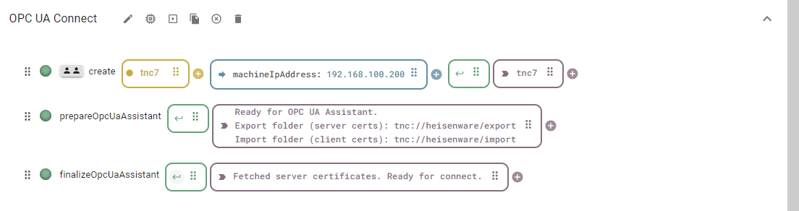
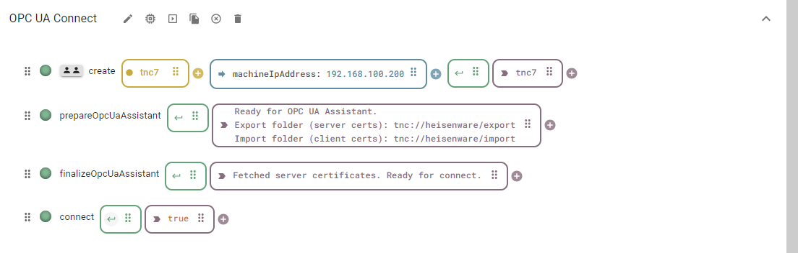
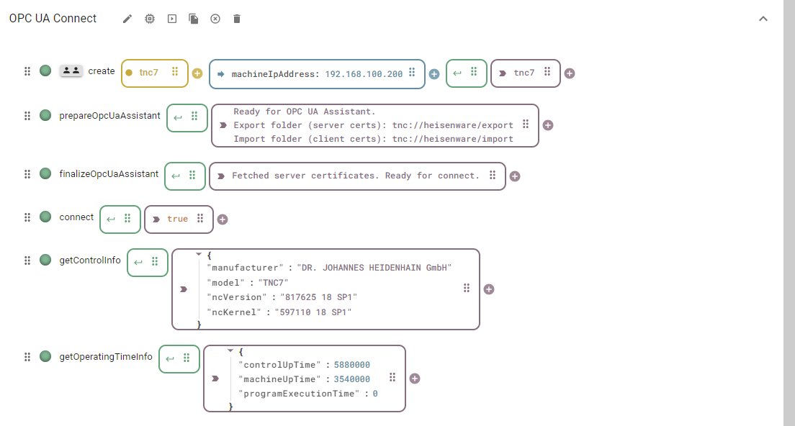

# Connect a Heidenhain CNC via OPC UA

A Heidenhain control speaks OPC UA, but only to a client whose certificate it knows. This lab walks the whole exchange: the control's SSH server, an agent inside the machine's network, the OPC UA Connection Assistant on the control, and the first values in an App.

The example is a TNC7. The steps are the same on any Heidenhain control with the OPC UA option; where a TNC640 differs, it is said.

## What you need

* The machine's IP address, and the machine user's password on the control.
* A host inside the machine's network that can run a service around the clock: an industrial PC, a VM, anything with a route to the control. The control is at a private address, so nothing in the cloud can reach it. See [Agents and where code runs](../concepts/agents-and-where-code-runs.md).
* The OPC UA option enabled on the control.



### Allow SSH access with a password

The connector places its certificates on the control over SSH, so password authentication has to be on while it does. Switch it back off afterwards if your policy says so.

1. Open the settings (**Einstellungen**) menu on the control.

<figure><figcaption></figcaption></figure>

2. Under the operating system (**Betriebssystem**) section, select **Current User** and click **Open** (**Öffnen**).

<figure><figcaption></figcaption></figure>

3. In the dialog, select **Certificates and keys** (**Zertifikate und Schlüssel**).

<figure><figcaption></figcaption></figure>

4. Tick **Erlaube Authentifizierung mit Passwort**.

<figure><figcaption></figcaption></figure>

5. Click **Speichern & Server neu starten** to restart the control's SSH server.

<figure><figcaption></figcaption></figure>



### Put an agent in the machine's network

A [native agent](../app-manager/agents/native-agent.md) is built in the App Manager, not in the Builder, and installs as a service on a host of yours.

1. In the Manager's [Agents panel](../app-manager/agents/README.md), click **Build agent**.
2. Tick the **OPC UA Client** and **Heidenhain OPC UA** connectors, choose the **Target OS** of the host, and write what the build is for under **Note**. If several machines get the same build, give it a **Fleet name** such as `milling`.
3. **Create and build**. The compilation takes a minute or two and goes on when you close the dialog.
4. Hand the build's **Requirements for IT** sheet to whoever runs the host and the network.
5. Open **Installer** on the build, download the package and install it on that host. On Windows, unpack the `.zip` and run the `.exe`; on Linux, `sudo dpkg -i` the Debian package. It registers the service and starts the agent.

The agent dials out and appears in the Agents panel and in the Builder's [Functions explorer](../app-builder/explorers/functions.md) with its two connectors. This is the one installation by hand: every later build reaches the host remotely.


#### Ports 8883 and 443

The agent needs outbound TCP 8883 to the platform host for its data channel and TCP 443 for updates, with direct egress. An HTTP proxy in the path stops both. An agent that runs but never appears is almost always 8883 blocked by a firewall; one that appears but cannot be updated is 443.




### Exchange the certificates

A secure OPC UA connection needs the control to trust the client's certificate and the client to trust the control's. The connector does both file transfers for you; you only drive the control's own assistant. Once per machine.

1. In the Functions explorer, open your agent > **Heidenhain OPC UA** and drag `create` onto the [Flowboard](../app-builder/flowboard/README.md). Name the instance after the machine, `tnc7`, and fill its options:

   ```yaml
   # options
   machineIpAddress: 192.168.100.200
   machineUser: user
   machinePassword: user
   ```

   Right-click the `options` input and choose **Secret Input** so the machine's password is masked everywhere. Click the trigger to create the instance.

2. Under that instance, drag `prepareOpcUaAssistant` and `finalizeOpcUaAssistant` onto the Flowboard.
3. Click the trigger of `prepareOpcUaAssistant`. It creates the client's certificates, logs into the control over SSH, makes `TNC:\heisenware\import` and `TNC:\heisenware\export`, and puts `heisenware_opcua_client.der` and `heisenware_opcua_user.der` into the import folder. It answers with those two folder paths.

<figure><figcaption><p><code>prepareOpcUaAssistant</code> answers with the two folders it made on the control</p></figcaption></figure>

Then go to the machine.



### Run the OPC UA Assistant on the control

1. On a TNC7: **Einstellungen** > **Netzwerk/Fernzugriff** > **OPC UA** > **OPC UA Verbindungsassistent**. On a TNC640, open the same menu through the HEROS interface.

<figure><figcaption></figcaption></figure>

2. Follow the assistant step by step.

<figure><figcaption></figcaption></figure>

3. Where it asks you to export the server certificates, select the `TNC:` drive, open the `heisenware` directory and go into `export`.

<figure><figcaption></figcaption></figure>

4. Click **Alle Zertifikate exportieren** to write the machine's certificates into that folder, then **Vorwärts**.

<figure><figcaption></figcaption></figure>

5. Where it asks you to import the client certificate, go to `heisenware\import`.

<figure><figcaption></figcaption></figure>

6. Select `heisenware_opcua_client.der` and complete the import.

<figure><figcaption></figcaption></figure>

7. Tick the box that enables the OPC UA connection, click **Anwenden**, then **Vorwärts**.

<figure><figcaption></figcaption></figure>

8. Where it asks for the user certificate, open `heisenware\import` again and select `heisenware_opcua_user.der`.

<figure><figcaption></figcaption></figure>

9. Let the control's firewall through: double-click the OPC UA **Methode** option and set it to **Allen erlauben**.
10. Click **Firewall-Konfiguration neu laden**.

<figure><figcaption></figcaption></figure>

11. Finish the assistant.



### Connect

Back in the App Builder:

1. Click the trigger of `finalizeOpcUaAssistant`. It fetches the machine's certificates out of the export folder and adds them to what the workspace trusts. It answers with a message saying so.

<figure><figcaption><p><code>finalizeOpcUaAssistant</code> has the control's certificates</p></figcaption></figure>

2. Drag `connect` onto the Flowboard and click its trigger. It builds the endpoint itself, `opc.tcp://<machine>:4840/HEIDENHAIN/NC`, and answers `true` once connected. While an automatic reconnect is running it answers `reconnect ongoing`, which is not a failure.

<figure><figcaption><p><code>connect</code> answers <code>true</code>: the control is on the bus</p></figcaption></figure>

Give `connect` a trigger source **App Start** > **once on deploy**. A deployed App only does what its logic says, and an unconnected instance reads nothing.



## Read the machine

The [Heidenhain OPC UA](../reference/functions/connectors/heidenhain-opc-ua.md) connector wraps what a control is usually asked:

* `getStateInfo`, `getOperatingMode` and `getProgramInfo`: what the machine is doing right now.
* `getToolInfo` and `getOperatingTimeInfo`: the tool in the spindle, and the running hours.
* `getActiveErrors`: the alarms that stand, each with its number, text, cause and remedy.
* `readVariable` and `readNode`: any node by its id or browse path, one or a list of them in one request. `writeVariable` writes one back.
* `browseObjects` and `browseTncDirectory`: what the control offers, when you do not yet know the node.

None of these is an event function: the control is read, not subscribed to. Give the executor the impulse it needs with **App Start** and an interval, for example **every 1s** for the state and **every 10s** for the running hours.

<figure><figcaption><p>A TNC7 answering <code>getControlInfo</code> and <code>getOperatingTimeInfo</code></p></figcaption></figure>

For OPC UA nodes outside the Heidenhain namespace, the plain [OPC UA client](../reference/functions/connectors/opc-ua-client.md) on the same agent reaches the same control, and its `monitorVariable` does subscribe: the server then pushes every change.

## Several machines, one flow

An instance name is unique on its agent, and every App of the workspace reaches it there. A second machine is a second instance, `tnc640`, on the same agent or on another one, created the same way.

One executor serves them all: set the instance part of its address to a list of names, or to `*` for every live instance of the class. With a list and **Process One By One** > **On all inputs**, row *i* of the arguments goes to machine *i*. See [Addresses](../concepts/executors-and-instances.md#addresses-where-a-call-goes).
