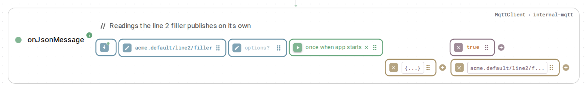

# Connect an external MQTT client

A device or a program of yours can log into the workspace's own MQTT broker, publish what it measures and receive what your Apps publish. Nothing has to be opened in your firewall: the client dials out.

This lab gets a sensor on acme's packaging line 2 to publish a filler reading, picks that reading up in an App, and sends a setpoint back.

## Send data to the workspace



#### Make the credentials

In the App Manager, open [Integrations](../app-manager/integrations.md) and click **Add Integration** > **MQTT client**.

The row that appears carries the login. A username always ends in its workspace, `<name>@<account>.<workspace>`: rename it to something you recognize, for example `line2-filler@acme.default`, and copy the whole username and the password. An MQTT integration has full access to its workspace.


There is a second way, for a client you cannot configure by hand: switch **Start onboarding new agents** on in the Builder's [Functions explorer](../app-builder/explorers/functions.md), let the client try to log in with credentials of its own choosing, and confirm it. See [Agent onboarding](../app-manager/integrations.md#agent-onboarding).




#### Point the client at the broker

In the Heisenware cloud, the broker answers at your account's own address, over TLS:

| | |
| --- | --- |
| Host | `acme.heisenware.cloud` |
| Port | `8884` |
| Transport | MQTT over TLS |
| Username | `line2-filler@acme.default` |
| Password | the one from the row |

TLS is not optional in the cloud: the address is read from the TLS handshake, so a plain connection reaches nothing. A client that cannot verify the certificate from its own store may be told to skip verification; see [Connecting an external client to Heisenware](../reference/functions/connectors/mqtt-client.md#connecting-an-external-client-to-heisenware).

On a [self-hosted](../self-hosting/README.md) installation the same broker also listens on port `1884` without TLS, which is what a device on the same LAN usually takes.



#### Choose a topic

**Every topic begins with the workspace's domain.** A client of `acme.default` publishes and subscribes under `acme.default/...` and reaches nothing outside it. Beyond that first level the name is yours:

```
acme.default/line2/filler
```

Three rules keep you clear of the platform's own traffic:

* **Never exactly five levels.** `<domain>/<agent>/<class>/<instance>/<function>` is how the platform calls functions over the same broker.
* **Never a level named `__something__`.** Those carry the platform's own announcements.
* **At most ten levels** in all.



#### Publish something

Publish a JSON payload from your client, every few seconds, so there is live traffic to look at:

```json
{ "fillLevel": 71.4, "temperature": 23.8 }
```



#### Listen in the App

Every workspace has an [MQTT client](../reference/functions/connectors/mqtt-client.md) instance called `internal-mqtt`, already connected to that same broker. It needs no connection settings of its own.

1. In the Builder's [Functions explorer](../app-builder/explorers/functions.md), open **Connectors** > **MQTT Client** > **internal-mqtt** and drag [`onJsonMessage`](../reference/functions/connectors/mqtt-client.md#onjsonmessage) onto the Flowboard.
2. Set its `topic` input to `acme.default/line2/filler`. A wildcard works too: `acme.default/line2/#`.
3. Right-click its trigger and add **App Start** > **once on deploy**. Triggering an event executor declares the subscription; without a trigger of its own, a deployed App subscribes to nothing.
4. Click **Test**. Messages appear on the executor's **event outputs**, not on its return: the return only says that the executor is listening.

The first event output carries the payload as an object, with the concrete topic added as `__topic__`. The second carries that topic on its own. Wire or link from those outputs: they are the source of the data. See [Backend events](../concepts/backend-events.md).



#### Do something with it

Link the payload output straight to a widget to see it, or wire it into the executor that stores it: a [recorder](../app-builder/flowboard/recorder.md) on that output keeps its history, and [`addRow`](../reference/functions/storage/relational-database.md#addrow) writes it into a table.

Each message is its own impulse, so a target that should run per message takes the payload on a hot input. See [Triggers and wires](../concepts/triggers-and-wires.md).

<figure><figcaption></figcaption></figure>



## Receive data on your client



#### Publish from the App

Drag [`publishJson`](../reference/functions/connectors/mqtt-client.md#publishjson) of `internal-mqtt` onto the Flowboard:

```yaml
# topic
acme.default/line2/setpoint
# message
target: 72
```

Wire the value to publish into the `message` input and make that input hot, or let a button fire the trigger.


To try it without a real value, create a [Signal Simulator](../reference/functions/utilities/signal-simulation.md) instance with the `machine` preset and wire its `onTick` event output into `message`. Simulated data comes from a simulator, never from a function that invents numbers.




#### Subscribe with your client

Subscribe your external client to `acme.default/line2/setpoint`. It receives every payload the App publishes there, under the same credentials and the same domain rule.



## Your own broker instead

The above uses the workspace's broker. To talk to a broker of yours, or to a hosted one, create your own [MQTT client](../reference/functions/connectors/mqtt-client.md#create) instance and call [`connect`](../reference/functions/connectors/mqtt-client.md#connect) with its URL and credentials, which belong in [secret variables](../concepts/variables-and-endpoints.md#secrets). A broker inside your own network needs an [agent](../concepts/agents-and-where-code-runs.md) there; one with a company certificate has to be trusted once with `trustServer` of [Trusted certificates](../reference/functions/connectors/trusted-certificates.md).
