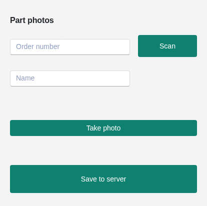

# Photos from the App to a server

A worker scans an order number, types a name, takes a few photos of the part, and taps **Save to server**. This lab builds that App and sends the photos on, either to an HTTP endpoint or into a folder on a computer in your own network.

## How a photo travels

A photo never travels as bytes through your flow. The [upload](../reference/widgets/input/upload.md) widget puts each file into the workspace's file store and hands your logic a short **reference**: `{ id, name, type, size }`. One file is an entry, several are a list, at every step. Functions that take a file take that reference where they take a path: an HTTP upload, an email attachment, every File read. See [Files, data and dates](../concepts/files-data-and-dates.md#files-a-row-keeps).

That is why the widget's **Storage type** stays at **File**. The other setting, **Buffer**, keeps the content inside the value as base64 and is capped at 64 kB, which no camera photo fits into.

## The page



#### The order number and the name

Place a [form](../reference/widgets/input/form.md) widget with two fields, `orderNumber` and `name`. Beside it, place a [barcode / QR](../reference/widgets/input/barcode-qr.md) widget so the number can be scanned instead of typed.



#### The photos

Place an [upload](../reference/widgets/input/upload.md) widget. In its settings:

* **Allowed file types**: `Photo`. On a phone or a tablet that replaces the file picker with the camera.
* **Maximum number of files**: `10`. With more than one allowed, the widget writes the list of entries; with the default 1 it writes that one entry.
* **Show thumbnails**: on, so the worker sees what was taken.



#### The button

Place a [button](../reference/widgets/trigger/button.md) and set its text to `Save to server`.



<div align="left"><figure><figcaption></figcaption></figure></div>

## The flow



#### Fill the form from the scan

Drag **New Echo Executor** onto the Flowboard, select it, and drag the barcode widget onto its input. Make that input hot by dragging it onto the echo's trigger: a widget write runs nothing by itself, so without that nothing happens when someone scans. Then add a [modifier](../app-builder/flowboard/modifier.md) to the echo's output that names the field:

```javascript
({ orderNumber: x })
```

Link that modifier to the form's `autoFill` property. The form merges the object into its data.



#### Pick the entries up

Two more echo executors: one fed by the form's `formData`, one fed by the upload widget's `files`. These are the two values the save needs, each held on its own node.

Make both inputs hot as well, so each echo runs when its widget writes and passes the value on.



#### Put the request together

Drag [`combine`](../reference/functions/utilities/data-processing.md#combine) onto the Flowboard, wire the two echoes into its inputs and make both hot. It answers the latest value of each as one array.

Add a modifier to its output that shapes the whole request, so every later step reads one object:

```javascript
(() => {
  const [form, files] = x
  // one file is an entry, several are a list: always work with a list
  const photos = Array.isArray(files) ? files : files ? [files] : []
  return {
    orderNumber: form?.orderNumber ?? '',
    name: form?.name ?? '',
    photos
  }
})()
```



#### Enable the button only when ready

Add a second modifier **after** the first one, with the **+** on the first modifier. Extensions chain, so this one works on the request:

```javascript
Boolean(x.orderNumber && x.name && x.photos.length)
```

Link it to the button's `toggle` property: truthy enables the button, falsy disables it.



#### Send it

This is the one step that differs by destination. Pick a tab below.



#### Give the worker an answer

* Link the output of the sending executor to the button's `done` property. The button spins from the click until that value arrives.
* Link the same output to the upload widget's `clear` property, so the next part starts with an empty list.
* Add an [error handler](../app-builder/flowboard/error-handler.md) to the sending executor's output and drop the **Toast** action on it, with **Take message from the live value** on and the type **Error**. A failing call produces no output, so without the handler the button would spin forever and nobody would learn why.



## Where the photos go



One executor does it. The HTTP connector runs in the platform, which holds the file store, so it reads the references itself.

Drag [`post`](../reference/functions/connectors/http-rest.md#post) of **Connectors** > **HTTP / REST** onto the Flowboard:

```yaml
# url
https://intake.acme.example/parts
# options
requestType: multipart
```

Wire the request modifier into `post`'s `data` input. With `requestType: multipart`, every key of `data` becomes a form field, and a value that is a file reference becomes a file part under its own name and type: `photos` holds the list, so the request carries one part per photo and two text fields.

Link the button's event to `post`'s trigger. Leave the `data` input as plain data: the click is the impulse.


An endpoint with a company or self-made certificate is refused until the workspace trusts it. Trust it once with `trustServer` of [Trusted certificates](../reference/functions/connectors/trusted-certificates.md). Credentials for the endpoint belong in a [secret variable](../concepts/variables-and-endpoints.md#secrets), never in a plain input.




A folder on a PC in your network is not reachable from the cloud, so this needs a [native agent](../app-manager/agents/native-agent.md) running on that PC, built with the **File I/O** connector. Build it in the Manager's [Agents](../app-manager/agents/README.md) screen and hand the requirements sheet to whoever installs it.

The agent runs on that PC and does not see the workspace's file store, so the photos are read in the platform and written on the agent: the same **File I/O** class at two addresses, with one reshape between them.

1. **Read them.** From **Connectors** > **File I/O**, the platform's own entry and not your agent's, drag [`readFileToBuffer`](../reference/functions/connectors/file-i-o.md#readfiletobuffer) onto the Flowboard. Wire the upload echo's output into its `filePath` input, which takes a reference as well as a path. Right-click its trigger, **Process One By One** > **On input 1**: the executor then runs once per entry and collects the results into a list, in the same order. See [Loops](../concepts/when-streams-meet.md#loops-once-per-element).
2. **Name them.** Drag a second `combine` onto the board, wire the request modifier into input 1 and `readFileToBuffer`'s output into input 2, and add a modifier to it:

   ```javascript
   (() => {
     const [request, buffers] = x
     return request.photos.map((photo, i) => ({
       name: photo.name,
       base64: buffers[i]
     }))
   })()
   ```

3. **Write them.** From your agent's own entry in the Functions explorer, under **File I/O**, drag [`writeBuffersToDirectory`](../reference/functions/connectors/file-i-o.md#writebufferstodirectory) onto the board. Give it the folder and wire the modifier into `bufferData`:

   ```yaml
   # dirname
   C:\Data\Images
   ```

A relative path is read relative to the agent's own folder on that host.

The click goes to `readFileToBuffer` alone: link the button's event to its trigger. The write follows the read, so make `writeBuffersToDirectory`'s `bufferData` input hot instead of linking the button to it. A click that fired both would start the write before the files were read.


Sort the photos by order number by computing `dirname` instead of fixing it: a modifier on the request that builds `'C:\\Data\\Images\\' + x.orderNumber`, wired into the `dirname` input.




## Try it

Click **Test**, open the App on a phone with the QR code from the version badge, and take a photo. The App has to be deployed before a phone can use it: a device opens the App's URL, which serves the deployed version alone.

## What to change next

* **Keep the photos with the order**: a `files` field on a table takes the whole list in one cell, a `file` field one entry. Where each photo needs a caption or an author, give it a row of its own, related to the order's row. See [Database editor](../app-builder/database-editor.md).
* **Show them again**: a [gallery](../reference/widgets/display/gallery.md) shows a list of files, or a list of rows that hold one.
* **Fewer, smaller files**: the upload widget's **Resolution** and **Aspect ratio** settings scale and crop what the camera delivers before it leaves the device.
