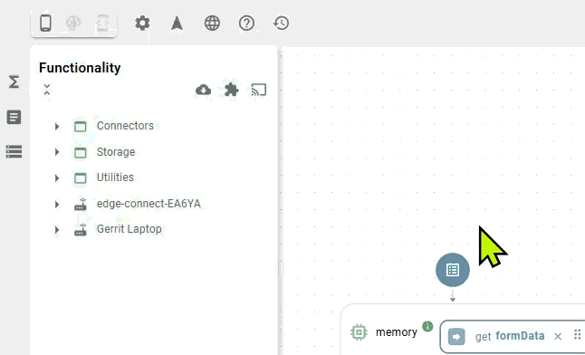

# Add-ons

An add-on brings new classes to a workspace. It is a Docker image that the platform starts as an agent of its own; its classes then appear in the Functions explorer under the add-on's name and are wired like any others. Some add-ons are Heisenware's; one is whatever you write yourself.


#### Add-ons and extensions

Add-ons add whole new classes. Extensions are something else: the modifiers, filters, recorders and error handlers that sit on an executor's output. See [Extensions, branching and errors](../../../concepts/extensions-branching-and-errors.md).


## Installing one

The Functions explorer has a puzzle-piece button, **Install Extension**. It opens a small form:

* **Heisenware Extension**: the add-on to install. **Industrial Blockchain** and **RAG AI** are Heisenware's; **Custom Extension** asks for the **Full image name** of your own.
* **Environment Variables**: one line per setting the image expects, written `NAME: value`, for credentials and endpoints.

**Install** pulls the image and starts it. Installing the same image again replaces the running container, which is how you bring a new version in. **Remove** stops it and takes its classes out of the explorer.

<figure><figcaption>Installing an add-on from the Functions explorer</figcaption></figure>

What you install stays installed: the add-on comes back when the platform restarts, and one you removed stays away. Each add-on signs in to the workspace with a login of its own, listed with the other [integrations](../../../app-manager/integrations.md).


#### Your own image needs your own server

On the Heisenware cloud only Heisenware's own images may be installed, because its servers are shared. **Custom Extension** is therefore offered on a dedicated server and on a self-hosted platform only; elsewhere the install is refused with "Own Docker images run on your own server only". A custom add-on can still run outside the platform, on your own machine, and connect in as an agent: see [Custom add-ons](../../../developers/custom-add-ons.md).


## Official add-ons

<table><thead><tr><th width="220">Add-on</th><th>Description</th></tr></thead><tbody><tr><td><a href="industrial-blockchain.md">Industrial Blockchain</a></td><td>Writes data to a tamper-evident ledger, for audit trails and proof of origin. Installed, it also gives the <a href="../../../app-builder/flowboard/recorder.md">recorder</a> its <strong>Blockchain</strong> retention policy.</td></tr><tr><td>RAG AI</td><td>Retrieval-augmented AI over your own documents. Not documented here yet.</td></tr></tbody></table>

## Custom add-ons

A custom add-on is your own code, in plain Node.js, running as an agent. You write the class, build the image and install it, and its functions are on the Flowboard like the platform's own. [Custom add-ons](../../../developers/custom-add-ons.md) shows the steps and the project scaffold to start from.
