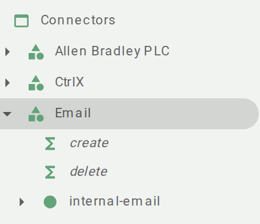
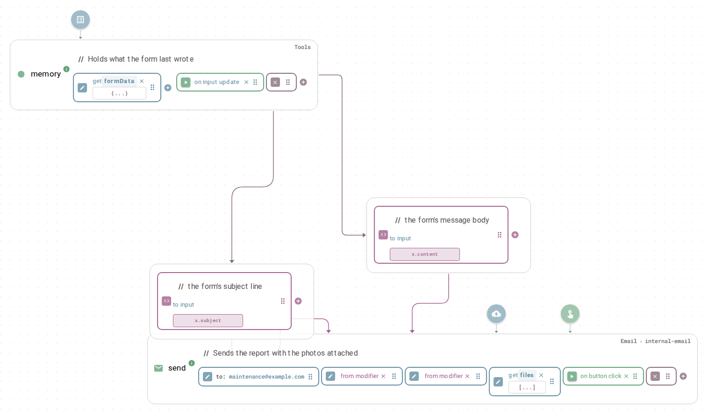

# Email

The email connector sends emails via SMTP. You configure a mail server once, then send messages with plain text or HTML content and any number of attachments.

This connector requires [instance creation](README.md#instance-creation) before you can interact with an SMTP server of your own. Heisenware includes a ready-made instance.


#### Ready-to-use instance

Heisenware ships with an email instance called `internal-email`. It is always available, letting you call `send` directly. Its emails come from `<Account> Notifier <no-reply@heisenware.com>`.



To send through another mailing system (such as Gmail, Office 365, or a private SMTP server), create a new instance with your server's connection and authentication details.


### `create`

Creates a new email client instance by configuring the connection to an SMTP server. Nothing connects yet: each `send` dials the server.

A mail server with a self-made or company certificate is refused until it is trusted. Trust it once for the whole workspace with the [Trusted certificates](trusted-certificates.md) function `trustServer`, for example `smtp://mail.plant.local` (`smtps://` for port 465). The next email goes out. The `tls` option is for the exceptions.

#### Parameters

<table><thead><tr><th width="150">Input</th><th width="120">Key</th><th>Description</th><th width="100">Type</th></tr></thead><tbody><tr><td><code>options</code></td><td><code>host</code></td><td>The hostname or IP address of your SMTP server (such as <code>smtp.gmail.com</code>).</td><td>string</td></tr><tr><td></td><td><code>port</code></td><td>The port to connect to. Common values include 465 for SMTPS (use with <code>secure: true</code>), 587 for STARTTLS (use with <code>secure: false</code>), or 25 for unencrypted SMTP. Default 587, or 465 if <code>secure</code> is true.</td><td>integer</td></tr><tr><td></td><td><code>secure</code></td><td>If true, the connection uses direct SSL/TLS. If false, the connection upgrades to TLS via STARTTLS if the server supports it. Default false.</td><td>boolean</td></tr><tr><td></td><td><code>ignoreTLS</code></td><td>Optional. If true (and <code>secure</code> is false), the connector does not use TLS even if the server supports STARTTLS. Default false.</td><td>boolean</td></tr><tr><td></td><td><code>requireTLS</code></td><td>Optional. If true (and <code>secure</code> is false), the connection must upgrade to STARTTLS, otherwise the connector does not send the message. Default false.</td><td>boolean</td></tr><tr><td></td><td><code>tls</code></td><td>Optional. TLS settings for this server only, on top of what the workspace trusts: <code>rejectUnauthorized</code> (false accepts any certificate), <code>ca</code>, <code>cert</code>, <code>key</code>, <code>passphrase</code>, as for <a href="http-rest.md#self-signed-and-internal-certificates">HTTP / REST</a>.</td><td>object</td></tr><tr><td><code>auth</code></td><td><code>user</code></td><td>The username, typically your full email address.</td><td>string</td></tr><tr><td></td><td><code>pass</code></td><td>The password for the email account, for the type <code>login</code>.</td><td>string</td></tr><tr><td></td><td><code>type</code></td><td>The authentication type: <code>login</code> or <code>oauth2</code>. Default <code>login</code>.</td><td>string</td></tr><tr><td></td><td><code>clientId</code></td><td>OAuth2 only. The registered client id of the application.</td><td>string</td></tr><tr><td></td><td><code>clientSecret</code></td><td>OAuth2 only. The registered client secret of the application.</td><td>string</td></tr><tr><td></td><td><code>refreshToken</code></td><td>OAuth2 only, optional. With it, the connector requests a new access token when the current one expires or fails.</td><td>string</td></tr><tr><td></td><td><code>accessToken</code></td><td>OAuth2 only. The access token for the user. Required only without a <code>refreshToken</code>.</td><td>string</td></tr><tr><td></td><td><code>expires</code></td><td>OAuth2 only, optional. The expiration time of the current <code>accessToken</code>.</td><td>string</td></tr><tr><td></td><td><code>accessUrl</code></td><td>OAuth2 only, optional. The HTTP endpoint that issues new access tokens. Default: Gmail's.</td><td>string</td></tr><tr><td></td><td><code>serviceClient</code></td><td>OAuth2 with a service account. The service client id: the <code>client_id</code> field of the service key file.</td><td>string</td></tr><tr><td></td><td><code>privateKey</code></td><td>OAuth2 with a service account. The private key: the <code>private_key</code> field of the service key file.</td><td>string</td></tr><tr><td><code>defaults</code></td><td></td><td>An object merged into every email sent with this instance, such as to set a shared <code>from</code> address.</td><td>object</td></tr></tbody></table>


Right-click the `auth` input and choose **Secret Input** to mask the password.


#### Examples

Example 1: Connecting with STARTTLS (such as Office 365)

```yaml
# options
host: smtp.office365.com
port: 587
secure: false
# auth
user: my-user@my-company.com
pass: my-secret-password
# defaults
from: '"My Application" <my-user@my-company.com>'
```

Example 2: Connecting with direct SSL/TLS

```yaml
# options
host: mail.my-legacy-server.com
port: 465
secure: true
# auth
user: my-user@my-legacy-server.com
pass: another-password
```

Example 3: Connecting with OAuth2

```yaml
# options
host: smtp.gmail.com
port: 465
secure: true
# auth
type: oauth2
user: my-user@my-company.com
clientId: <client id>
clientSecret: <client secret>
refreshToken: <refresh token>
```

#### Output

Returns the name of the created instance.

### `send`

Composes and sends an email. A `content` with HTML tags goes out as HTML, any other as plain text.

#### Parameters

<table><thead><tr><th width="150">Input</th><th width="120">Key</th><th>Description</th><th width="100">Type</th></tr></thead><tbody><tr><td><code>address</code></td><td><code>from</code></td><td>The sender's address, plain (<code>sender@server.com</code>) or formatted (<code>'"Sender Name" &#x3C;sender@server.com>'</code>). Omit this if the instance defines a default <code>from</code>.</td><td>string</td></tr><tr><td></td><td><code>to</code></td><td>The primary recipient or recipients, provided as a single address, a comma-separated string, or an array of strings.</td><td>string or array</td></tr><tr><td></td><td><code>cc</code></td><td>Carbon copy recipients, using the same formats as <code>to</code>.</td><td>string or array</td></tr><tr><td></td><td><code>bcc</code></td><td>Blind carbon copy recipients, using the same formats as <code>to</code>.</td><td>string or array</td></tr><tr><td><code>subject</code></td><td></td><td>The subject line of the email.</td><td>string</td></tr><tr><td><code>content</code></td><td></td><td>The body of the email, provided as plain text or HTML.</td><td>string</td></tr><tr><td><code>attachments</code></td><td><code>filename</code></td><td>The filename shown in the email. Unicode characters are allowed.</td><td>string</td></tr><tr><td></td><td><code>content</code></td><td>The attachment content as a string. For base64 content, add <code>encoding: base64</code>.</td><td>string</td></tr><tr><td></td><td><code>encoding</code></td><td>The encoding of the <code>content</code> value, such as <code>base64</code>.</td><td>string</td></tr><tr><td></td><td><code>path</code></td><td>The path of the file to attach, for example a file of the workspace under <code>/shared/uploads/</code>. This streams the file from disk, which is more memory-efficient for large files than <code>content</code>.</td><td>string</td></tr><tr><td></td><td><code>href</code></td><td>A URL to the file. The connector downloads the content from this URL. Data URIs work as well.</td><td>string</td></tr><tr><td></td><td><code>httpHeaders</code></td><td>Optional HTTP headers to pass with the <code>href</code> request, such as an authorization header.</td><td>object</td></tr><tr><td></td><td><code>cid</code></td><td>A unique content ID to embed the attachment as an inline image in the HTML body (for example, <code>&#x3C;img src="cid:my-image-cid"></code>).</td><td>string</td></tr></tbody></table>

The `attachments` input takes a list of objects with the keys above. Provide either `content`, `path`, or `href` per attachment.

A file a table row or a widget keeps is attached as it is, under its own name and type. A list element can be:

* **A file reference**: `{ id, name, type, size }`, as an [upload](../../widgets/input/upload.md) widget delivers it and a [`file` field](../storage/relational-database.md#files-in-a-table) holds it. The connector reads the file from the workspace's file store.
* **Small content**: `{ name, type, size, base64 }`, for example a signature.
* **A list of those**: the value of a `files` field. Each file is attached.


`attachments` must be a list. A widget or field that holds one file delivers a single entry: put it into a list (`[entry]`), for example with a [modifier](../../../app-builder/flowboard/modifier.md).


#### Examples

Example 1: Plain text email

```yaml
# address
to: 'recipient@example.com'
from: '"Support Team" <support@my-company.com>'
# subject
Your recent support ticket
# content
Hello,

This is a confirmation that we have received your support ticket. We will get back to you shortly.

Regards,
The Support Team
```

Example 2: HTML email

```yaml
# address
to: 'customer@example.com'
from: '"Sales" <sales@my-company.com>'
# subject
Your weekly newsletter
# content
'<h1>Our Top Story This Week</h1><p>Check out our latest product, now available for pre-order!</p><a href="https://my-company.com/products/new">Pre-order Now</a>'
```

Example 3: Attachment from a file path

```yaml
# address
to: 'manager@example.com'
from: 'reports@my-company.com'
# subject
Q3 financial report
# content
Please find the Q3 financial report attached.
# attachments
[
  {
    filename: 'Q3-Report.pdf',
    path: '/shared/uploads/reports/q3_financials.pdf'
  }
]
```

Example 4: Attachment from a base64 string

```yaml
# address
to: 'client@example.com'
from: 'invoices@my-company.com'
# subject
Your invoice #12345
# content
Your invoice is attached.
# attachments
[
  {
    filename: 'invoice.pdf',
    content: 'JVBERi0xLjQKJ...', # the base64 string
    encoding: 'base64'
  }
]
```

Example 5: HTML email with an inline image

```yaml
# address
to: 'team@example.com'
from: 'marketing@my-company.com'
# subject
Check out our new logo!
# content
'<p>We are excited to unveil our new company logo:</p>'
# attachments
[
  {
    filename: 'logo.png',
    path: '/shared/uploads/new_logo.png',
    cid: 'logo-image@my-company.com' # this cid must match the src in the HTML
  }
]
```

Example 6: Files a table row keeps

```yaml
# address
to: 'maintenance@example.com'
# subject
Leak at the filler
# content
Photos attached.
# attachments
[
  {
    id: '9f2c…', # the reference a file field holds
    name: 'pump-leak.jpg',
    type: 'image/jpeg',
    size: 482113
  }
]
```

#### Output

Returns `true` on a successful send. If the send fails, the function logs the error and returns nothing without throwing an error: check the return for `true` when the flow depends on the email. The same applies when the instance was created with a failing configuration: the connector then skips sending and logs a warning.

### `delete`

Removes the instance and its configured mail transport.


#### Irreversible action

Deleting an instance removes its configuration. To send through that server again, you must trigger `create` anew.


#### Parameters

None.

#### Output

Returns `true` upon removal.

## App Builder example

In the example below, a [form](../../widgets/input/form.md) fills the subject and content, an [upload](../../widgets/input/upload.md) widget set to hold several files provides the attachments, and the recipient address is predefined. A button triggers the `send` function.

<figure><figcaption></figcaption></figure>

This is how the email looks:

<figure><figcaption></figcaption></figure>

