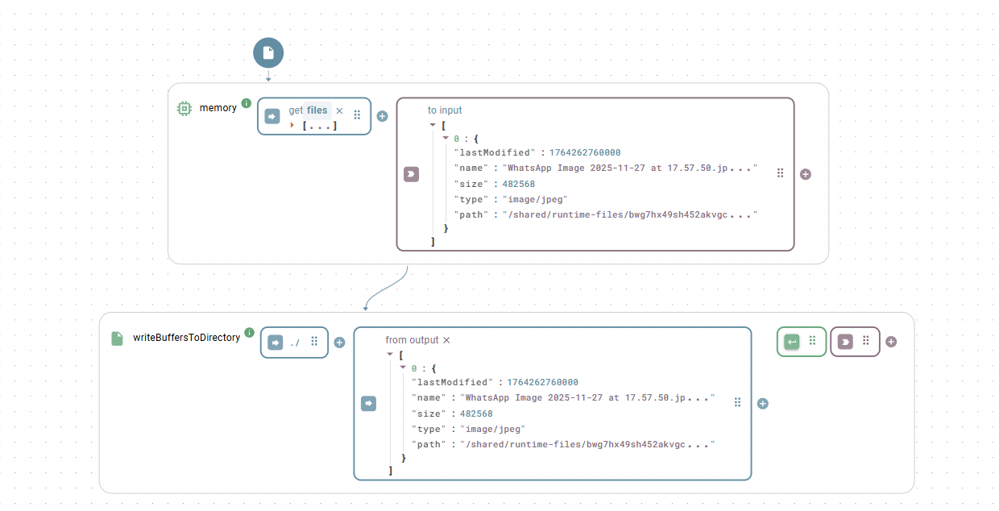

# File I/O

The file I/O functions read data from multiple file formats (CSV, Excel, PDF, XML, Word, and more), write data to files, and manage files and folders on a file system. All functions in this class are static and execute without an instance configuration.

## Where functions execute

The file system these functions access depends on their execution environment:

1. **On the platform**: the functions see the workspace's own file system, the same content as the [Files explorer](../../../app-builder/explorers/files.md). Its root is `/shared`, so a file in the uploads folder is `/shared/uploads/test.csv`.
2. **On your premises**: build an [agent](../../../concepts/agents-and-where-code-runs.md) with this connector and install it on the computer whose files you want. The functions then see that computer's file system, with its own paths, such as `C:\Users\YourUserName\Documents\test.csv`.


#### Pitfall on Windows
When referencing Windows paths, wrap the YAML input in quotes. Without quotes, `C:\Users` parses as an object containing a `C` key and a `\Users` value. Define paths as `'C:\Users'`.


## Reading files

Every read function takes the file's path. On the platform it also takes a **file reference**, `{ id, name, type, size }`: what an [upload](../../widgets/input/upload.md) widget delivers and a [`file` field](../storage/relational-database.md#files-in-a-table) of a table holds. Hand the reference over in place of the path, and the function reads that file from the workspace's file store. `read` picks the reader by the reference's `name`.

A reference works for `exists`, `read`, `readFileToBuffer`, `readCsv`, `readXlsx`, `readXlsxCells`, `readPdf`, `readXml`, the text reads (`readDocx`, `readPptx`, `readHtml`, `readTxt`, `readMd`) and the `src` of `copyFile`. Everything that writes, moves or deletes takes a path.


One file is one reference. A `files` field holds a list of them: take the element you want, for example with a [modifier](../../../app-builder/flowboard/modifier.md).


### `read`

Reads a file and automatically parses its content based on the file extension. This function serves as a convenience wrapper that calls the matching specific function (such as `readCsv` or `readXlsx`). Supported extensions include `csv`, `xlsx`, `docx`, `pptx`, `html`, `htm`, `md`, `txt`, `xsl`, `pdf`, and `xml`.

#### Parameters

<table>
  <thead>
    <tr>
      <th width="150">Input</th>
      <th>Description</th>
      <th width="100">Type</th>
    </tr>
  </thead>
  <tbody>
    <tr>
      <td><code>filename</code></td>
      <td>The full path to the file, or its file reference.</td>
      <td>string or object</td>
    </tr>
    <tr>
      <td><code>options</code></td>
      <td>Options specific to the detected file type. See the respective read function.</td>
      <td>object</td>
    </tr>
  </tbody>
</table>

#### Example

```yaml
# filename
/path/to/my-data.xlsx
```

#### Output

Returns the parsed content of the file (for example, executing this on an `.xlsx` path internally calls `readXlsx` and returns the parsed JSON content). Throws an error for unsupported file types.

### `exists`

Checks whether a file exists at the specified path.

#### Parameters

<table>
  <thead>
    <tr>
      <th width="150">Input</th>
      <th>Description</th>
      <th width="100">Type</th>
    </tr>
  </thead>
  <tbody>
    <tr>
      <td><code>filename</code></td>
      <td>The path of the file to check, or its file reference.</td>
      <td>string or object</td>
    </tr>
  </tbody>
</table>

#### Output

Returns `true` if the file exists, or `false` if it does not.

## Working with buffers

### `readFileToBuffer`

Reads any file and returns its entire content as a base64 encoded string.

#### Parameters

<table>
  <thead>
    <tr>
      <th width="150">Input</th>
      <th>Description</th>
      <th width="100">Type</th>
    </tr>
  </thead>
  <tbody>
    <tr>
      <td><code>filePath</code></td>
      <td>The path of the file to read, or its file reference.</td>
      <td>string or object</td>
    </tr>
  </tbody>
</table>

#### Output

Returns the file content as a base64 encoded string.

### `writeBufferToFile`

Writes a base64 encoded string to a new file.

#### Parameters

<table>
  <thead>
    <tr>
      <th width="150">Input</th>
      <th>Description</th>
      <th width="100">Type</th>
    </tr>
  </thead>
  <tbody>
    <tr>
      <td><code>filePath</code></td>
      <td>The full path where the file is saved, including the filename and extension.</td>
      <td>string</td>
    </tr>
    <tr>
      <td><code>buffer</code></td>
      <td>The content of the file as a base64 encoded string.</td>
      <td>string</td>
    </tr>
  </tbody>
</table>

#### Output

Returns `true` on a successful write.

### `writeBuffersToDirectory`

Writes one or more buffer-file objects to a directory. The function creates the directory (including parent folders) if it does not exist.

#### Parameters

<table>
  <thead>
    <tr>
      <th width="150">Input</th>
      <th>Description</th>
      <th width="100">Type</th>
    </tr>
  </thead>
  <tbody>
    <tr>
      <td><code>dirname</code></td>
      <td>The path to the directory where the files are written.</td>
      <td>string</td>
    </tr>
    <tr>
      <td><code>bufferData</code></td>
      <td>A single object or an array of objects, each with a <code>name</code> and a <code>base64</code>. An object without both is refused.</td>
      <td>object or array</td>
    </tr>
  </tbody>
</table>

#### Output

Returns `true` when all files are successfully written. Throws an error listing every file that failed.

<figure><figcaption><p>What the <a href="../../widgets/input/photo.md">photo</a> and <a href="../../widgets/input/upload.md">upload</a> widgets deliver with <strong>buffer</strong> storage goes straight into this function.</p></figcaption></figure>


This function takes the inline shape, `{ name, type, size, base64 }`, which the [photo](../../widgets/input/photo.md) and [upload](../../widgets/input/upload.md) widgets deliver with **buffer** storage. With **file** storage they deliver a file reference instead, which carries no content: read it with `readFileToBuffer` and write it with `writeBufferToFile`.



#### Local file sharing
Run these functions on an agent and your App writes to a file system of your own: pictures taken with the photo widget land on your file server.


## Managing files and folders

### `moveFile`

Moves or renames a file.

#### Parameters

<table>
  <thead>
    <tr>
      <th width="150">Input</th>
      <th>Description</th>
      <th width="100">Type</th>
    </tr>
  </thead>
  <tbody>
    <tr>
      <td><code>oldPath</code></td>
      <td>The original path of the file.</td>
      <td>string</td>
    </tr>
    <tr>
      <td><code>newPath</code></td>
      <td>The new path for the file.</td>
      <td>string</td>
    </tr>
  </tbody>
</table>

#### Output

Returns nothing on success. Throws an error on failure.

### `copyFile`

Copies a file from a source path to a destination path.

#### Parameters

<table>
  <thead>
    <tr>
      <th width="150">Input</th>
      <th>Description</th>
      <th width="100">Type</th>
    </tr>
  </thead>
  <tbody>
    <tr>
      <td><code>src</code></td>
      <td>The path of the file to copy, or its file reference.</td>
      <td>string or object</td>
    </tr>
    <tr>
      <td><code>dest</code></td>
      <td>The path where the copy is created. An existing file there is overwritten.</td>
      <td>string</td>
    </tr>
  </tbody>
</table>

#### Output

Returns nothing on success. Throws an error on failure.

### `deleteFile`

Deletes a file.


#### Irreversible action
This permanently deletes the file from the file system. You cannot undo this action.


#### Parameters

<table>
  <thead>
    <tr>
      <th width="150">Input</th>
      <th>Description</th>
      <th width="100">Type</th>
    </tr>
  </thead>
  <tbody>
    <tr>
      <td><code>filename</code></td>
      <td>The path of the file to delete.</td>
      <td>string</td>
    </tr>
  </tbody>
</table>

#### Output

Returns nothing on success. Throws an error if the file does not exist.

### `createFolder`

Creates a new folder at the specified path, including any missing parent folders. A folder that already exists is left as it is.

#### Parameters

<table>
  <thead>
    <tr>
      <th width="150">Input</th>
      <th>Description</th>
      <th width="100">Type</th>
    </tr>
  </thead>
  <tbody>
    <tr>
      <td><code>path</code></td>
      <td>The path where the new folder is created.</td>
      <td>string</td>
    </tr>
  </tbody>
</table>

#### Output

Returns the first folder it created, or nothing when the folder was already there. Throws an error on failure.

### `deleteFolder`

Deletes a folder and all of its contents recursively. The function does not throw an error if the folder is missing.


#### Irreversible action
This permanently deletes the folder and all containing files and subfolders. You cannot undo this action.


#### Parameters

<table>
  <thead>
    <tr>
      <th width="150">Input</th>
      <th>Description</th>
      <th width="100">Type</th>
    </tr>
  </thead>
  <tbody>
    <tr>
      <td><code>dir</code></td>
      <td>The path of the folder to delete.</td>
      <td>string</td>
    </tr>
  </tbody>
</table>

#### Output

Returns nothing.

### `browse`

Recursively scans a folder and returns a structure representing its files and subfolders.

#### Parameters

<table>
  <thead>
    <tr>
      <th width="150">Input</th>
      <th>Description</th>
      <th width="100">Type</th>
    </tr>
  </thead>
  <tbody>
    <tr>
      <td><code>filename</code></td>
      <td>The path of the folder to browse.</td>
      <td>string</td>
    </tr>
  </tbody>
</table>

#### Output

Returns a nested JSON object detailing the folder's contents, containing the properties `name`, `path`, `size`, `modDate`, `isDir`, and a `children` array for directories:

```json
{
  "id": "12345",
  "path": "/path/to/project",
  "name": "project",
  "modDate": "2025-08-22T12:02:00.000Z",
  "size": 4096,
  "isDir": true,
  "childrenCount": 2,
  "children": [
    {
      "id": "12346",
      "path": "/path/to/project/report.docx",
      "name": "report.docx",
      "modDate": "2025-08-21T10:30:00.000Z",
      "size": 15360,
      "isDir": false,
      "isFile": true,
      "isSymlink": false
    },
    {
      "id": "12347",
      "path": "/path/to/project/images",
      "name": "images",
      "modDate": "2025-08-22T11:00:00.000Z",
      "size": 4096,
      "isDir": true,
      "childrenCount": 1,
      "children": []
    }
  ]
}
```

## CSV files

### `readCsv`

Reads CSV data and converts it into an array of JSON objects. The function automatically detects whether the input is a file path, a raw CSV string, or a base64 encoded string.

#### Parameters

<table>
  <thead>
    <tr>
      <th width="150">Input</th>
      <th width="120">Key</th>
      <th>Description</th>
      <th width="100">Type</th>
    </tr>
  </thead>
  <tbody>
    <tr>
      <td><code>fileInfo</code></td>
      <td></td>
      <td>The path to the <code>.csv</code> file or its file reference, a raw CSV string, or a base64 encoded string of the file content.</td>
      <td>string or object</td>
    </tr>
    <tr>
      <td><code>options</code></td>
      <td><code>delimiter</code></td>
      <td>The column delimiter. Provide a string (such as <code>;</code>), <code>auto</code> for automatic detection, or an array of candidates (such as <code>[',', ';', '|']</code>). Default <code>,</code>.</td>
      <td>string or array</td>
    </tr>
    <tr>
      <td></td>
      <td><code>checkType</code></td>
      <td>If true, automatically converts numbers and booleans from strings to their native types. Default false.</td>
      <td>boolean</td>
    </tr>
    <tr>
      <td></td>
      <td><code>noheader</code></td>
      <td>Indicates that the CSV data has no header row. Default false.</td>
      <td>boolean</td>
    </tr>
    <tr>
      <td></td>
      <td><code>headers</code></td>
      <td>An array of strings used as column headers, such as when the CSV has no header row.</td>
      <td>array</td>
    </tr>
    <tr>
      <td></td>
      <td><code>output</code></td>
      <td>The output format: <code>json</code>, <code>csv</code> (array of arrays), or <code>line</code> (each line as a string). Default <code>json</code>.</td>
      <td>string</td>
    </tr>
    <tr>
      <td></td>
      <td><code>trim</code></td>
      <td>Trims whitespace from headers and values. Default true.</td>
      <td>boolean</td>
    </tr>
    <tr>
      <td></td>
      <td><code>ignoreEmpty</code></td>
      <td>If true, ignores empty lines. Default false.</td>
      <td>boolean</td>
    </tr>
    <tr>
      <td></td>
      <td><code>quote</code></td>
      <td>The character used for quoting columns. Default <code>"</code>.</td>
      <td>string</td>
    </tr>
    <tr>
      <td></td>
      <td><code>includeColumns</code></td>
      <td>A regular expression specifying which columns to include.</td>
      <td>string</td>
    </tr>
    <tr>
      <td></td>
      <td><code>ignoreColumns</code></td>
      <td>A regular expression specifying which columns to ignore.</td>
      <td>string</td>
    </tr>
  </tbody>
</table>

All other [csvtojson](https://www.npmjs.com/package/csvtojson) options pass through directly.

#### Examples

Example 1: Reading a semicolon-delimited CSV with type conversion

```yaml
# fileInfo
/path/to/data.csv
# options
delimiter: ;
checkType: true
```

Example 2: Reading a CSV string with no header row

```yaml
# fileInfo
'1,ProductA,19.99\n2,ProductB,25.50'
# options
noheader: true
headers: ['id', 'name', 'price']
checkType: true
```

#### Output

Returns an array of JSON objects (or the format specified by `output`). Throws an error if the input is neither a valid path, base64 string, nor a valid CSV string.

### `writeCsv`

Converts an array of JSON objects into a CSV string and writes it to a file.

#### Parameters

<table>
  <thead>
    <tr>
      <th width="150">Input</th>
      <th width="120">Key</th>
      <th>Description</th>
      <th width="100">Type</th>
    </tr>
  </thead>
  <tbody>
    <tr>
      <td><code>json</code></td>
      <td></td>
      <td>An array of JSON objects.</td>
      <td>array</td>
    </tr>
    <tr>
      <td><code>filename</code></td>
      <td></td>
      <td>The path where the <code>.csv</code> file is saved.</td>
      <td>string</td>
    </tr>
    <tr>
      <td><code>options</code></td>
      <td><code>keys</code></td>
      <td>An array of strings specifying which properties to include as columns, in order.</td>
      <td>array</td>
    </tr>
    <tr>
      <td></td>
      <td><code>delimiter</code></td>
      <td>The field separator. Default <code>,</code>.</td>
      <td>string</td>
    </tr>
    <tr>
      <td></td>
      <td><code>header</code></td>
      <td>If false, the connector omits the header row. Default true.</td>
      <td>boolean</td>
    </tr>
    <tr>
      <td></td>
      <td><code>prependHeader</code></td>
      <td>Another name for <code>header</code>. Default true.</td>
      <td>boolean</td>
    </tr>
    <tr>
      <td></td>
      <td><code>eol</code></td>
      <td>The end-of-line character. Default <code>\n</code>.</td>
      <td>string</td>
    </tr>
    <tr>
      <td></td>
      <td><code>sortHeader</code></td>
      <td>If true, sorts the headers alphabetically. Default false.</td>
      <td>boolean</td>
    </tr>
    <tr>
      <td></td>
      <td><code>emptyFieldValue</code></td>
      <td>The value used for empty, null, or undefined fields. Default <code>''</code>.</td>
      <td>string</td>
    </tr>
    <tr>
      <td></td>
      <td><code>excelBOM</code></td>
      <td>If true, adds a BOM character for correct UTF-8 display in Excel.</td>
      <td>boolean</td>
    </tr>
  </tbody>
</table>

#### Example

```yaml
# json
[
  { "id": 1, "name": "Product A", "price": 19.99, "stock": 100 },
  { "id": 2, "name": "Product B", "price": 25.50, "stock": 250 }
]
# filename
/path/to/output.csv
# options
keys: ['id', 'name', 'price']
prependHeader: false
```

All other [json-2-csv](https://www.npmjs.com/package/json-2-csv) options pass through directly.

#### Output

Returns `true` on a successful write.

## Excel files

### `readXlsx`

Reads an Excel file and converts its content into JSON. If the file contains only one sheet (or only one is queried), the result is an array of row objects. For files with multiple sheets, the result is an object containing one key per sheet name.

#### Parameters

<table>
  <thead>
    <tr>
      <th width="150">Input</th>
      <th width="120">Key</th>
      <th>Description</th>
      <th width="100">Type</th>
    </tr>
  </thead>
  <tbody>
    <tr>
      <td><code>fileInput</code></td>
      <td></td>
      <td>The path to the <code>.xlsx</code> file, its file reference, or a base64 encoded string of the file content.</td>
      <td>string or object</td>
    </tr>
    <tr>
      <td><code>options</code></td>
      <td><code>headerRows</code></td>
      <td>The number of rows from the top treated as a header and excluded from the data.</td>
      <td>integer</td>
    </tr>
    <tr>
      <td></td>
      <td><code>sheets</code></td>
      <td>An array of sheet names to include. Default includes all existing sheets.</td>
      <td>array</td>
    </tr>
    <tr>
      <td></td>
      <td><code>columnToKey</code></td>
      <td>An object whose keys identify xlsx columns and whose values define the corresponding property name in the result.</td>
      <td>object</td>
    </tr>
    <tr>
      <td></td>
      <td><code>range</code></td>
      <td>A cell range to read (such as <code>'A2:C10'</code>).</td>
      <td>string</td>
    </tr>
  </tbody>
</table>


#### Configuration tips
* Use `columnToKey: { '*': '{{columnHeader}}' }` to automatically extract names from the header row.
* Use `columnToKey: { A: '{{A1}}', B: '{{B1}}' }` to use names defined anywhere in the sheet.
* Configure options per sheet by passing objects inside the `sheets` array:

```yaml
sheets:
  - name: sheet1
    range: 'A2:B2'
  - name: sheet2
    range: 'A3:B4'
```


#### Examples

Example 1: Reading a specific range with named columns

```yaml
# fileInput
/path/to/report.xlsx
# options
range: 'B2:D10'
columnToKey: {
  B: product,
  C: quantity,
  D: price
}
```

Output:

```json
[
  { "product": "Widget", "quantity": 10, "price": 19.99 }
]
```

Example 2: Reading a table with a single header row and mapped columns

```yaml
# fileInput
/path/to/assets.xlsx
# options
headerRows: 1
columnToKey: {
  B: barcode,
  C: name,
  D: acquired,
  H: keeper,
  K: inventoryNo,
  M: serialNo,
  N: costCtr
}
```

Output:

```json
[
  { "barcode": 187552, "name": "HP Laptop", "acquired": "2025-06-01T00:00:00.000Z" }
]
```

Example 3: Combining Excel reading with a file upload

<figure><figcaption><p>An uploaded .xlsx file with <strong>buffer</strong> storage: a modifier takes its <code>base64</code> and feeds it to <code>readXlsx</code>.</p></figcaption></figure>

With **file** storage the widget delivers a file reference instead. Wire that straight into `fileInput`: no modifier is needed, and a large workbook never travels through the flow as text.

### `readXlsxCells`

Reads the values of one or more specific cells from an Excel sheet.

#### Parameters

<table>
  <thead>
    <tr>
      <th width="150">Input</th>
      <th>Description</th>
      <th width="100">Type</th>
    </tr>
  </thead>
  <tbody>
    <tr>
      <td><code>fileInput</code></td>
      <td>The path to the <code>.xlsx</code> file, its file reference, or a base64 encoded string of the file content.</td>
      <td>string or object</td>
    </tr>
    <tr>
      <td><code>cellAddresses</code></td>
      <td>A single cell address (such as <code>'B5'</code>) or an array of addresses (such as <code>['A1', 'C5']</code>).</td>
      <td>string or array</td>
    </tr>
    <tr>
      <td><code>sheetIdentifier</code></td>
      <td>The name (such as <code>'Sales'</code>) or zero-based index (<code>0</code>) of the sheet. Default targets the first sheet.</td>
      <td>string or integer</td>
    </tr>
  </tbody>
</table>

#### Example

```yaml
# fileInput
/path/to/report.xlsx
# cellAddresses
['B2', 'D5']
# sheetIdentifier
'Summary'
```

#### Output

Returns the cell value, or an array of values when you provide multiple addresses (such as `['Total Revenue', 15000]`). Empty or non-existent cells return no value. Throws an error if the file or sheet is not found.

### `writeXlsx`

Writes an array of JSON objects to a new Excel file.

#### Parameters

<table>
  <thead>
    <tr>
      <th width="150">Input</th>
      <th width="120">Key</th>
      <th>Description</th>
      <th width="100">Type</th>
    </tr>
  </thead>
  <tbody>
    <tr>
      <td><code>data</code></td>
      <td></td>
      <td>The array of JSON objects to write. This array must not be empty.</td>
      <td>array</td>
    </tr>
    <tr>
      <td><code>filePath</code></td>
      <td></td>
      <td>The path where the new <code>.xlsx</code> file is saved.</td>
      <td>string</td>
    </tr>
    <tr>
      <td><code>options</code></td>
      <td><code>sheetName</code></td>
      <td>The name for the worksheet. Default <code>Sheet1</code>.</td>
      <td>string</td>
    </tr>
    <tr>
      <td></td>
      <td><code>headers</code></td>
      <td>An array of strings used as the header row. Default uses the keys of the first data object.</td>
      <td>array</td>
    </tr>
  </tbody>
</table>

#### Example

```yaml
# data
[
  { "product": "Widget", "quantity": 10, "price": 19.99 },
  { "product": "Gadget", "quantity": 5, "price": 49.95 }
]
# filePath
/path/to/new_report.xlsx
# options
sheetName: 'Inventory'
```

#### Output

Returns nothing on success. Throws an error on empty data, an invalid path, or a failed write.

## Other document formats

### `readPdf`

Reads a PDF file and extracts its text content and metadata.

#### Parameters

<table>
  <thead>
    <tr>
      <th width="150">Input</th>
      <th>Description</th>
      <th width="100">Type</th>
    </tr>
  </thead>
  <tbody>
    <tr>
      <td><code>filename</code></td>
      <td>The path to the <code>.pdf</code> file, or its file reference.</td>
      <td>string or object</td>
    </tr>
    <tr>
      <td><code>options</code></td>
      <td>Accepted so that <code>read</code> can pass its options on, and not used. The PDF is always read whole.</td>
      <td>object</td>
    </tr>
  </tbody>
</table>

#### Output

Returns an object containing `text` (the full text content), `numpages`, `numrender`, and `info` (metadata):

```json
{
  "numpages": 2,
  "numrender": 2,
  "info": {
    "PDFFormatVersion": "1.7",
    "Title": "My Annual Report",
    "Author": "John Doe",
    "Creator": "Microsoft® Word for Office 365",
    "CreationDate": "D:20250822120200Z"
  },
  "metadata": null,
  "text": "\n\nPage 1 Content\n\nThis is the first paragraph of the annual report...\n\n",
  "version": "1.10.100"
}
```

### `readXml`

Reads an XML file and converts it into a JSON object.

#### Parameters

<table>
  <thead>
    <tr>
      <th width="150">Input</th>
      <th width="120">Key</th>
      <th>Description</th>
      <th width="100">Type</th>
    </tr>
  </thead>
  <tbody>
    <tr>
      <td><code>filename</code></td>
      <td></td>
      <td>The path to the <code>.xml</code> file, or its file reference.</td>
      <td>string or object</td>
    </tr>
    <tr>
      <td><code>options</code></td>
      <td><code>attrkey</code></td>
      <td>The key used for XML attributes. Default <code>_attr</code>.</td>
      <td>string</td>
    </tr>
    <tr>
      <td></td>
      <td><code>explicitArray</code></td>
      <td>If false, single-element arrays convert to a single object. Default true.</td>
      <td>boolean</td>
    </tr>
    <tr>
      <td></td>
      <td><code>mergeAttrs</code></td>
      <td>If true, merges attributes into their parent object instead of a separate <code>attrkey</code> object.</td>
      <td>boolean</td>
    </tr>
    <tr>
      <td></td>
      <td><code>explicitRoot</code></td>
      <td>If false, the root XML element is excluded from the result.</td>
      <td>boolean</td>
    </tr>
  </tbody>
</table>

All other [xml2js](https://www.npmjs.com/package/xml2js) parser options pass through directly.

#### Output

Returns a JSON representation of the XML content.

### `readDocx`, `readPptx`, `readHtml`, `readTxt`, `readMd`

These functions read their respective file types and extract the plain text content. They take the same `options`, and each picks its extractor by the function you call, not by the file's name: `readTxt` on a `.docx` file reads the Word document's bytes as text. Use `typeOverride` for a file whose ending does not match its content.

#### Parameters

<table>
  <thead>
    <tr>
      <th width="150">Input</th>
      <th width="220">Key</th>
      <th>Description</th>
      <th width="100">Type</th>
    </tr>
  </thead>
  <tbody>
    <tr>
      <td><code>filename</code></td>
      <td></td>
      <td>The path to the file, or its file reference.</td>
      <td>string or object</td>
    </tr>
    <tr>
      <td><code>options</code></td>
      <td><code>preserveLineBreaks</code></td>
      <td>Maintains line breaks from the original document. Default true.</td>
      <td>boolean</td>
    </tr>
    <tr>
      <td></td>
      <td><code>preserveOnlyMultipleLineBreaks</code></td>
      <td>Removes single line breaks and keeps multiple ones, so paragraphs stay apart and wrapped lines join. Default false.</td>
      <td>boolean</td>
    </tr>
    <tr>
      <td></td>
      <td><code>includeAltText</code></td>
      <td>Adds the alt text of images, for HTML. Default false.</td>
      <td>boolean</td>
    </tr>
    <tr>
      <td></td>
      <td><code>typeOverride</code></td>
      <td>Reads the file as this media type instead of the function's own: <code>application/vnd.openxmlformats-officedocument.wordprocessingml.document</code> (Word), <code>application/vnd.openxmlformats-officedocument.presentationml.presentation</code> (Powerpoint), <code>text/html</code>, <code>text/markdown</code>, <code>text/plain</code> or <code>application/xml</code>. Any other type is refused.</td>
      <td>string</td>
    </tr>
  </tbody>
</table>

These four are all the options a text read takes. Any other key is refused, naming it (`Refused text read option 'x'`).

#### Output

Returns the plain text content of the file as a string.
