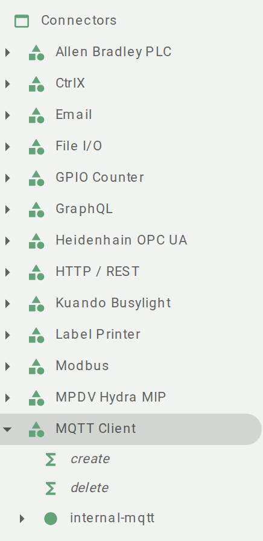

# MQTT client

The MQTT client connector connects to an MQTT broker over TCP, TLS or WebSockets, publishes messages and listens to topics. It handles keep-alive pings, the Quality of Service (QoS) flows and reconnection, and queues what you publish while the connection is down.

Every workspace comes with a connected instance named `internal-mqtt`, which talks to the platform's own broker. Use it in your flows to publish and listen to the workspace's topics without any connection settings. To talk to a broker of your own, this connector requires [instance creation](README.md#instance-creation): create an instance and use the [connection management](mqtt-client.md#connection-management) functions below.

<p align="center"><br></p>

## Two ways to use MQTT

Which setup you need depends on where the broker runs:

* **Your devices or software act as MQTT clients** and exchange data with Heisenware. You need no broker of your own and no connector instance. Your clients connect to your account's Heisenware broker, and in the App Builder the built-in `internal-mqtt` instance handles the messages. See [Connecting an external client to Heisenware](mqtt-client.md#connecting-an-external-client-to-heisenware).
* **You run your own MQTT broker** (or use a third-party broker such as HiveMQ). Create a connector instance with [`create`](mqtt-client.md#create) and connect it to that broker with `connect`.

## Connecting an external client to Heisenware

External devices and scripts connect as MQTT clients of your account's broker. Data published this way arrives on the internal broker, where `internal-mqtt` can subscribe to it, and messages published through `internal-mqtt` reach the external client in turn.

To connect an external client, first generate credentials in the [Integrations panel](../../../app-manager/integrations.md) of the App Manager, then configure your client with these credentials and the following connection details:

* Hostname: `<account>.heisenware.cloud`
* Port: `8884` (MQTTS, TLS encrypted)
* Protocol version: MQTT 3.1.1 (the broker can refuse MQTT 5 connections)
* Topic prefix: the workspace's domain, `<account>.<workspace>`. A client of the workspace `acme.default` publishes to a topic like `acme.default/line2/filler`.


#### Server certificate

Standard CA certificates work, for example the system certificate store under `/etc/ssl/certs/`. If your environment does not trust the Heisenware certificate, enable your client's option to proceed without validating the server certificate.


For a complete walkthrough, including how to process the incoming data in an App, see [Connect an external MQTT client](../../../labs/connect-an-external-mqtt-client.md).

## Connection management

### `create`

Creates a client instance for a broker of your own. It takes no parameters: `connect` names the broker.

#### Parameters

None.

#### Output

Returns the name of the created instance.

### `connect`

Connects to an MQTT broker. If the client is already connected to the same URL with the same options, the function does nothing. With another URL or other options, the client first disconnects from the current broker, which ends its listeners and subscriptions, and then connects anew.

The connection is not stored with the instance: after a restart of the agent the instance exists but is not connected. Trigger `connect` when the App starts.

A broker with a self-made or company certificate (`mqtts`, `wss`) is refused until it is trusted. Trust it once for the whole workspace with the [Trusted certificates](trusted-certificates.md) function `trustServer`, for example `mqtts://broker.local`. The next `connect` accepts it.

#### Parameters

<table><thead><tr><th width="95.28619384765625">Input</th><th width="167.6767578125">Key</th><th>Description</th><th width="100">Type</th></tr></thead><tbody><tr><td><code>url</code></td><td></td><td>The broker URL including the transport protocol prefix (such as <code>mqtt://broker.hivemq.com</code> or <code>mqtts://test.mosquitto.org</code>). Supported protocols: <code>mqtt</code>, <code>mqtts</code>, <code>tcp</code>, <code>tls</code>, <code>ws</code>, <code>wss</code>.</td><td>string</td></tr><tr><td><code>options</code></td><td><code>clientId</code></td><td>A unique identifier for the client session. Generates a random identifier if omitted.</td><td>string</td></tr><tr><td></td><td><code>username</code></td><td>The username required by the broker, if any.</td><td>string</td></tr><tr><td></td><td><code>password</code></td><td>The password required by the broker, if any.</td><td>string</td></tr><tr><td></td><td><code>keepalive</code></td><td>The interval in seconds between keep-alive pings. Set to 0 to disable. Default 60.</td><td>integer</td></tr><tr><td></td><td><code>connectTimeout</code></td><td>The time in milliseconds to wait for the connection acknowledgment before the connection fails. Default 30000.</td><td>integer</td></tr><tr><td></td><td><code>reconnectPeriod</code></td><td>The interval in milliseconds between two reconnection attempts. Set to 0 to disable automatic reconnection. Default 1000.</td><td>integer</td></tr><tr><td></td><td><code>protocolVersion</code></td><td>The MQTT version: 4 is MQTT 3.1.1, 5 is MQTT 5. Default 4.</td><td>integer</td></tr><tr><td></td><td><code>protocolId</code></td><td>The protocol name sent to the broker. Change it only for an MQTT 3.1 broker (<code>MQIsdp</code> with <code>protocolVersion</code> 3). Default <code>MQTT</code>.</td><td>string</td></tr><tr><td></td><td><code>clean</code></td><td>Set to false to receive QoS 1 and 2 messages while offline. Default true.</td><td>boolean</td></tr><tr><td></td><td><code>resubscribe</code></td><td>When the connection breaks and reconnects, subscribed topics are subscribed again automatically. Default true.</td><td>boolean</td></tr><tr><td></td><td><code>queueQoSZero</code></td><td>Queue outgoing QoS 0 messages while the connection is broken. Default true.</td><td>boolean</td></tr><tr><td></td><td><code>reschedulePings</code></td><td>Restart the keep-alive timer after every packet sent, so a client that keeps publishing sends no extra pings. Default true.</td><td>boolean</td></tr><tr><td></td><td><code>autoUseTopicAlias</code></td><td>MQTT 5 only: send a topic alias in place of a topic the broker already knows. Default false.</td><td>boolean</td></tr><tr><td></td><td><code>autoAssignTopicAlias</code></td><td>MQTT 5 only: assign topic aliases to published topics automatically. Default false.</td><td>boolean</td></tr><tr><td></td><td><code>will</code></td><td>A last will and testament configuration object the broker delivers if the client disconnects ungracefully. Keys: <code>topic</code>, <code>payload</code>, <code>qos</code>, <code>retain</code>.</td><td>object</td></tr><tr><td></td><td><code>tls</code></td><td>TLS settings for an <code>mqtts</code> or <code>wss</code> broker, on top of what the workspace trusts: <code>rejectUnauthorized</code> (false accepts any certificate), <code>ca</code>, <code>cert</code>, <code>key</code>, <code>passphrase</code>.</td><td>object</td></tr><tr><td></td><td><code>wsOptions</code></td><td>For <code>ws</code> and <code>wss</code> only: options of the WebSocket connection, such as <code>headers</code>. Default <code>{}</code>.</td><td>object</td></tr></tbody></table>

#### Example

```yaml
# url
mqtt://broker.hivemq.com
# options
username: my-device-user
password: my-secret-password
will:
  topic: devices/my-device/status
  payload: offline
  qos: 1
  retain: true
```

#### Output

Returns `true` when the connection is established, also when it existed already. Throws an error if the connection fails.

### `disconnect`

Closes the connection to the MQTT broker. Every `onStringMessage` and `onJsonMessage` listener of the instance ends, and its subscriptions are dropped.

#### Parameters

<table><thead><tr><th width="150">Input</th><th>Description</th><th width="100">Type</th></tr></thead><tbody><tr><td><code>force</code></td><td>When set to true, the client closes the connection immediately without waiting for in-flight messages to be acknowledged. Default false.</td><td>boolean</td></tr></tbody></table>

#### Output

Returns `true` upon successful disconnection, including when no connection exists.

### `isConnected`

Checks whether the client has an active connection to the broker.

#### Parameters

None.

#### Output

Returns `true` if connected, or `false` if disconnected.

### `isReconnecting`

Checks whether the client is currently trying to reconnect after a connection failure.

#### Parameters

None.

#### Output

Returns `true` if a reconnection attempt is running, or `false` if it is not.

### `delete`

Deletes the instance: closes its broker connection and drops every listener and subscription.


#### Irreversible action

To talk to the broker again, trigger `create` and `connect` anew.


#### Parameters

None.

#### Output

Returns `true` upon removal.

## Publishing messages

### `publishString`

Publishes a text to a topic. A message published while the connection is down waits until it is back, see [Publishing while the connection is down](mqtt-client.md#publishing-while-the-connection-is-down).

#### Parameters

<table><thead><tr><th width="102.02020263671875">Input</th><th width="120">Key</th><th>Description</th><th width="100">Type</th></tr></thead><tbody><tr><td><code>topic</code></td><td></td><td>The topic to publish to.</td><td>string</td></tr><tr><td><code>message</code></td><td></td><td>The text message payload to publish.</td><td>string</td></tr><tr><td><code>options</code></td><td><code>qos</code></td><td>The Quality of Service (QoS) delivery guarantee level (0, 1, or 2). Default 0.</td><td>integer</td></tr><tr><td></td><td><code>retain</code></td><td>When set to true, the broker stores the message as the last known value for the topic. Default false.</td><td>boolean</td></tr><tr><td></td><td><code>dup</code></td><td>Marks the message as a duplicate. Default false.</td><td>boolean</td></tr></tbody></table>

#### Example

```yaml
# topic
devices/my-device/log
# message
Device starting up...
# options
qos: 1
```

#### Output

Returns nothing for a QoS 0 publication and the broker acknowledgment packet for QoS 1 and 2. Throws an error if publication fails or the client was never connected.

### `publishJson`

Publishes an object to a topic. The connector serializes it into a JSON string first.

#### Parameters

<table><thead><tr><th width="112.12127685546875">Input</th><th width="120">Key</th><th>Description</th><th width="100">Type</th></tr></thead><tbody><tr><td><code>topic</code></td><td></td><td>The topic to publish to.</td><td>string</td></tr><tr><td><code>message</code></td><td></td><td>The structured data object payload to publish.</td><td>object</td></tr><tr><td><code>options</code></td><td><code>qos</code></td><td>The Quality of Service (QoS) delivery guarantee level (0, 1, or 2). Default 0.</td><td>integer</td></tr><tr><td></td><td><code>retain</code></td><td>When set to true, the broker stores the message as the last known value for the topic. Default false.</td><td>boolean</td></tr><tr><td></td><td><code>dup</code></td><td>Marks the message as a duplicate. Default false.</td><td>boolean</td></tr></tbody></table>

#### Example

```yaml
# topic
devices/my-device/data
# message
temperature: 21.5
humidity: 45.2
```

#### Output

Returns nothing for a QoS 0 publication and the broker acknowledgment packet for QoS 1 and 2. Throws an error if publication fails or the client was never connected.

## Subscribing to messages

There are two ways to receive messages:

* **A listener with a topic**: give `onStringMessage` or `onJsonMessage` a `topic`. The listener subscribes to it and receives only what matches. This is the common case, and it needs no `subscribe`.
* **A listener without a topic**: it receives every message of the topics you subscribed with `subscribe`.

`onStringMessage` and `onJsonMessage` are event functions. Triggering an event executor subscribes it; triggering it again with the same inputs changes nothing. The payload arrives on the executor's event outputs, not on its return. A subscription follows the executor's inputs and address, pauses while the App is stopped and ends with its scope: a user's with the user's last connection, a shared one never by itself. To end it by hand, choose **Stop listening** in the menu of the executor's event input; the next trigger subscribes again. See [Backend events](../../../concepts/backend-events.md).

A listener owns the topics it named: when it ends, the client unsubscribes those that no other listener and no `subscribe` still needs. `disconnect`, `delete`, a `connect` to another broker and an `unsubscribe` of one of its topics end a listener as well. Trigger the executor again after a new `connect`.

### `subscribe`

Subscribes to one or more topics, for listeners without a topic of their own. See [Topic wildcards](mqtt-client.md#topic-wildcards) for matching multiple topics.

#### Parameters

<table><thead><tr><th width="150">Input</th><th width="120">Key</th><th>Description</th><th width="100">Type</th></tr></thead><tbody><tr><td><code>topic</code></td><td></td><td>A topic string or an array of topic strings. Supports topic wildcards (<code>+</code> for a single level and <code>#</code> for multiple levels).</td><td>string or array</td></tr><tr><td><code>options</code></td><td><code>qos</code></td><td>The maximum requested Quality of Service (QoS) level. Default 0.</td><td>integer</td></tr></tbody></table>

#### Example

```yaml
# topic
sensors/+/temperature
# options
qos: 1
```

#### Output

Returns `true` once the broker confirmed the subscription.

### `onStringMessage`

Listens to incoming messages and delivers their payload as text. A listener with a `topic` first receives the retained message of that topic, if the broker holds one.

#### Parameters

<table><thead><tr><th width="129.7979736328125">Input</th><th width="92.22216796875">Key</th><th>Description</th><th width="100">Type</th></tr></thead><tbody><tr><td><code>listener</code></td><td></td><td>Called for every message. Payload: the message as text, the topic it arrived on, and the raw packet (<code>qos</code>, <code>retain</code>, <code>dup</code> and more), one event output each.</td><td>callback</td></tr><tr><td><code>topic</code></td><td></td><td>Optional: a topic or an array of topics, wildcards allowed. The listener subscribes to them and receives only matching messages. If omitted, it receives the messages of all topics subscribed on the instance.</td><td>string or array</td></tr><tr><td><code>options</code></td><td><code>qos</code></td><td>The QoS subscription level. Default 0.</td><td>integer</td></tr></tbody></table>

#### Example

```yaml
# listener
<callback>
# topic
devices/my-device/commands
```

#### Output

Returns `true` once the executor is listening. The values arrive on the event outputs.

### `onJsonMessage`

Listens to incoming messages and delivers their payload parsed from JSON. A message that is not valid JSON is skipped with a warning in the agent's log. A listener with a `topic` first receives the retained message of that topic, if the broker holds one.

#### Parameters

<table><thead><tr><th width="115.48809814453125">Input</th><th width="80.4376220703125">Key</th><th>Description</th><th width="100">Type</th></tr></thead><tbody><tr><td><code>listener</code></td><td></td><td>Called for every valid message. Payload: the parsed object with an added <code>__topic__</code> key holding the topic, then the topic it arrived on, and the raw packet (<code>qos</code>, <code>retain</code>, <code>dup</code> and more), one event output each.</td><td>callback</td></tr><tr><td><code>topic</code></td><td></td><td>Optional: a topic or an array of topics, wildcards allowed. The listener subscribes to them and receives only matching messages. If omitted, it receives the messages of all topics subscribed on the instance.</td><td>string or array</td></tr><tr><td><code>options</code></td><td><code>qos</code></td><td>The QoS subscription level. Default 0.</td><td>integer</td></tr></tbody></table>

#### Example

```yaml
# listener
<callback>
# topic
devices/my-device/config
```

#### Output

Returns `true` once the executor is listening. The values arrive on the event outputs.

### `unsubscribe`

Unsubscribes from one or more topics. The `onStringMessage` and `onJsonMessage` listeners that named one of these topics end.

#### Parameters

<table><thead><tr><th width="150">Input</th><th>Description</th><th width="100">Type</th></tr></thead><tbody><tr><td><code>topic</code></td><td>A topic string or an array of topic strings to remove.</td><td>string or array</td></tr></tbody></table>

#### Output

Returns the broker acknowledgment. Throws an error if the operation fails.

## Utility functions

### `getLastMessageId`

Gets the packet identifier of the most recently sent outbound message.

#### Parameters

None.

#### Output

Returns an integer matching the identifier of the last sent packet.

## Tips and tricks

### Connecting a Mosquitto bridge

When bridging a local Mosquitto broker to Heisenware, add these options to the bridge configuration:

* `notifications false`. Bridges try to publish their status to `$SYS` system topics by default. The Heisenware broker does not allow writing to `$SYS` topics and disconnects the client.
* `try_private false`. The bridge then behaves like a regular client. The broker does not support the private bridge mode.

### Topic wildcards

MQTT topic levels are separated by forward slashes (`/`). In `subscribe` and in a listener's `topic`, use `+` to match any value at a single level, or a trailing `#` to match all levels below that point.

### Publishing while the connection is down

When the connection breaks, the client reconnects by itself (`reconnectPeriod`). Messages you publish meanwhile wait in memory and go out once the connection is back; QoS 0 messages only while `queueQoSZero` is on. An instance that never connected has nowhere to queue: `publishString` and `publishJson` fail until the first `connect` succeeded.

