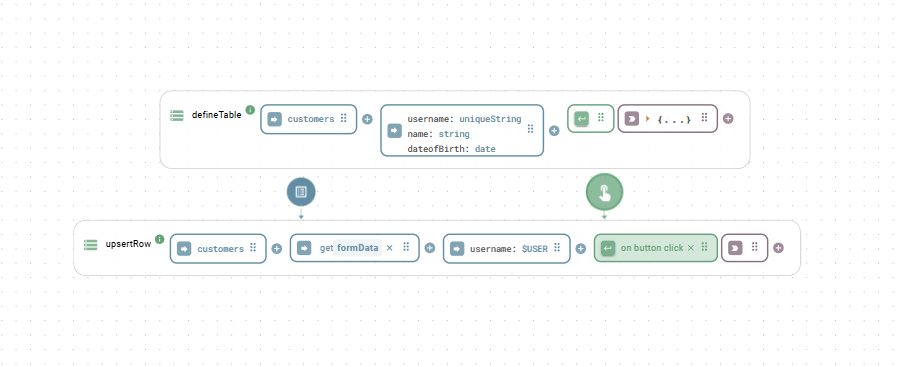

# Relational database

The relational database connector communicates with SQL databases (PostgreSQL, MySQL, MariaDB, MSSQL, SQLite, Oracle, and Snowflake) without writing raw SQL. You can define tables, insert and query rows, model relationships, and track changes with a consistent set of functions.

## Quick start: the internal PostgreSQL instance

Heisenware provides a pre-initialized SQL database called `internal-postgres`. It is globally available and ready for use. Pick functions from inside `internal-postgres` to make use of it.

<figure><figcaption></figcaption></figure>

## Connecting an external database

To connect an external database, use the [`create`](relational-database.md#create) function. How you configure it depends on where the database is located:

* **Cloud or public database**: If the database is accessible over the internet, create the instance directly in your App backend.
* **Local database (via Agent)**: If the database sits inside a private network (such as on a shopfloor server), deploy an [Agent](../../../concepts/agents-and-where-code-runs.md) in that network first and create the database instance within that Agent.


Whether you use the internal database or an external connection, the functions for querying, inserting, and managing data are identical.


## Connection and database management

### `create`

Initializes the connection to an external database.


Skip this step for `internal-postgres`. It is already instantiated for you.


#### Parameters

<table><thead><tr><th width="150">Input</th><th width="120">Key</th><th>Description</th><th width="100">Type</th></tr></thead><tbody><tr><td><code>options</code></td><td><code>dialect</code></td><td>The database dialect: <code>postgres</code>, <code>mysql</code>, <code>mariadb</code>, <code>mssql</code>, <code>sqlite</code>, <code>oracle</code>, or <code>snowflake</code>.</td><td>string</td></tr><tr><td></td><td><code>database</code></td><td>The name of the database.</td><td>string</td></tr><tr><td></td><td><code>username</code></td><td>The username for authentication.</td><td>string</td></tr><tr><td></td><td><code>password</code></td><td>The password for authentication.</td><td>string</td></tr><tr><td></td><td><code>host</code></td><td>The hostname or IP address of the database server.</td><td>string</td></tr><tr><td></td><td><code>port</code></td><td>The port number. Default is the standard port of the dialect.</td><td>integer</td></tr><tr><td></td><td><code>ssl</code></td><td>Encrypts the connection when <code>true</code>, and the server must be trusted (see <a href="#encrypted-connections">Encrypted connections</a>). <code>false</code> connects unencrypted. Omitted, as the database does by default: <code>mssql</code> encrypts and accepts any certificate, the other dialects connect unencrypted.</td><td>boolean</td></tr><tr><td></td><td><code>tls</code></td><td>TLS settings for this database only, on top of what the workspace trusts: <code>rejectUnauthorized</code> (false accepts any certificate), <code>ca</code>, <code>cert</code>, <code>key</code>, <code>passphrase</code>. Given, the connection is encrypted.</td><td>object</td></tr><tr><td></td><td><code>sqlLogging</code></td><td>Logs all SQL statements when <code>true</code>. Default true.</td><td>boolean</td></tr><tr><td></td><td><code>rawOnly</code></td><td>Skips the database introspection for instant startup when <code>true</code>. Use when you only need <code>executeSql</code>.</td><td>boolean</td></tr></tbody></table>


Right-click the `options` input and mark it as a secret to mask the password.


#### Example

```yaml
# options
dialect: 'postgres'
database: 'mydb'
username: 'user'
password: 'pass'
host: 'localhost'
```

#### Output

Returns the name of the created instance.

#### Encrypted connections

With `ssl: true` a database with a self-made or company certificate is refused until it is trusted. Trust it once for the whole workspace with the [Trusted certificates](../connectors/trusted-certificates.md) function `trustServer`, for example `postgres://db.plant.local` (`mysql://` and `mariadb://` alike). The next connection accepts it, the instance needs no restart.

* **MySQL** checks that the certificate comes from a trusted authority, not the name in it. A MySQL server's own generated certificates need that authority: add `ca.pem` from the server's data folder with `addCertificateAuthority`.
* **SQL Server** shows its certificate only inside its own protocol: add the certificate file with `addServerCertificate`, and use the name the certificate carries as `host`.
* `dumpDatabase` and `importDatabase` check the server against the same list.

### `isConnected`

Checks whether the database connection is currently active.

#### Parameters

None.

#### Output

Returns `true` if connected, or `false` if it is not.

### `getAllTables`

Retrieves all tables that exist in the database.

#### Parameters

None.

#### Output

Returns an array of table name strings.

### `reset`

Drops and recreates the entire database.


#### Irreversible action

This permanently deletes all tables and all data in the database. You cannot undo this action.


#### Parameters

None.

#### Output

Returns `true` if the reset succeeds.

### `delete`

Removes the instance and its connection configuration.


#### Irreversible action

Deleting an instance removes its configuration. To communicate with the database again, you must create a new instance.


#### Parameters

None.

#### Output

Returns `true` upon removal.

## Schema and table definition

### `defineTable`

Defines a table schema. If the table does not exist, the function creates it. If it exists, the function adds any new fields.

On the workspace's own database every definition is recorded in its [data model](relational-database.md#data-model).

Unless you define a custom primary key, the function automatically adds these fields:

* `id`: The table's primary key. A UUID on PostgreSQL, an auto-incrementing integer on other dialects.
* `createdAt`: A timestamp recording when the row was created.
* `updatedAt`: A timestamp tracking the last modification of the row.


When running inside an Agent, the database disables the automatic `createdAt` and `updatedAt` timestamps.


#### Parameters

<table><thead><tr><th width="150">Input</th><th width="120">Key</th><th>Description</th><th width="100">Type</th></tr></thead><tbody><tr><td><code>name</code></td><td></td><td>The name of the table (such as <code>users</code>).</td><td>string</td></tr><tr><td><code>fields</code></td><td></td><td>The table columns. Keys are the field names in camelCase. Values are either a data type string or a configuration object. Supported types: <code>string</code>, <code>text</code>, <code>integer</code>, <code>bigint</code>, <code>float</code>, <code>double</code>, <code>number</code>, <code>boolean</code> (alias <code>bool</code>), <code>date</code> (a date with a time, stored as an instant), <code>dateonly</code> (a calendar date such as <code>2026-10-01</code>), <code>time</code> (a time of day such as <code>08:30:00</code>), <code>uuid</code>, <code>json</code>, <code>jsonb</code>, <code>file</code> (one file), <code>files</code> (a list of files, see <a href="relational-database.md#files-in-a-table">Files in a table</a>), <code>uniquestring</code>, <code>uniqueinteger</code>, <code>uniquebiginteger</code>. Unknown types fall back to <code>string</code>.</td><td>object</td></tr><tr><td><code>options</code></td><td><code>auditLog</code></td><td>Records all changes to this table when <code>true</code>. See <a href="relational-database.md#audit-logging">Audit logging</a>.</td><td>boolean</td></tr></tbody></table>


Use English and camelCase for table and field names (such as `firstName` or `dateOfBirth`). Avoid spaces, dashes, and other special characters. When using PostgreSQL, prefer the `jsonb` type for JSON data: it is more efficient and allows nested properties in filter expressions.



#### Output

Returns the resulting table description: an object with one entry per column.
#### Examples

**Example 1: Simple table**

```yaml
# name
users
# fields
name: string
email: uniquestring
age: integer
```

**Example 2: Table with custom primary key and JSONB**

```yaml
# name
products
# fields
id: { type: string, primaryKey: true }
name: string
price: number
specs: jsonb
```


#### Custom primary key naming

Always use `id` as the name of the primary key, even when overriding the default. Other names can cause unexpected behavior.


### Advanced field configuration

For more control, provide an object as a field's value with these properties:

<table><thead><tr><th width="150">Property</th><th>Description</th><th width="100">Type</th></tr></thead><tbody><tr><td><code>type</code></td><td>The data type string (such as <code>string</code> or <code>integer</code>). Required.</td><td>string</td></tr><tr><td><code>primaryKey</code></td><td>Sets this field as the primary key, overriding the default <code>id</code> field.</td><td>boolean</td></tr><tr><td><code>unique</code></td><td>Ensures all values in this column are unique. Assign the same arbitrary string to several fields to make their combination unique.</td><td>boolean or string</td></tr><tr><td><code>allowNull</code></td><td>Allows null values when <code>true</code>. Set to <code>false</code> to require a value.</td><td>boolean</td></tr><tr><td><code>defaultValue</code></td><td>A default value used if none is provided: a literal (such as <code>active</code> or <code>0</code>) or a special value like <code>NOW</code> for the current time.</td><td>any</td></tr><tr><td><code>autoIncrement</code></td><td>Automatically increments an integer primary key for each new row.</td><td>boolean</td></tr><tr><td><code>validate</code></td><td>Adds validation constraints (such as <code>{ isEmail: true, max: 23 }</code>).</td><td>object</td></tr></tbody></table>

**Example 1: Advanced table with constraints**

```yaml
# name
employees
# fields
employeeId: { type: integer, primaryKey: true, autoIncrement: true }
email: { type: string, allowNull: false, unique: true }
status: { type: string, defaultValue: active }
hireDate: { type: date, defaultValue: NOW }
```

**Example 2: Unique constraint across multiple columns**

To make a combination of fields unique, assign an arbitrary string (such as `timeAndId`) to the corresponding fields:

```yaml
# name
machineHistory
# fields
machineId: { unique: timeAndId, type: string }
timestamp: { unique: timeAndId, type: date }
data: jsonb
```

### Files in a table

A table row never holds a file's content, and it holds no path. The file lies in the workspace's file store, and the row keeps an **entry** that says which file is meant:

```json
{ "id": "9f2c81d0b7a44e63a1c5d2e8f0b3a6c7d9e1f2a3b4c5d6e7f8a9b0c1d2e3e41a", "name": "pump-leak.jpg", "type": "image/jpeg", "size": 482113 }
```

The `id` is calculated from the file's content, so the same file is stored once however often it is uploaded. Small content, such as an icon or a signature, may travel inside the entry instead: `{ "name": "ok.png", "type": "image/png", "size": 1312, "base64": "..." }`.

Two field types say how many files a field holds:

| Type | Holds | Comes from |
| ---- | ----- | ---------- |
| `file` | one entry, or nothing | an [upload](../../widgets/input/upload.md) or [photo](../../widgets/input/photo.md) widget that holds one file, a [signature](../../widgets/input/signature.md) |
| `files` | a list of entries, or nothing | an upload or photo widget that holds several files |

Store what the widget delivers as it is. The [media view](../../widgets/display/media-view.md), the [data grid](../../widgets/display/data-grid.md) and the [form](../../widgets/input/form.md) show an entry as one picture and a list as its first picture with the number of files.

* **The fields are strict.** A `file` field takes one entry and a `files` field a list. The other shape is refused, and the error names the other type. A path is refused too.
* **A cell holds at most 64 kB.** That only matters for content inside the entry. A larger file is uploaded, and the row stores its reference.
* **Changing the type converts the values.** [`changeFieldType`](relational-database.md#previewtypechange-and-changefieldtype) from `file` to `files` turns each file into a list of one. From `files` to `file` it works where no row holds more than one file, and names the rows that do.
* **Nobody deletes a file.** A file stays as long as a row points to it. Thirty days after the last row let go, the platform's nightly clean-up removes it. Until then a deleted row can come back, from an undo or a restored backup, and its file is still there. The clean-up starts out reporting only: an installation lets it remove with `HW_FILES_CLEANUP=remove`.
* **A file your logic produced**, such as a downloaded document or a generated PDF, goes into the store with the `store` function of the `Files` class on the Media Server (a `path` on the file server, or `base64` content). It answers the entry to store.

On the workspace's own database a check on the column holds SQL to the same rules. On any other database both types are plain JSON columns.

A `files` field is a list in one cell. Files that each need a caption, an author or an audit entry of their own belong in a table of their own, with a relation to the row they belong to.

### `getTableSchema`

Retrieves the schema definition of a given table.

#### Parameters

<table><thead><tr><th width="150">Input</th><th>Description</th><th width="100">Type</th></tr></thead><tbody><tr><td><code>name</code></td><td>The name of the table.</td><td>string</td></tr></tbody></table>

#### Output

Returns an object containing schema details for each field, including `type`, `primaryKey`, `allowNull`, `sqlType`, `defaultValue`, `unique`, `autoIncrement`, and any referenced foreign keys.

### `deleteTable`

Deletes an entire table.


#### Irreversible action

This permanently deletes the table and all its data. You cannot undo this action.


#### Parameters

<table><thead><tr><th width="150">Input</th><th>Description</th><th width="100">Type</th></tr></thead><tbody><tr><td><code>name</code></td><td>The name of the table to delete.</td><td>string</td></tr></tbody></table>

#### Output

Returns `true` when deletion succeeds. If the table has an audit log table, the function removes it as well.

### `enforceUniqueField`

Retroactively enforces a UNIQUE and NOT NULL constraint on an existing field. It removes duplicate rows and rows with NULL values before applying both constraints.


#### Irreversible action

This permanently deletes duplicate and null rows. You cannot undo this action.


#### Parameters

<table><thead><tr><th width="150">Input</th><th width="120">Key</th><th>Description</th><th width="100">Type</th></tr></thead><tbody><tr><td><code>table</code></td><td></td><td>The name of the table.</td><td>string</td></tr><tr><td><code>field</code></td><td></td><td>The field to deduplicate and make unique (such as <code>barcode</code>).</td><td>string</td></tr><tr><td><code>options</code></td><td><code>keep</code></td><td>Which duplicate to keep: <code>newest</code> (latest <code>createdAt</code> or ID) or <code>oldest</code>. Default <code>newest</code>.</td><td>string</td></tr></tbody></table>

#### Output

Returns `true` on success. Throws an error on failure and rolls back all changes.

## Data model

The workspace's own database, `internal-postgres`, keeps its **data model**: every table made through Heisenware, with its fields, keys, audit log and relations, and a history of who changed what and when. `defineTable`, the relationship functions, `deleteTable`, `duplicateTable` and a statement through [`executeSql`](relational-database.md#executesql) that changes the structure record into it, and so does the [Database editor](../../../app-builder/database-editor.md), where the model is shown and shaped. The functions below work on the workspace's own database only; an external database answers with a refusal.


Shape the tables of the workspace's own database in the Database editor (or let the assistant do it), not with a function that calls `defineTable`: such a function runs once and leaves no record of why. One that exists keeps working and fills the model as it runs.


Most changes take an `options.actorId`: who made the change, for the model's history.

### `getDataModel`

Returns the data model: per table its fields (in the words of `defineTable`), `auditLog` when on, and its relations, written on the table that has them (`{ mandatorilyHasOne: 'customers' }`). The `id`, `createdAt`, `updatedAt` and the column of a relation come by themselves and are not listed.

#### Output

```yaml
tables:
  orders:
    fields:
      number: { type: string, unique: true, allowNull: false }
      total: number
    auditLog: true
    relations:
      - mandatorilyHasOne: customers
```

### `getDataModelHistory`

Returns the changes of the model, newest first: when, which table, the function that made it, who, the statement when SQL made it (`executeSql`), and what changed (a table, a field, a relation or the audit log, from what to what).

#### Parameters

<table><thead><tr><th width="150">Input</th><th width="120">Key</th><th>Description</th><th width="100">Type</th></tr></thead><tbody><tr><td><code>options</code></td><td><code>table</code></td><td>Only the changes of this table.</td><td>string</td></tr><tr><td></td><td><code>limit</code></td><td>At most this many changes (default 100).</td><td>integer</td></tr></tbody></table>

### `getDataModelDrift`

Returns where the model and the database differ, per table: a table, field or relation made outside the model (by SQL from elsewhere, such as another system or a database console, by an import, or by an App built before the model was kept), one dropped outside it, a field the database holds with another type. Compared are tables, fields and their types, relations and the audit log.

#### Parameters

<table><thead><tr><th width="150">Input</th><th width="120">Key</th><th>Description</th><th width="100">Type</th></tr></thead><tbody><tr><td><code>options</code></td><td><code>table</code></td><td>Only this table.</td><td>string</td></tr></tbody></table>

### `adoptDrift`

The model takes what the database holds where the two differ. The database stays as it is. Without a table, every table that differs is adopted.

#### Parameters

<table><thead><tr><th width="150">Input</th><th width="120">Key</th><th>Description</th><th width="100">Type</th></tr></thead><tbody><tr><td><code>options</code></td><td><code>table</code></td><td>Only this table.</td><td>string</td></tr><tr><td></td><td><code>actorId</code></td><td>Who made the change.</td><td>string</td></tr></tbody></table>

### `previewRemoval`

Tells what removing would lose, without removing anything: a field (the rows holding a value, the unique key it shares), a relation (the rows it links) or the table (its rows, its audit log, the relations of other tables that end).

#### Parameters

<table><thead><tr><th width="150">Input</th><th width="120">Key</th><th>Description</th><th width="100">Type</th></tr></thead><tbody><tr><td><code>table</code></td><td></td><td>The table.</td><td>string</td></tr><tr><td><code>options</code></td><td><code>field</code></td><td>A field of the table.</td><td>string</td></tr><tr><td></td><td><code>relation</code></td><td>A relation as the model writes it, such as <code>{ mandatorilyHasOne: 'customers' }</code>.</td><td>object</td></tr></tbody></table>

### `removeField` and `removeRelation`

Remove a field, or a relation as the model writes it, of a table. The primary key stays as long as the table; the column of a relation goes with its relation.


#### Irreversible action

The values go with the field, the links with the relation. Call `previewRemoval` first.


### `previewTypeChange` and `changeFieldType`

`previewTypeChange` tells what a new type does to a field's values: the values it cannot take, with their rows, and the values it changes on the way, with an example (`12.5` as an integer is `12`). `changeFieldType` changes the type, converting every value; it refuses while a value cannot be taken. Between `file` and `files` it converts the cells, see [Files in a table](relational-database.md#files-in-a-table).

#### Parameters

<table><thead><tr><th width="150">Input</th><th>Description</th><th width="100">Type</th></tr></thead><tbody><tr><td><code>table</code></td><td>The table.</td><td>string</td></tr><tr><td><code>field</code></td><td>The field.</td><td>string</td></tr><tr><td><code>type</code></td><td>The new type, one of the types of <code>defineTable</code>.</td><td>string</td></tr></tbody></table>

### `mergeDataModel`

Brings a data model into the workspace's own database, adding only: a table, field or relation it lacks, an audit log. Nothing is removed or changed: a field the database holds with another type stays as it is and is reported as a conflict. This is how an App's bundle brings its tables when it is imported.

#### Output

```yaml
added:
  - table: orders
  - { table: lines, field: shift }
conflicts:
  - { table: lines, field: qty, has: string, brings: integer }
```

## Querying and filtering data

Filters can reference the currently logged-in App user, see [Referencing the current user with $USER](relational-database.md#referencing-the-current-user-with-usduser).

### `getTableData`

Retrieves rows from one or more tables, with options for filtering, joining, sorting, and selecting specific fields. This is the primary function for reading data.

#### Parameters

<table><thead><tr><th width="150">Input</th><th width="120">Key</th><th>Description</th><th width="100">Type</th></tr></thead><tbody><tr><td><code>name</code></td><td></td><td>The name of the table, or an array of table names for a multi-table join query.</td><td>string or array</td></tr><tr><td><code>options</code></td><td><code>filter</code></td><td>The conditions rows must meet. For multi-table queries, this must include the join conditions. A condition names a column, or a JSON column followed by its nested keys in dot notation (letters, digits, <code>_</code> and <code>-</code>); a read naming anything else, in a condition, <code>fields</code> or <code>order</code>, is refused.</td><td>array</td></tr><tr><td></td><td><code>fields</code></td><td>Selects specific columns. For multi-table queries, use dot notation (such as <code>users.name</code>).</td><td>array</td></tr><tr><td></td><td><code>order</code></td><td>The sort order specified as <code>['fieldName', 'DIRECTION']</code>, where direction is <code>ASC</code> or <code>DESC</code>.</td><td>array</td></tr><tr><td></td><td><code>limit</code></td><td>The maximum number of rows to return.</td><td>integer</td></tr><tr><td></td><td><code>offset</code></td><td>The number of rows to skip, useful for pagination.</td><td>integer</td></tr><tr><td></td><td><code>include</code></td><td>The relations to join besides the rows a row points to, which it always joins: child rows by their relation's name, such as <code>[orders]</code>. <code>false</code> joins nothing. See <a href="relational-database.md#related-rows-in-a-result">Related rows in a result</a>.</td><td>array or boolean</td></tr></tbody></table>

### Filtering explained

The `filter` option uses an array syntax to build precise queries.

Simple conditions are an array of three elements: `[fieldName, operator, value]`.

* `fieldName`: The column name. For `jsonb` fields, use dot notation to access nested keys (such as `specs.dimensions.width`). For multi-table queries, always prefix with the table name (such as `users.name`).
* `operator`: A comparison string, see the table below.
* `value`: The value to compare against.

Compound conditions combine conditions with `'and'` or `'or'`:

* **AND**: `[ [condition1], 'and', [condition2] ]`, both must be true.
* **OR**: `[ [condition1], 'or', [condition2] ]`, at least one must be true.

Available operators:

| Operator(s)                             | Description                                        | Example value              |
| --------------------------------------- | -------------------------------------------------- | -------------------------- |
| `=`, `==`, `eq`, `equals`, `is`         | Equals                                             | `'John'` or `100`          |
| `<>`, `!=`, `neq`, `notequals`, `isnot` | Not equals                                         | `'John'` or `100`          |
| `>`, `gt`                               | Greater than                                       | `99`                       |
| `>=`, `gte`                             | Greater than or equal to                           | `100`                      |
| `<`, `lt`                               | Less than                                          | `100`                      |
| `<=`, `lte`                             | Less than or equal to                              | `100`                      |
| `contains`                              | String field contains the value (case-insensitive) | `'oh'` (matches 'John')    |
| `notcontains`                           | String field does not contain the value            | `'Peter'`                  |
| `startswith`                            | String field starts with the value                 | `'J'`                      |
| `endswith`                              | String field ends with the value                   | `'oe'` (matches 'Doe')     |
| `between`                               | Value is between two values in an array            | `[18, 30]` or `['A', 'D']` |
| `notbetween`                            | Value is not between two values in an array        | `[18, 30]` or `['A', 'D']` |
| `in`                                    | Value is one of several possibilities in an array  | `['active', 'pending']`    |

#### Examples

**Example 1: Simple filter and field selection**

Get the `name` and `email` of all active users:

```yaml
# name
users
# options
filter: ['status', '=', 'active']
fields: ['name', 'email']
```

**Example 2: Date range filter**

Find all orders placed in January 2025:

```yaml
# name
orders
# options
filter: ['createdAt', 'between', ['2025-01-01', '2025-01-31T23:59:59Z']]
```

**Example 3: Compound 'and' filter**

Find products that are in stock and cost more than 50:

```yaml
# name
products
# options
filter: [ ['quantity', '>', 0], 'and', ['price', '>', 50] ]
```

**Example 4: Sorting and limiting**

Get the 5 most recent high-priority tickets:

```yaml
# name
tickets
# options
filter: ['priority', 'in', ['high', 'critical']]
order: ['createdAt', 'DESC']
limit: 5
```

**Example 5: Multi-table join**

Retrieve user names and post titles. The first filter condition defines the join:

```yaml
# name
- users
- posts
# options
filter: [ ['users.id', '=', 'posts.userId'] ]
fields: ['users.name', 'posts.title']
```

**Example 6: Join with a where clause**

Retrieve post titles for a specific user named Alice:

```yaml
# name
- users
- posts
# options
filter: [
  ['users.id', '=', 'posts.userId'],
  'and',
  ['users.name', '=', 'Alice']
]
fields: ['posts.title']
```

**Example 7: Join with a nested JSONB filter**

Find all orders for Alice where the shipment details JSON field has priority set to true:

```yaml
# name
- users
- orders
- shipments
# options
fields: ['users.name', 'orders.product', 'shipments.trackingNumber']
filter: [
  ['users.id', '=', 'orders.userId'],
  'and',
  ['orders.shipmentId', '=', 'shipments.id'],
  'and',
  ['users.name', '=', 'Alice'],
  'and',
  ['shipments.details.priority', '=', true]
]
```

#### Output

Returns an array of objects representing matching rows.

### `findRows`

Works like `getTableData`, but returns nothing if you do not provide a filter. Use this when the filter comes from user input (such as a search field) and an empty input should not load the entire table.

#### Parameters

The same as [`getTableData`](relational-database.md#gettabledata), but `filter` is effectively required.

#### Output

Returns an array of matching rows, or nothing when no filter is provided.

### `findRow`

Finds and returns the first row matching the filter. Returns nothing if you do not provide a filter.

#### Parameters

<table><thead><tr><th width="150">Input</th><th width="120">Key</th><th>Description</th><th width="100">Type</th></tr></thead><tbody><tr><td><code>table</code></td><td></td><td>The name of the table.</td><td>string</td></tr><tr><td><code>options</code></td><td><code>filter</code></td><td>The filter conditions.</td><td>array</td></tr><tr><td></td><td><code>fields</code></td><td>An optional array of fields to return.</td><td>array</td></tr><tr><td></td><td><code>include</code></td><td>The relations to join besides the rows a row points to, which it always joins: child rows by their relation's name, such as <code>[orders]</code>. <code>false</code> joins nothing. See <a href="relational-database.md#related-rows-in-a-result">Related rows in a result</a>.</td><td>array or boolean</td></tr></tbody></table>

#### Output

Returns the first matching row object, or `null` if no match is found.

### `getRow`

Retrieves a single row by its primary key.

#### Parameters

<table><thead><tr><th width="150">Input</th><th width="120">Key</th><th>Description</th><th width="100">Type</th></tr></thead><tbody><tr><td><code>table</code></td><td></td><td>The name of the table.</td><td>string</td></tr><tr><td><code>id</code></td><td></td><td>The primary key of the row.</td><td>string</td></tr><tr><td><code>options</code></td><td><code>fields</code></td><td>An optional array of fields to return.</td><td>array</td></tr><tr><td></td><td><code>include</code></td><td>The relations to join besides the rows a row points to, which it always joins: child rows by their relation's name, such as <code>[orders]</code>. <code>false</code> joins nothing. See <a href="relational-database.md#related-rows-in-a-result">Related rows in a result</a>.</td><td>array or boolean</td></tr></tbody></table>

#### Output

Returns the row object, or `null` if the ID is not found.

### `countRows`

Counts the rows of a table, or those a filter finds.

#### Parameters

<table><thead><tr><th width="150">Input</th><th width="120">Key</th><th>Description</th><th width="100">Type</th></tr></thead><tbody><tr><td><code>name</code></td><td></td><td>The name of the table, or an array of table names for a multi-table query.</td><td>string or array</td></tr><tr><td><code>options</code></td><td><code>filter</code></td><td>The conditions rows must meet, as for <a href="relational-database.md#gettabledata"><code>getTableData</code></a>.</td><td>array</td></tr></tbody></table>

#### Output

Returns the number of rows.

### Related rows in a result

`getRow`, `findRow`, `findRows` and `getTableData` join the rows a row points to and name them after the relation. Child rows come only when `include` names them. The names are the same on every database, while the App runs and after a restart.

| Relation | A row carries | Its parent carries, with `include` |
| -------- | ------------- | ---------------------------------- |
| `orders` [optionallyHasOne](relational-database.md#optionallyhasone) `customers` | `order.customer` | `customer.orders` |
| the same with the role `payer` | `order.payer` | `customer.payerOrders` |
| `posts` [optionallyHasMany](relational-database.md#optionallyhasmany) `tags` | `post.tags`, with `include: [tags]` | `tag.posts`, with `include: [posts]` |

A table made by SQL names its relations from its foreign keys. A column named after the parent (`customer_id` for `customers`) is the plain relation: `order.customer`, `customer.orders`. Any other column acts as a role: `payer_id` gives `order.payer` and `customer.payerOrders`.

Tables and fields are always called what the database calls them, on the internal database too.

```yaml
# (call getRow)
# table
customers
# id
'c1b2a3d4-e5f6-4a3b-8c2d-1f2e3d4c5b6a'
# options
include: [orders, payerOrders]
```

## Data manipulation

### `addRow`

Adds a single new row to a table.

#### Parameters

<table><thead><tr><th width="150">Input</th><th>Description</th><th width="100">Type</th></tr></thead><tbody><tr><td><code>table</code></td><td>The name of the table.</td><td>string</td></tr><tr><td><code>data</code></td><td>An object containing the column values to insert.</td><td>object</td></tr></tbody></table>

#### Example

```yaml
# table
users
# data
name: Jane Doe
email: jane.doe@example.com
age: 34
```

#### Output

Returns the created row as saved in the database, including the generated `id`.

### `addRows`

Adds multiple rows to a table in a single, efficient bulk operation.

#### Parameters

<table><thead><tr><th width="150">Input</th><th>Description</th><th width="100">Type</th></tr></thead><tbody><tr><td><code>table</code></td><td>The name of the table.</td><td>string</td></tr><tr><td><code>data</code></td><td>An array of data objects to insert.</td><td>array</td></tr></tbody></table>

#### Example

```yaml
# table
products
# data
- name: 'Thingamajig'
  price: 19.99
  stock: 100
- name: 'Widget'
  price: 25.50
  stock: 250
```

#### Output

Returns the number of rows added.

### `upsertRow`

Atomically updates or inserts a row. The function looks for an existing row and either updates it or creates a new one. It identifies the row by the first of these that applies: the `uniqueKey` object, the primary key (`id`) inside `data`, or any unique field present in `data`. If none of them matches an existing row, the function creates one. To key rows on the logged-in user, see [Referencing the current user with $USER](relational-database.md#referencing-the-current-user-with-usduser).

#### Parameters

<table><thead><tr><th width="150">Input</th><th width="120">Key</th><th>Description</th><th width="100">Type</th></tr></thead><tbody><tr><td><code>table</code></td><td></td><td>The name of the table.</td><td>string</td></tr><tr><td><code>data</code></td><td></td><td>The data object to upsert.</td><td>object</td></tr><tr><td><code>options</code></td><td><code>uniqueKey</code></td><td>An optional object identifying the row by a business key instead of the ID. If omitted, any unique field present in <code>data</code> identifies the row automatically.</td><td>object</td></tr></tbody></table>

#### Examples

**Example 1: Upsert using the default primary key**

Update the user with a specific ID, or create them if they do not exist:

```yaml
# table
users
# data
id: 'a1b2c3d4-e5f6-4a3b-8c2d-1f2e3d4c5b6a'
name: Jane Smith
age: 36
```

**Example 2: Upsert using a custom unique key**

Find a user by email. If the user exists, update the age; if not, create the user. Passing `email` inside `data` has the same effect, as long as the field is unique:

```yaml
# table
users
# data
name: Jane Doe
age: 35
# options
uniqueKey:
  email: 'jane.doe@example.com'
```

#### Output

Returns the created or updated row as saved in the database. Throws an error if the upsert fails.

### `updateRow`

Updates fields of an existing row. It finds the row by the `id` option, by `uniqueKey`, or by the primary or a unique key inside `data`. Fields not included in `data` stay untouched. A JSON field is replaced by the given value; with `merge`, the value is merged into what the field holds: nested objects key by key, arrays and plain values replaced. To key rows on the logged-in user, see [Referencing the current user with $USER](relational-database.md#referencing-the-current-user-with-usduser).

#### Parameters

<table><thead><tr><th width="150">Input</th><th width="120">Key</th><th>Description</th><th width="100">Type</th></tr></thead><tbody><tr><td><code>table</code></td><td></td><td>The name of the table.</td><td>string</td></tr><tr><td><code>data</code></td><td></td><td>The new values.</td><td>object</td></tr><tr><td><code>options</code></td><td><code>id</code></td><td>The primary key of the row to update.</td><td>string</td></tr><tr><td></td><td><code>uniqueKey</code></td><td>An object identifying the row by a business key instead of the ID. If omitted, the primary key or any unique field present in <code>data</code> identifies the row.</td><td>object</td></tr><tr><td></td><td><code>merge</code></td><td>Merges JSON fields into what they hold instead of replacing them when <code>true</code>. Default <code>false</code>.</td><td>boolean</td></tr><tr><td></td><td><code>fieldDelimiter</code></td><td>Unflattens <code>data</code> by this delimiter first (<code>settings.theme</code> with <code>.</code> becomes a nested object).</td><td>string</td></tr><tr><td></td><td><code>actorId</code></td><td>Who makes the change, for the <a href="relational-database.md#audit-logging">audit log</a>.</td><td>string</td></tr></tbody></table>

#### Example

Before, a row in the `settings` table:

```json
{
  "id": 1,
  "name": "Config A",
  "settings": { "theme": "dark", "notifications": true }
}
```

Call `updateRow` with:

```yaml
# table
settings
# data
settings: {
  notifications: false,
  timezone: UTC
}
# options
id: 1
```

After:

```json
{
  "id": 1,
  "name": "Config A",
  "settings": { "notifications": false, "timezone": "UTC" }
}
```

The `name` field stayed untouched, and the JSON field holds what was given: the `theme` key is gone. With `merge: true` in the options, the given keys are merged in and `theme` stays:

```json
{
  "id": 1,
  "name": "Config A",
  "settings": { "theme": "dark", "notifications": false, "timezone": "UTC" }
}
```

#### Output

Returns the updated row as saved in the database. Throws an error if the row is not found. Changing the primary key to a value that already exists throws an error naming the conflicting value.

### `deleteRow`

Deletes a single row from a table, identified by its primary key.


#### Irreversible action

This permanently deletes the row. You cannot undo this action.


#### Parameters

<table><thead><tr><th width="150">Input</th><th>Description</th><th width="100">Type</th></tr></thead><tbody><tr><td><code>table</code></td><td>The name of the table.</td><td>string</td></tr><tr><td><code>id</code></td><td>The primary key of the row to delete.</td><td>string</td></tr></tbody></table>

#### Example

```yaml
# table
users
# id
'a1b2c3d4-e5f6-4a3b-8c2d-1f2e3d4c5b6a'
```

#### Output

Returns `true` if the row is deleted, or `false` if no row with that ID exists.

### `clearTable`

Deletes all rows from a table, leaving the table structure intact.


#### Irreversible action

This permanently deletes all data in the table. You cannot undo this action.


#### Parameters

<table><thead><tr><th width="150">Input</th><th width="120">Key</th><th>Description</th><th width="100">Type</th></tr></thead><tbody><tr><td><code>name</code></td><td></td><td>The name of the table to clear.</td><td>string</td></tr><tr><td><code>options</code></td><td><code>nullifyLinkedRecords</code></td><td>Sets foreign keys in other tables pointing to this table to <code>NULL</code> before clearing when <code>true</code>. Default <code>false</code>.</td><td>boolean</td></tr></tbody></table>

#### Example

```yaml
# name
logs
```

#### Output

Returns `true` on success.

## Relationships and associations

These functions define logical connections between tables to create a relational data model. Relationships ensure data integrity and enable cross-table queries. The workflow has three steps:

1. **Define tables**: Create your tables using `defineTable`.
2. **Define the relationship**: Use one of the association functions to declare how the tables connect.
3. **Link records**: Use the foreign key fields created in step 2 to connect specific rows. For many-to-many relationships, use `associateRow`.

### `optionallyHasOne`

Creates a one-to-many relationship where the child record can exist without a parent. This adds a nullable foreign key column to the child table. In short: a child has zero or one parent, a parent may have many children.

#### Parameters

<table><thead><tr><th width="150">Input</th><th>Description</th><th width="100">Type</th></tr></thead><tbody><tr><td><code>childTable</code></td><td>The table that receives the foreign key (such as <code>posts</code>).</td><td>string</td></tr><tr><td><code>parentTable</code></td><td>The table being referenced (such as <code>users</code>).</td><td>string</td></tr><tr><td><code>role</code></td><td>An optional role in camelCase (such as <code>owner</code>; <code>Owner</code> is taken as <code>owner</code>) naming a second relationship to the same parent. Its column is <code>ownerId</code>, and a row carries the parent as <code>owner</code>.</td><td>string</td></tr></tbody></table>

#### Output

Returns `true` when the relationship is created.

### `mandatorilyHasOne`

Creates a one-to-many relationship where the child record cannot exist without a parent. This adds a non-nullable foreign key column to the child table. In short: a child must have exactly one parent, a parent may have many children.

#### Parameters

<table><thead><tr><th width="150">Input</th><th>Description</th><th width="100">Type</th></tr></thead><tbody><tr><td><code>childTable</code></td><td>The table that receives the foreign key (such as <code>employees</code>).</td><td>string</td></tr><tr><td><code>parentTable</code></td><td>The table being referenced (such as <code>companies</code>).</td><td>string</td></tr><tr><td><code>role</code></td><td>An optional role in camelCase (such as <code>manager</code>; <code>Manager</code> is taken as <code>manager</code>) naming a second relationship to the same parent. Its column is <code>managerId</code>, and a row carries the parent as <code>manager</code>.</td><td>string</td></tr></tbody></table>

#### Output

Returns `true` when the relationship is created.

### `optionallyHasMany`

Creates a many-to-many relationship between two tables. This automatically generates a hidden junction table to manage the associations. In short: a child can have many parents, a parent can have many children.

#### Parameters

<table><thead><tr><th width="150">Input</th><th>Description</th><th width="100">Type</th></tr></thead><tbody><tr><td><code>childTable</code></td><td>The first table in the relationship.</td><td>string</td></tr><tr><td><code>parentTable</code></td><td>The second table in the relationship.</td><td>string</td></tr></tbody></table>

#### Output

Returns `true` when the relationship is created.

### `associateRow`

Links existing records. Use this to create links for a many-to-many relationship after defining it.

#### Parameters

<table><thead><tr><th width="150">Input</th><th>Description</th><th width="100">Type</th></tr></thead><tbody><tr><td><code>sourceTable</code></td><td>The name of the source table.</td><td>string</td></tr><tr><td><code>sourceId</code></td><td>The ID of the row in the source table.</td><td>string</td></tr><tr><td><code>targetTable</code></td><td>The name of the target table.</td><td>string</td></tr><tr><td><code>targetId</code></td><td>The ID or an array of IDs of the row(s) in the target table.</td><td>string or array</td></tr></tbody></table>

#### Output

Returns `true` when the association succeeds.

### Relationship strategies and examples

This section guides you through choosing and implementing relationships.

#### One-to-many (mandatory)

The most common relationship. Use it when a child record requires a parent. Example: An employee must belong to a company.



#### Define tables

Create the `companies` and `employees` tables.

```yaml
# (call defineTable)
# name
companies
# fields
name: string

# (call defineTable)
# name
employees
# fields
firstName: string
lastName: string
```



#### Define the relationship

Declare that an employee mandatorily has one company.

```yaml
# (call mandatorilyHasOne)
# childTable
employees
# parentTable
companies
```


This adds a non-nullable `companyId` foreign key column to the `employees` table.




#### Link records

Because `companyId` is mandatory, provide it when creating a new employee record.

```yaml
# (call addRow)
# table
employees
# data
firstName: Ada
lastName: Lovelace
companyId: 'a1b2c3d4-e5f6-4a3b-8c2d-1f2e3d4c5b6a'
```



#### One-to-many (optional)

Use this when the link between child and parent is optional. The child can be created first and linked later. Example: A blog post can optionally be assigned to a category.



#### Define tables

```yaml
# (call defineTable)
# name
posts
# fields
title: string
content: text

# (call defineTable)
# name
categories
# fields
name: string
```



#### Define the relationship

Declare that a post optionally has one category.

```yaml
# (call optionallyHasOne)
# childTable
posts
# parentTable
categories
```


This adds a nullable `categoryId` foreign key column to the `posts` table.




#### Link records

Create a post without a category, and link it later by updating the record.

```yaml
# (call addRow to create the post initially)
# table
posts
# data
title: 'My First Post'
content: '...'

# (call updateRow later to link it to a category)
# table
posts
# data
categoryId: 'c1b2a3d4-e5f6-4a3b-8c2d-1f2e3d4c5b6a'
# options
id: 'f1e2d3c4-b5a6-4a3b-8c2d-1f2e3d4c5b6a'
```



#### Many-to-many

Use this when records in two tables can have multiple links to each other. Example: An order can contain many products, and a product can be part of many orders.



#### Define tables

```yaml
# (call defineTable)
# name
orders
# fields
orderDate: date

# (call defineTable)
# name
products
# fields
name: string
price: number
```



#### Define the relationship

Declare the many-to-many relationship between orders and products.

```yaml
# (call optionallyHasMany)
# childTable
orders
# parentTable
products
```


This automatically creates a hidden junction table (such as `__orders2products`) storing the links between order IDs and product IDs.




#### Link records

Connect the records with `associateRow`. Link one order to multiple products by providing an array of product IDs.

```yaml
# (call associateRow)
# sourceTable
orders
# sourceId
'o1d2e3r4-b5a6-4a3b-8c2d-1f2e3d4c5b6a'
# targetTable
products
# targetId
- 'p1r2o3d4-b5a6-4a3b-8c2d-1f2e3d4c5b6a'
- 'p5r6o7d8-b5a6-4a3b-8c2d-1f2e3d4c5b6a'
```



#### Advanced: multiple relationships with roles

Use the `role` parameter to define multiple distinct relationships between the same two tables (such as a document with both an owner and an editor from the `users` table).



#### Define tables

```yaml
# (call defineTable)
# name
users
# fields
name: string

# (call defineTable)
# name
documents
# fields
title: string
```



#### Define the relationships with roles

Create two distinct one-to-many relationships, specifying a role for each.

```yaml
# (call optionallyHasOne for the owner)
# childTable
documents
# parentTable
users
# role
owner

# (call optionallyHasOne for the editor)
# childTable
documents
# parentTable
users
# role
editor
```


This adds two separate foreign keys to the `documents` table: `ownerId` and `editorId`. The role names the foreign key and the relation: a document carries `owner` and `editor`, a user `ownerDocuments` and `editorDocuments` when `include` names them.




#### Link records

When creating a document, provide IDs for both the owner and the editor using the specific foreign key fields.

```yaml
# (call addRow)
# table
documents
# data
title: 'Q4 Financial Report'
ownerId: 'u1s2e3r4-b5a6-4a3b-8c2d-1f2e3d4c5b6a'
editorId: 'u5s6e7r8-b5a6-4a3b-8c2d-1f2e3d4c5b6a'
```



## Audit logging

The relational database connector (`RelationalDatabase`) features a built-in audit logging system that creates a secure, detailed, and queryable trail of all data changes. It tracks what changed, when, and who changed it. It automatically calculates the differences (diff) between old and new values for updates, and stores full snapshots for creations and deletions.

On PostgreSQL, the internal database included, the database itself writes the log: every write is in it, whether it comes from a row function, from [`executeSql`](relational-database.md#executesql), or from another system writing to the table. On the other databases the connector writes the log for the writes of its own row functions.

### Enabling audit logs

Set the `auditLog` option to `true` when defining the table schema:

```yaml
# name
orders
# fields
orderNumber: string
status: string
total: number
# options
auditLog: true
```

The database automatically creates a parallel table (such as `ordersAuditLog`) recording all CREATE, UPDATE, and DELETE actions on the main table.

### Tracking the actor

To record who made a change, all data manipulation functions and `executeSql` accept an optional `actorId` within their options. In an App, bind this to the authenticated user via the [`$USER` variable](relational-database.md#referencing-the-current-user-with-usduser) or their user ID. A change made without one is logged with `actorId` empty.

```yaml
# table
orders
# data
status: 'shipped'
# options
id: 'order-123'
actorId: 'admin-alice'
```

### `getAuditLog`

Retrieves and filters the recorded history, including natural language time parsing and field-level tracking.

#### Parameters

<table><thead><tr><th width="150">Input</th><th width="120">Key</th><th>Description</th><th width="100">Type</th></tr></thead><tbody><tr><td><code>table</code></td><td></td><td>The name of the table to query.</td><td>string</td></tr><tr><td><code>options</code></td><td><code>id</code></td><td>Filters logs for a specific record's primary key.</td><td>string</td></tr><tr><td></td><td><code>actorId</code></td><td>Filters logs by the user who made the change.</td><td>string</td></tr><tr><td></td><td><code>action</code></td><td>Filters by action type (<code>CREATE</code>, <code>UPDATE</code>, or <code>DELETE</code>).</td><td>string</td></tr><tr><td></td><td><code>changedField</code></td><td>Returns only logs where a specific field was modified.</td><td>string</td></tr><tr><td></td><td><code>start</code></td><td>The earliest time to include, supporting natural language (such as <code>yesterday</code> or <code>-1h</code>).</td><td>string</td></tr><tr><td></td><td><code>stop</code></td><td>The latest time to include. Default <code>now</code>.</td><td>string</td></tr></tbody></table>

#### Examples

**Example 1: View all changes to a specific record**

```yaml
# table
orders
# options
id: 'order-999'
```

**Example 2: Track specific field modifications**

Find out who changed the `status` field of an order, and when:

```yaml
# table
orders
# options
id: 'order-999'
changedField: status
```

**Example 3: Monitor user activity**

See all deletions performed by a specific admin in the last 24 hours:

```yaml
# table
products
# options
action: DELETE
actorId: admin-alice
start: -24h
```

#### Output

An array of log entries, ordered from newest to oldest. The `diff` object varies by action:

**CREATE**: There is no old state; `new` contains the complete inserted record.

```json
{
  "action": "CREATE",
  "actorId": "admin-alice",
  "diff": {
    "old": null,
    "new": { "id": "order-123", "status": "pending", "total": 150.00 }
  },
  "createdAt": "2025-08-20T10:00:00.000Z"
}
```

**UPDATE**: The `diff` contains only the fields that actually changed, with their old and new values.

```json
{
  "action": "UPDATE",
  "actorId": "admin-alice",
  "diff": {
    "status": {
      "old": "pending",
      "new": "shipped"
    }
  },
  "createdAt": "2025-08-21T14:30:00.000Z"
}
```

**DELETE**: There is no new state; `old` contains the final snapshot of the record.

```json
{
  "action": "DELETE",
  "actorId": "admin-alice",
  "diff": {
    "old": { "id": "order-123", "status": "shipped", "total": 150.00 },
    "new": null
  },
  "createdAt": "2025-08-25T09:15:00.000Z"
}
```

## Raw SQL and templates

### `executeSql`

Executes a raw SQL statement with bound parameters. A placeholder such as `{{customer.id}}` names a value of the `parameters` object. The value is bound, never written into the SQL text: quotes, types and dates come out right, and the value cannot change the statement. To use a variable such as `$customerName`, give it as a value of `parameters`. A `$variable` written in the template itself becomes SQL text. For `SELECT` statements, the query returns an array of row objects.

SQL is a full path to the data, never a side door:

* **On PostgreSQL** a write is in the table's [audit log](relational-database.md#audit-logging) and reaches its [`onChange`](relational-database.md#onchange) registrations like any other write. With `actorId`, the statement runs in a transaction that names who acts.
* **On the internal database** a statement that changes the structure (`CREATE`, `ALTER`, `DROP`, `RENAME`) goes into the [data model](relational-database.md#data-model), with the statement and the actor in its history. A table it makes can be used at once.


#### Irreversible action

Raw SQL can modify or delete database schemas and records. Run custom scripts with caution.


#### Parameters

<table><thead><tr><th width="150">Input</th><th width="120">Key</th><th>Description</th><th width="100">Type</th></tr></thead><tbody><tr><td><code>template</code></td><td></td><td>The SQL string containing <code>{{double.curly.braces}}</code> placeholders.</td><td>string</td></tr><tr><td><code>parameters</code></td><td></td><td>The values the placeholders name, bound into the statement. Nested values are addressed with dot notation.</td><td>object</td></tr><tr><td><code>options</code></td><td><code>type</code></td><td>Forces a specific query type (such as <code>SELECT</code>, <code>UPDATE</code>, or <code>INSERT</code>). If omitted, the function derives the type from the statement.</td><td>string</td></tr><tr><td></td><td><code>actorId</code></td><td>Who makes the change, for the audit log and the data model's history.</td><td>string</td></tr></tbody></table>

#### Example

```yaml
# template
SELECT name, email FROM users WHERE "companyId" = {{company.id}} AND age > {{minAge}}
# parameters
company: { id: $companyId }
minAge: 30
```

#### Output

Returns the result of the query. For `SELECT` statements, this is an array of row objects.

### `fillTemplate`

Fills a template string with data from the first record matching a given condition per table. Placeholders use double curly braces such as `{{table.field}}` or nested keys such as `{{table.jsonField.nestedKey}}`. With a `locale`, dates print for people: a date in the date style, a time of day in the time style, a date with a time in the date and time style in the given `timeZone`. Unresolved placeholders are removed from the result.

#### Parameters

<table><thead><tr><th width="150">Input</th><th width="120">Key</th><th>Description</th><th width="100">Type</th></tr></thead><tbody><tr><td><code>template</code></td><td></td><td>The template string containing placeholders.</td><td>string</td></tr><tr><td><code>condition</code></td><td></td><td>An object mapping table names to their filter conditions.</td><td>object</td></tr><tr><td><code>options</code></td><td><code>locale</code></td><td>The language dates print in (such as <code>en-GB</code> or <code>de-DE</code>); without it dates print as data. Feed it <code>$LOCALE</code>.</td><td>string</td></tr><tr><td></td><td><code>timeZone</code></td><td>The time zone a date with a time prints in (such as <code>Europe/Berlin</code>); without it such a date prints as data (UTC). A plain date (<code>2026-10-01</code>) prints as that day in any zone. Feed it <code>$TIMEZONE</code>.</td><td>string</td></tr><tr><td></td><td><code>dateStyle</code></td><td>The formatting style for dates (<code>full</code>, <code>long</code>, <code>medium</code>, <code>short</code>, or <code>hidden</code>). Default <code>medium</code>.</td><td>string</td></tr><tr><td></td><td><code>timeStyle</code></td><td>The formatting style for times (<code>full</code>, <code>long</code>, <code>medium</code>, <code>short</code>, or <code>hidden</code>). Default <code>medium</code>.</td><td>string</td></tr></tbody></table>

#### Example

Create a notification string for a specific user and their latest order:

```yaml
# template
"Hello {{users.name}}! Your order #{{orders.orderNumber}} will ship on {{orders.details.shippingDate}}."
# condition
users: ['id', '=', 'user-123']
orders: ['userId', '=', 'user-123']
# options
locale: en-GB
timeZone: Europe/London
dateStyle: long
```

Result (example): "Hello Jane Doe! Your order #98765 will ship on 18 August 2025."

#### Output

Returns the template string with all resolved placeholders.

## Change notifications

### `onChange`

Registers a callback executed whenever the specified table changes (insert, update, or delete).

On PostgreSQL, the internal database included, the database announces each change once it is committed, whoever made it: a row function, `executeSql`, another system. The callback runs a moment after the write, once per row, and a write that is rolled back is no change. On the other databases the callback hears the writes of the connector's own row functions.

#### Parameters

<table><thead><tr><th width="150">Input</th><th>Description</th><th width="100">Type</th></tr></thead><tbody><tr><td><code>name</code></td><td>The name of the table to subscribe to.</td><td>string</td></tr><tr><td><code>handler</code></td><td>The callback evaluated on every change to the table.</td><td>callback</td></tr></tbody></table>

#### Callback payload

The callback receives the affected row as an object, as it is now; a deleted row as it was. On PostgreSQL every row of a bulk write is a call of its own, and a deleted row too large to announce arrives as its primary key alone. On the other databases a bulk insert delivers an array of rows.

#### Output

Returns the registration. Deleting the table ends it.

## Removed functions

These functions are gone since v93. Use their replacements.

| Removed | Use instead |
| ------- | ----------- |
| `autoUpsertRow` | declare the table with [`defineTable`](relational-database.md#definetable), then [`upsertRow`](relational-database.md#upsertrow) |
| `autoAddRows` | declare the table, then [`addRows`](relational-database.md#addrows) |
| `changeRow` | [`updateRow`](relational-database.md#updaterow) with the `id` option |
| `patchRow`, `changeRow` with `patch` | [`updateRow`](relational-database.md#updaterow) with `merge: true` |
| `getTableRowCount` | [`countRows`](relational-database.md#countrows) |
| `findOne` | [`findRow`](relational-database.md#findrow) |
| `getHistoricalData`, the `trackHistory` option | [`getAuditLog`](relational-database.md#getauditlog), the `auditLog` option |
| the `autoJoin` option | the [`include`](relational-database.md#related-rows-in-a-result) option |

## Tips and tricks

### Referencing the current user with $USER

The `$USER` variable references the authenticated user of your App. Define the username as a unique key (type `uniquestring`) when creating the table to allow [`upsertRow`](relational-database.md#upsertrow) to update and insert rows based on that unique key.

Pass the variable inside `uniqueKey` in the `options` input box. The key name matches the column you defined as unique:

```yaml
# table
preferences
# data
theme: dark
# options
uniqueKey:
  username: $USER
```

The same syntax applies to [`updateRow`](relational-database.md#updaterow).

<div align="center"><figure><figcaption><p>$USER in combination with the upsertRow function</p></figcaption></figure></div>
