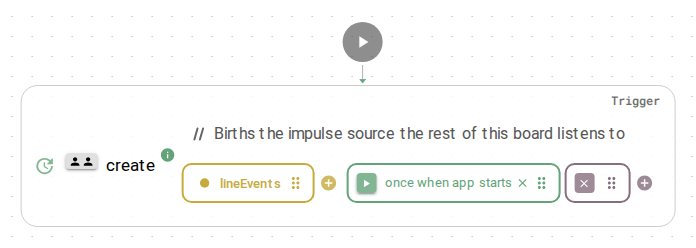
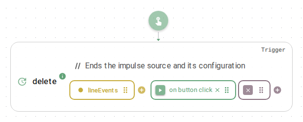
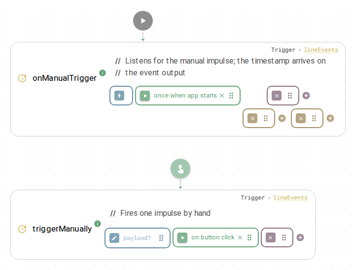
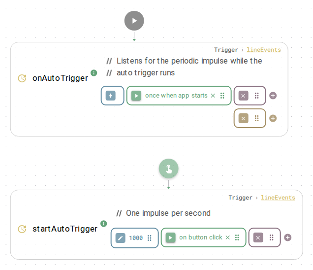
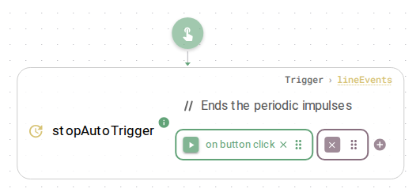
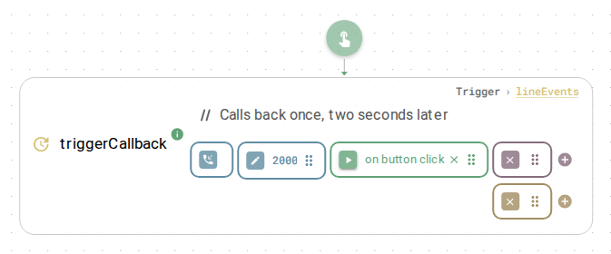

# Event simulation

The event simulation class is a source of impulses: manual ones fired by a button or another flow, periodic ones, a one-shot delayed callback, and debounced values. Use it to test and validate flows with mock events, as a placeholder before your App is complete, or as a named instance that turns a button in one App into an event in another.

You find the functions under **Utilities** > **Event Simulation** in the Functions explorer. This class requires an instance. The code class name is `Trigger`.

The `on` functions are event functions. Triggering an event executor subscribes it; triggering it again with the same inputs changes nothing. The payload arrives on the executor's event outputs, not on its return. A subscription follows the executor's inputs and address, pauses while the App is stopped and ends with its scope: a user's with the user's last connection, a shared one never by itself. To end it by hand, choose **Stop listening** in the menu of the executor's event input; the next trigger subscribes again. See [Backend events](../../../concepts/backend-events.md).

### `create`

Constructs a new event simulation instance.

#### Parameters

None.

#### Output

Returns the name of the created instance.

#### Example

<figure><figcaption>
Create an event simulation instance
</figcaption></figure>

### `delete`

Removes the event simulation instance.


#### Irreversible action
Deleting removes the instance configuration.


#### Parameters

None.

#### Output

Returns `true` upon removal.

#### Example

<figure><figcaption>
Delete an event simulation instance
</figcaption></figure>

## Manual impulses

### `triggerManually`

Fires one manual impulse to every `onManualTrigger` listener.

#### Parameters

<table><thead><tr><th width="150">Input</th><th>Description</th><th width="100">Type</th></tr></thead><tbody><tr><td><code>payload</code></td><td>An optional value handed to the listeners together with the timestamp.</td><td>any</td></tr></tbody></table>

#### Output

Returns `true`.

### `onManualTrigger`

Subscribes to manual impulses. The callback runs on every `triggerManually`.

#### Parameters

<table><thead><tr><th width="150">Input</th><th>Description</th><th width="100">Type</th></tr></thead><tbody><tr><td><code>listener</code></td><td>The callback function.  Payload: <code>time</code>, a Unix timestamp in milliseconds, and <code>payload</code>, the value given to <code>triggerManually</code> or nothing.</td><td>callback</td></tr></tbody></table>

#### Output

Returns `true` once the executor is listening. The values arrive on the event outputs.

#### Example

<figure><figcaption>
The listener outputs the timestamp after a manual trigger
</figcaption></figure>

## Periodic impulses

### `startAutoTrigger`

Starts firing periodic impulses to every `onAutoTrigger` listener. A running auto trigger is replaced by the new interval. The auto trigger runs in memory only: after a restart of the platform, start it again.

#### Parameters

<table><thead><tr><th width="150">Input</th><th>Description</th><th width="100">Type</th></tr></thead><tbody><tr><td><code>interval</code></td><td>The time in milliseconds between impulses, at least 1. Default 1000.</td><td>integer</td></tr></tbody></table>

#### Output

Returns the string `started`.

### `onAutoTrigger`

Subscribes to periodic impulses. The callback runs once per interval while the auto trigger runs.

#### Parameters

<table><thead><tr><th width="150">Input</th><th>Description</th><th width="100">Type</th></tr></thead><tbody><tr><td><code>listener</code></td><td>The callback function.  Payload: <code>time</code>, a Unix timestamp in milliseconds.</td><td>callback</td></tr></tbody></table>

#### Output

Returns `true` once the executor is listening. The values arrive on the event outputs.

#### Example

<figure><figcaption>
React periodically to automatic events
</figcaption></figure>

### `stopAutoTrigger`

Stops the periodic impulses. Nothing happens when none run.

#### Parameters

None.

#### Output

Returns `true`.

#### Example

<figure><figcaption>
Stop event generation
</figcaption></figure>

### `isAutoTriggering`

Checks whether periodic impulses are being fired.

#### Parameters

None.

#### Output

Returns `true` while the auto trigger runs, otherwise `false`.

## One-shot delay

### `triggerCallback`

Calls back once after a delay. Every call schedules its own callback. To prevent infinite loops, the function does not react to the output of its own callback.

#### Parameters

<table><thead><tr><th width="150">Input</th><th>Description</th><th width="100">Type</th></tr></thead><tbody><tr><td><code>done</code></td><td>Callback that executes once after the delay.  Payload: <code>time</code>, a Unix timestamp in milliseconds.</td><td>callback</td></tr><tr><td><code>timeout</code></td><td>The delay in milliseconds, 0 or more. Default 3000.</td><td>integer</td></tr></tbody></table>

#### Output

Returns a string stating when the callback will run, for example `Calling back in 3 seconds`.

#### Example

<figure><figcaption>
Callback execution after a timeout delay
</figcaption></figure>

## Debouncing

### `debounce`

Debounces a stream of values. Each call restarts the quiet period; when no call arrives for `waitMs`, `onDebounced` fires once with the last value. Use it to react to a text field or a chatty sensor only once the input has settled.

#### Parameters

<table><thead><tr><th width="150">Input</th><th>Description</th><th width="100">Type</th></tr></thead><tbody><tr><td><code>value</code></td><td>The value of this call. The last one of a burst is emitted.</td><td>any</td></tr><tr><td><code>waitMs</code></td><td>The quiet period in milliseconds, at least 1. Default 300.</td><td>integer</td></tr></tbody></table>

#### Output

Returns `true`.

### `onDebounced`

Subscribes to debounced values. The callback runs once per burst of `debounce` calls, after the quiet period.

#### Parameters

<table><thead><tr><th width="150">Input</th><th>Description</th><th width="100">Type</th></tr></thead><tbody><tr><td><code>listener</code></td><td>The callback function.  Payload: <code>value</code>, the last value of the burst, and <code>time</code>, a Unix timestamp in milliseconds.</td><td>callback</td></tr></tbody></table>

#### Output

Returns `true` once the executor is listening. The values arrive on the event outputs.
