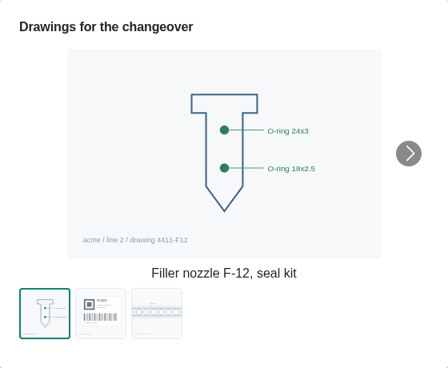

# Gallery

<figure><figcaption></figcaption></figure>

A gallery shows several files to look through: one large, the others as thumbnails under it. Hand it a list of files, or a list of rows that each keep one, and the gallery pages through them with its arrows while a caption names what is on screen. Pictures show as themselves; any other file, such as a PDF, shows by its name and type. It only shows, and never writes anything back.

**Good for:** the photos of a fault report, the drawings and documents of the current order, everything a row keeps in a `files` field.

<!-- generated -->
<!-- Source: heisenware-cloud/packages/widgets/gallery. Regenerate with scripts/reference/widgets.mjs; edit outside this block only. -->

## Properties

The widget's General tab lists these properties under Receives and Emits. Drop an executor's output, input or trigger onto a row to link it. An example also fills an unlinked widget as demo data in the App Builder.



**`data`** (from an output, `Array<object | string> | object`): The files to look through, in their order: the value of a `files` field, what an upload widget that holds several delivers, or a list of rows that each keep a file - `[{ "id": 7, "photo": { ...entry }, "note": "Front" }]`, the field named by `props.fileField` (empty: the first field a row holds a file in), a row's caption by `props.captionField`. One file shows as a gallery of one. A picture shows as itself, any other file (a PDF) by its name and type. Read-only: nothing is written back.

<details>

<summary>Example</summary>

```json
[
  {
    "name": "front.svg",
    "type": "image/svg+xml",
    "size": 169,
    "base64": "PHN2ZyB4bWxucz0iaHR0cDovL3d3dy53My5vcmcvMjAwMC9zdmciIHZpZXdCb3g9IjAgMCA0IDMiPjxyZWN0IHdpZHRoPSI0IiBoZWlnaHQ9IjMiIGZpbGw9IiMwRjgxNzAiLz48Y2lyY2xlIGN4PSIyIiBjeT0iMS41IiByPSIuOSIgZmlsbD0iI2ZmZiIgZmlsbC1vcGFjaXR5PSIuNiIvPjwvc3ZnPg=="
  },
  {
    "name": "side.svg",
    "type": "image/svg+xml",
    "size": 169,
    "base64": "PHN2ZyB4bWxucz0iaHR0cDovL3d3dy53My5vcmcvMjAwMC9zdmciIHZpZXdCb3g9IjAgMCA0IDMiPjxyZWN0IHdpZHRoPSI0IiBoZWlnaHQ9IjMiIGZpbGw9IiNiODczMzMiLz48Y2lyY2xlIGN4PSIyIiBjeT0iMS41IiByPSIuNiIgZmlsbD0iI2ZmZiIgZmlsbC1vcGFjaXR5PSIuNiIvPjwvc3ZnPg=="
  },
  {
    "name": "detail.svg",
    "type": "image/svg+xml",
    "size": 169,
    "base64": "PHN2ZyB4bWxucz0iaHR0cDovL3d3dy53My5vcmcvMjAwMC9zdmciIHZpZXdCb3g9IjAgMCA0IDMiPjxyZWN0IHdpZHRoPSI0IiBoZWlnaHQ9IjMiIGZpbGw9IiM0NTU4NmEiLz48Y2lyY2xlIGN4PSIyIiBjeT0iMS41IiByPSIuMyIgZmlsbD0iI2ZmZiIgZmlsbC1vcGFjaXR5PSIuNiIvPjwvc3ZnPg=="
  }
]
```

</details>





## Settings

Double-click the widget in the Page editor to open its settings, grouped in these tabs. Settings marked *set per screen* are pinned by nature: every screen keeps its own value.

<details>

<summary>Content</summary>

* **File field**: For a list of rows: the field that holds a row's file or files. Empty takes the first field a row holds a file in. A list of files needs none.
* **Show captions**: Shows a line under the large picture: the file's name, or the value of the caption field.
* **Caption field**: For a list of rows: the field whose value is the caption of a row's files. Empty shows the file's name.

</details>

<details>

<summary>Look &amp; feel</summary>

* **Show thumbnails**: Shows the row of small pictures to pick from under the large one; one file alone shows none. *Set per screen.*
* **Thumbnail size**: Edge of a thumbnail in px. Range 32 to 160. *Set per screen.*
* **Show navigation buttons**: Shows the arrows that page to the previous and the next file. *Set per screen.*
* **Show indicator**: Shows a dot per file on the large picture; a dot pages to its file. *Set per screen.*
* **Image fitting**: How the large picture meets its box when their shapes differ; a file that is no picture ignores it. Choices: Contain (whole image, bars if needed), Cover (fill the box, crop the rest), Fill (stretch to the box), None (natural size, clipped), Scale down (never enlarge). *Set per screen.*
* **Focal point**: Which part of the large picture stays visible when the fitting crops it. Choices: Center, Top, Bottom, Left, Right, Top left, Top right, Bottom left, Bottom right. *Set per screen.*
* **Corner radius**: Rounding of the corners, from square to circle; theme keeps the theme's radius. Choices: Theme, Square, Low, Medium, High, Circle.

</details>

<!-- /generated -->
