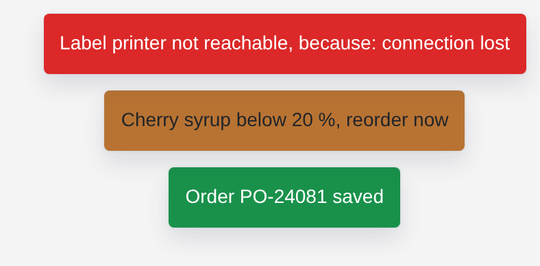

# Toast

<figure><figcaption></figcaption></figure>

A toast pops up a short message and fades away again: a success, a warning, an error or an info. It is no longer a widget you place on a page. It is an [App action](../../../app-builder/explorers/pages.md#app-actions), like Logout or Open link: drag the **Toast** chip from the foot of the Pages and actions explorer.

* **On an output or an error handler**: every value the output produces pops one toast, whatever page the user is on. Switch on *Take message from the live value* and the value becomes the message: an error handler's error reads "message, because: cause". With the switch off, the toast shows the message you typed, and the value only decides that it pops.
* **On a button, icon or image**: a click pops the toast with the message you typed.

Type, display time and position are set in the same dialog. Click the toast's chip on the flow board to change them later.


Apps built with a toast widget keep working: the App Builder turns every toast widget into a Toast action on the output or error handler it was linked to, and removes the widget. A toast that was copied to several pages becomes one action and pops once.

