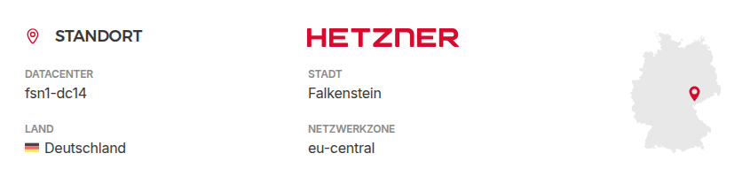

# Install

How to set up, run, update and back up a private on-premise installation of Heisenware (see [Cloud or on-prem](README.md)).

You work with two files. `install.sh` is the installer: it belongs to no version and handles the life of the installation (install, update, backup, restore, certificates). `start.sh` travels inside every release package and handles the life of the running platform (start, status, rotate); `stop.sh` travels with it.

## Prerequisites

The host must be **x86-64 (amd64) Linux**: the platform's images are built for that architecture only. It needs Docker Engine with the Compose plugin, `bash` 4.4 or newer, `openssl` and `curl`.

Docker needs 8 GB of memory for the platform. With less, its services stall and restart when memory runs short. The installer warns when Docker has less, and says where to give it more: in Docker Desktop under **Settings** > **Resources** (Memory limit), under WSL 2 with `memory=8GB` under `[wsl2]` in `.wslconfig` in your Windows user folder, followed by `wsl --shutdown`. It is a warning, never a refusal.



On a Linux distribution (Ubuntu, Debian, CentOS), install Docker Engine, which includes the Docker Compose plugin.

1. Follow the official Docker guide for your distribution:
   * [Install Docker Engine on Ubuntu](https://docs.docker.com/engine/install/ubuntu/)
   * [Install Docker Engine on Debian](https://docs.docker.com/engine/install/debian/)
   * [Install Docker Engine on CentOS](https://docs.docker.com/engine/install/centos/)
2. Run everything below in your normal terminal.



Windows runs Docker through the Windows Subsystem for Linux (WSL), which gives you a Linux environment inside Windows. This is good for a trial; a production installation belongs on a Linux server.

#### Step 1: Install WSL and Ubuntu

1. Open **PowerShell** as an administrator (search for PowerShell in the Start menu, right-click, select **Run as administrator**).
2.  Run:

    ```powershell
    wsl --install
    ```
3. The command enables the required Windows features, downloads the Linux kernel and installs Ubuntu as the default distribution.
4. Restart the computer when prompted.

#### Step 2: Install Docker Desktop for Windows

1. Download [Docker Desktop for Windows](https://www.docker.com/products/docker-desktop).
2. Run the installer. Check **Use WSL 2 instead of Hyper-V (recommended)** during setup.
3. Open Docker Desktop. It detects and integrates your WSL Ubuntu environment.

#### Step 3: Work inside the WSL terminal

1. Open the Start menu, search for **Ubuntu**, launch the terminal.
2. Copy the installation files into that environment and run the installer there.



Only an Intel Mac runs the platform's images natively; on Apple Silicon Docker has to emulate them, which is slow and for a look only.

1. Download [Docker Desktop for Mac](https://www.docker.com/products/docker-desktop).
2. Open the `.dmg` and drag the Docker icon to `Applications`.
3. Launch Docker Desktop and grant the system permissions it asks for.
4. Run everything below in **Terminal** (`/Applications/Utilities`). macOS ships bash 3.2; install a newer one (`brew install bash`) and make sure it comes first in `PATH`.



## Install

You get two files:

* `heisenware-onprem-<version>.tar.gz`, the release package: the compose file, `start.sh`, `stop.sh` and every Docker image the installation runs.
* `install.sh`, the installer.

Put both in an empty directory. On Windows, put them inside the WSL environment, for example `/home/<username>/heisenware/`.

<details>

<summary>Optional: download them on the server</summary>

<figure><figcaption></figcaption></figure>

The server needs outbound access to `downloads.heisenware.cloud` (Germany, static IP `128.140.88.150`) to fetch the package and the installer. Allow that traffic in your firewall.

The package comes on a time-bound link Heisenware sends you. Download it with `wget`:


#### Quote the link

Always put the download URL in double quotes (`"`).


```bash
wget -O heisenware.tar.gz "<provided_download_link>"
```

The installer is public and belongs to no version:

```bash
wget "https://downloads.heisenware.cloud/public/install.sh"
```

</details>



#### Open a terminal in the directory

```bash
cd /home/<username>/heisenware/
```

On Windows, open the **Ubuntu** app from the Start menu first.



#### Make the installer executable

```bash
chmod +x install.sh
```



#### Run it

```bash
./install.sh heisenware.tar.gz
```

The installer says where it will install and asks you to confirm. It then unpacks the package, loads the Docker images, writes `start.sh` and `stop.sh` next to the compose file, generates this machine's own self-signed TLS certificate in `certs/` if there is none (see [Certificates](#certificates)), and starts the platform through `./start.sh`.

Loading the images takes a few minutes.



#### Sign in

Open `https://localhost` (or `https://localhost/manager`), from another machine `https://<name or address of this machine>`. Port 80 redirects to 443. Your browser warns about the self-signed certificate; accept it and go on.

The installation has no account yet. Click the registration link on the sign-in page and create the first one with an email address and a password. That member becomes the owner of the account.


#### No Google sign-in on-premise

An on-premise installation never offers Google sign-in, connected or not. The sign-in page shows no Google button, and invites are taken up with a password.




#### Upload your licence

An on-premise account starts on Free. Open **Plan & License** in the App Manager and upload the licence file Heisenware sent you: it carries the number of Apps, the number of workspaces and its end date. See [Plan and billing](../app-manager/plan-and-billing.md).



### The `.env` file

The platform keeps every secret in a file named `.env` next to `docker-compose.yml`, readable by its owner only. The installer creates it, `start.sh` completes it, and for a standard installation you never edit it.

Keep it. A backup without `.env` cannot be restored on another machine. The installer's own backups include it.

Values you may want to set yourself:

| Key | What it does |
| --- | --- |
| `HW_ALLOW_SIGN_UP` | `false` refuses new accounts on this installation. Invited members still join. Unset means sign-up is allowed. |
| `HW_LOG_DRIVER` | the Docker log driver every container logs through (see [Logs](#logs)). |
| `HW_FILES_MAX_MB` | the largest file a workspace's file store takes, in MB. Default 250. |
| `HW_EMAIL_USER`, `HW_EMAIL_HOST`, `HW_EMAIL_PORT`, `HW_EMAIL_PASSWORD` | the SMTP relay invitations and password resets go out through. An installation without one starts anyway, with a warning. |
| `HW_SUPPORT_*` | a [remote support](remote-support.md) session. |

After editing `.env`, run `./start.sh`: it recreates only the containers whose configuration changed. `docker compose restart` never re-reads `.env`.

### Certificates

The ingress serves exactly two files from the `certs` folder:

```
certs/heisenware-fullchain.pem
certs/heisenware-privkey.pem
```

The first install generates a self-signed pair there, valid ten years, for this machine alone. It names `localhost`, `127.0.0.1`, `::1`, `heisenware.local`, the machine's host names (with its domain and without) and the IPv4 addresses it has at the install; Docker's own bridges and link-local addresses are left out. A browser still warns, since no authority signed it, but a client that checks names accepts it once it trusts the file, as Claude Code does with `NODE_EXTRA_CA_CERTS` (see [AI clients](../app-manager/ai-clients.md#claude-code-on-premise)).

A later install or update keeps the pair it finds, with one exception: a pair an earlier installer made for `heisenware.local` alone is made anew with the names above, and the installer says so in one line. If the new pair cannot be made, the old one stays. A certificate of your own, installed with `./install.sh certs`, is never touched.

To install your own certificate, let the installer take it: it checks that both files parse, that the key carries no passphrase and that the two belong together before anything is copied, and restarts the ingress.

```bash
./install.sh certs fullchain.pem privkey.pem
```

A wrong pair stops the ingress and with it every port, which is why nothing is copied unproven. If you put the files in place by hand instead, keep the two names above and restart the proxy: `docker restart heisenware-ingress-1`.

## Start and stop

```bash
./start.sh         # start, or apply changes in .env
./start.sh status  # what the platform needs and what is set; changes nothing
./stop.sh          # stop and remove every container; the data stays
```

`start.sh` checks every value the platform needs, generates the internal secrets that are missing, refuses to start when a required value is absent, and runs the services in the background. The first start takes a few minutes while the services initialize.

`./start.sh status` prints one line per value: `ok` when it is set, `default` when the platform fills it, `would generate` for an internal secret it will mint, and `missing` for a value you have to supply.

`./stop.sh --now` kills the processes instead of stopping them, without a grace period.


#### Why `docker compose down` is not enough

The platform starts a container at run time for each workspace (its backend, media server, MCP server and databases) so that workspaces stay separated. Those belong to the `heisenware` Compose project as one-off containers, which a plain `docker compose down` skips by Compose's own rules. `./stop.sh` takes the services and the workspace containers down together, including containers a platform before v93 spawned, which carry no project labels yet.



#### Data persistence

Databases, configuration and files live in Docker volumes. Power-cycling the host or restarting a container loses nothing. If the platform stops answering, restarting the containers is the first thing to try.



#### Services that stop answering

The platform restarts some of its services by itself. A workspace's backend, and the backend of each deployed App, that does not answer its health check for a minute is restarted. The broker is restarted only after three failed health probes in a row, about three minutes, so a short stall of the machine costs no MQTT session.


## Update

Download the new release package, put it in the installation directory, and run the installer again:

```bash
./install.sh heisenware.tar.gz
```

It detects the existing installation, checks the package and the disk, stops it, writes a full backup into `backup/`, loads the new images, offers to remove the images no longer used, and starts the new version through `start.sh`. Coming from a version before v93, it also moves your secrets out of the old `docker-compose.yml` into `.env`: see [Upgrading from v92](upgrading-from-v92.md).

Before it stops anything, the update asks the disk for the room it will take, per file system:

* **Docker's data root**: twice what the new images take unpacked, since loading them holds them twice at its peak. The images of the version before stay for a rollback.
* **The installation's folder**: the backup, as large as the volumes it archives.

On top comes a margin of a tenth, at least 2 GB. With too little room the update says where, how much it needs, how much is free and what for, and the platform keeps running. Nothing is downloaded for the check: Docker Desktop keeps its data root in a virtual machine, where an image already on the machine measures it; where nothing can measure, a warning names the room needed and the update goes on.


Always use the latest `install.sh`. It belongs to no version and works with every release package.


## Back up and restore

Every update makes a backup first. To make one at any time:

```bash
./install.sh backup
```

A backup is one timestamped `.tar.gz` in `backup/`, readable by its owner only. It holds every volume of this installation, the platform's own and each workspace's, plus the `docker-compose.yml` and the `.env` of that moment: data, version and secrets roll back together.

To restore one, hand the archive to the installer:

```bash
./install.sh backup/heisenware-backup-YYYY-MM-DD_HH-MM-SS.tar.gz
```

The installer enters restore mode and asks you to confirm before it stops the platform and overwrites the current data. Volumes in the archive that do not belong to this installation are left alone. Afterwards:

```bash
./start.sh
```

If the restored version's images are no longer on the machine, the installer says so: run its release package once before starting.

Backups and restores, the one an update makes included, run in a small helper image that every release package carries, and pull nothing from the internet while they run. If the helper is missing from the machine, the installer pulls it before it stops anything. Where that fails, for example without internet, it says how to load it from any release package, `docker load -i <the unpacked package>/docker-images.tar.gz`, and ends with nothing stopped or changed.

### Send a backup to Heisenware

When support asks for a copy of your data, the installer uploads a backup straight from the machine. It needs nothing but `curl` and `openssl`.

```bash
./install.sh upload
```

Without a file name the newest archive in `backup/` is sent, and one is made first if there is none; name a file to send that one. The script asks for one secret, which support hands you. The key is upload-only: it can write into the bucket and nothing else, and the upload lands in a folder named after your machine.

To run it unattended, pass the secret in the environment:

```bash
HW_UPLOAD_SECRET_KEY=... ./install.sh upload backup/heisenware-backup-YYYY-MM-DD_HH-MM-SS.tar.gz
```

`HW_UPLOAD_PREFIX` (default: the host name), `HW_UPLOAD_ENDPOINT`, `HW_UPLOAD_ACCESS_KEY`, `HW_UPLOAD_BUCKET` and `HW_UPLOAD_REGION` override the folder, server, key name, bucket and region. You need them only when support says so.

## Logs

```bash
docker compose logs -f          # every service
docker logs -f <container_name> # one container
```

Every container of the platform, the workspace containers included, keeps its log in rotating files on the host: Docker's `local` driver, at most five compressed files of 20 MB each. A container's log goes with the container, for example on `./stop.sh` or an update.

To send the logs to your own system instead, name the driver in `.env` and give it its settings in the host's Docker configuration:

1.  Configure the driver in `/etc/docker/daemon.json` and restart Docker. Sending everything to a syslog server, for example:

    ```json
    {
      "log-driver": "syslog",
      "log-opts": { "syslog-address": "udp://logs.example.com:514" }
    }
    ```
2.  Name the same driver in `.env`:

    ```
    HW_LOG_DRIVER=syslog
    ```
3. Restart the platform with `./stop.sh` and `./start.sh`.

Any driver Docker supports works (`journald`, `syslog`, `gelf`, `fluentd`, `splunk`, …), and the options in `daemon.json` apply to every container of the platform. With `journald`, `local` and `json-file`, `docker logs` keeps working; with a remote driver, Docker keeps a local copy for it by default.

## Remote support

Heisenware can help with your installation through one outbound connection you switch on and off: see [Remote support](remote-support.md).
